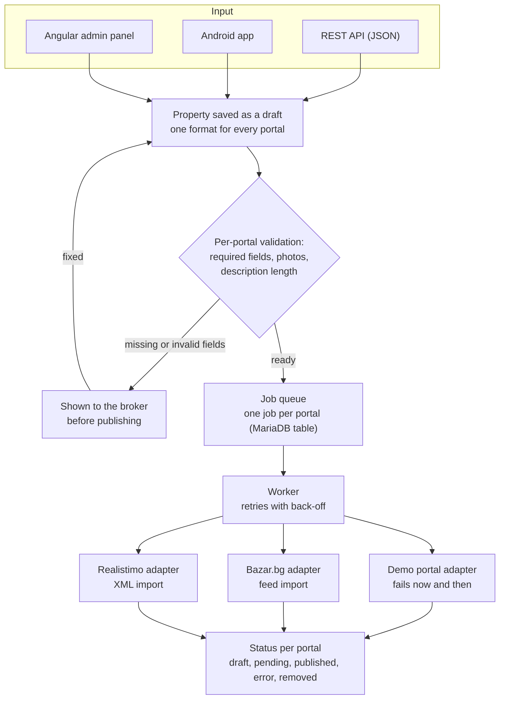
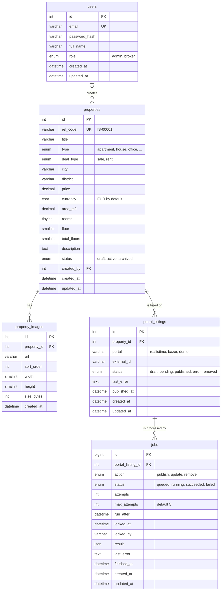

# ImotSync

**Prepare a property once, publish it to several Bulgarian real estate portals, and see its status on each of them in one place.**

ImotSync is a portfolio project: an admin panel, a REST API with a background job queue, portal adapters built on the portals' official import feeds, and a small Android companion app for brokers in the field.

## The problem

A real estate agency usually advertises the same property on several portals. Each portal has its own form, its own required fields, photo limits and description rules, so a broker types the same listing again and again. When the price changes or the property is sold, every portal has to be updated by hand, and it is easy to miss one.

ImotSync keeps the property in one portal-independent format, checks it against each portal's requirements before publishing, sends it through each portal's official import method in the background, and shows the result per portal: published, pending, failed (with the reason) or removed.

## How it works

This is the target design; [Current status](#current-status) says what is built so far.



1. **Input.** A property comes from the admin panel, the Android app or straight from the REST API, and is saved as a draft.
2. **Validation.** For every selected portal the system checks required fields, the number and size of photos and the description length, and lists what is missing before anything is sent.
3. **Queue.** "Publish" creates one job per portal. A Node.js worker processes them in order and retries failures with increasing, jittered delays.
4. **Adapter.** Each portal has its own module that turns the property into that portal's import format.
5. **Status.** The outcome is stored per portal and shown on the dashboard. A later price or photo change queues update jobs; bulk delete queues remove jobs.

More detail, including the state machines and the retry policy: [docs/architecture.md](docs/architecture.md).

## Current status

**Week 1 foundation is in place; publishing is not built yet.**

In place:

- Repository layout: `api/`, `web/`, `android/` (placeholder), `docs/`
- Docker Compose with MariaDB 11.8, plus an optional API container
- Knex migrations for the five tables and a demo seed with fictional data
- API skeleton: `GET /api/health` with a database check, static `/uploads`, consistent JSON errors
- Angular admin panel shell with PrimeNG and Tailwind CSS
- GitHub Actions workflow: lint, format check, type check, unit and integration tests, builds

Next:

- JWT login, property CRUD and photo upload, with request validation and Swagger docs
- Week 2: job worker, adapter interface, Realistimo, Bazar.bg and Demo portal adapters
- Week 3: admin panel screens (property list, form, pre-publish check, job log)
- Week 4: Android app, deployment with a demo account

The full plan is in the [roadmap](#roadmap).

## Stack

| Part             | Technologies                                                                                              | What it demonstrates                               |
| ---------------- | --------------------------------------------------------------------------------------------------------- | -------------------------------------------------- |
| Admin panel      | Angular 21, PrimeNG 21, Tailwind CSS 4, Vitest                                                            | Tables with filters, validated forms, bulk actions |
| API              | Node.js 24, Express 5, TypeScript, Vitest; _planned:_ JWT, express-validator, Swagger                     | A clean, documented, tested REST API               |
| Queue and worker | `jobs` table in MariaDB (queue schema in place); _planned:_ Node.js worker with retries (no Redis needed) | Background jobs, retries with back-off, resilience |
| Portal adapters  | _Planned:_ XML / JSON feeds following each portal's official import documentation                         | Integrations with external systems                 |
| Database         | MariaDB 11.8, Knex migrations and seeds, mysql2                                                           | Data modelling, migrations, UTF-8 (Cyrillic) data  |
| Photos           | sharp (seed placeholder photos), local storage; _planned:_ upload resizing, S3-compatible storage         | File processing and resizing                       |
| Mobile app       | _Planned:_ Kotlin, Jetpack Compose, Room, Retrofit, WorkManager, CameraX                                  | Offline work and syncing with the API              |
| Infrastructure   | Docker Compose, GitHub Actions                                                                            | One-command setup, automated checks on every push  |

**Why Angular 21 and PrimeNG 21.** PrimeNG 22 is no longer published under the MIT license: it uses PrimeTek's own PrimeUI License and ships with a license manager. The admin panel therefore stays on PrimeNG 21, the latest MIT-licensed line, and on Angular 21, which that line supports. Moving to Angular 22 would also need Node.js 24.15 or newer (Angular 22 requires `^24.15.0` on Node 24), so `.nvmrc` would then be pinned to that version.

## Repository layout

```text
imotsync/
├── api/                  Node.js REST API (Express 5, TypeScript, Knex): migrations, seed, health check
├── web/                  Angular admin panel (PrimeNG, Tailwind CSS)
├── android/              Kotlin companion app (placeholder until Week 4)
├── docs/                 Architecture notes
├── .github/workflows/    CI pipeline
├── docker-compose.yml    MariaDB, plus an optional API container
└── .env.example          Configuration template (copy to .env)
```

## Quick start

### Prerequisites

- [Node.js 24](https://nodejs.org/) (the version is pinned in `.nvmrc`) with npm
- [Docker Desktop](https://www.docker.com/products/docker-desktop/) (or Docker Engine with Compose v2+), running

### Windows (PowerShell)

From the repository root:

```powershell
Copy-Item .env.example .env
docker compose up -d --wait db

cd api
npm ci
npm run db:migrate
npm run db:seed
npm run dev
```

In a second terminal, from the repository root:

```powershell
cd web
npm ci
npm start
```

### macOS / Linux

From the repository root:

```bash
cp .env.example .env
docker compose up -d --wait db

cd api
npm ci
npm run db:migrate
npm run db:seed
npm run dev
```

In a second terminal, from the repository root:

```bash
cd web
npm ci
npm start
```

`docker compose up -d --wait db` starts only MariaDB and returns once it reports healthy, so the migrations do not race the database start.

### Check that it runs

- Admin panel: open <http://localhost:4200>. The dev server proxies `/api` requests to the API on port 3000.
- API health: `curl.exe http://localhost:3000/api/health` in PowerShell (`curl` on macOS/Linux) should return
  `{"status":"ok","db":"up","version":"...","uptimeSeconds":...}`. If the database is unreachable it answers `503` with `"status":"degraded"`.

### Why the database is on port 3307

The MariaDB container listens on 3306 inside Docker but is published on **host port 3307**, so it does not clash with a MariaDB or MySQL server that may already be installed on your machine. The API running on your machine connects to `127.0.0.1:3307` (`DB_HOST` / `DB_PORT` in `.env`); inside Compose the API container connects to `db:3306`. To use another host port, change `DB_PORT` in `.env`.

### Option: run the API in Docker too

The API container runs with `NODE_ENV=production`, where the API requires a `JWT_SECRET` of at least 32 characters. The `dev-only-...` placeholder from `.env.example` is public, so the container never uses it: when `JWT_SECRET` is empty or starts with `dev-only`, the container generates a random secret at each start and logs a warning. That is enough for a local demo, but login tokens then stop working whenever the container restarts. To keep them valid, put a random value of your own in `.env`, for example the output of:

```bash
node -e "console.log(require('crypto').randomBytes(32).toString('hex'))"
```

Build and start MariaDB and the API container:

```bash
docker compose up -d --build --wait
```

The container applies pending migrations and then starts the server on <http://localhost:3000>. Once `/api/health` returns `"status":"ok"`, load the demo data:

```bash
docker compose exec api node dist/db/seed.js
```

The admin panel still runs with `npm start` in `web/`. Stop everything with `docker compose down`; add `-v` to also delete the database and uploads volumes.

### Troubleshooting

- **Port 3307 is already in use**: set another `DB_PORT` in `.env` and run `docker compose up -d --wait db` again.
- **PowerShell says running scripts is disabled** when you type `npm`: run `npm.cmd` instead (for example `npm.cmd ci`).
- **Health check returns `"db":"down"`**: check that the database container is running and healthy with `docker compose ps`.

### Demo accounts

The seed creates two accounts. Their password is `SEED_DEMO_PASSWORD` from `.env` (default `demo1234`).

| Email                   | Role   | Name        |
| ----------------------- | ------ | ----------- |
| `admin@imotsync.local`  | admin  | Demo Admin  |
| `broker@imotsync.local` | broker | Demo Broker |

Login itself arrives with the authentication step (next on the roadmap). All seeded properties are made up.

## Configuration

All settings live in one `.env` file at the repository root. Docker Compose reads it, and so does the API when it runs on your machine.

| Variable                            | Default (from `.env.example`)     | Purpose                                                                                                                                                                                          |
| ----------------------------------- | --------------------------------- | ------------------------------------------------------------------------------------------------------------------------------------------------------------------------------------------------ |
| `NODE_ENV`                          | `development`                     | `production` hides error details and protects the seed                                                                                                                                           |
| `API_PORT`                          | `3000`                            | API port                                                                                                                                                                                         |
| `CORS_ORIGIN`                       | `http://localhost:4200`           | Allowed browser origin(s), comma-separated                                                                                                                                                       |
| `JWT_SECRET`                        | public `dev-only-...` placeholder | Token signing key for the upcoming login; when `NODE_ENV=production` it must be at least 32 characters and not a `dev-only-...` placeholder ([API container](#option-run-the-api-in-docker-too)) |
| `UPLOAD_DIR`                        | `./uploads`                       | Photo storage; relative paths resolve from `api/`                                                                                                                                                |
| `DB_HOST`, `DB_PORT`                | `127.0.0.1`, `3307`               | Database address as seen from your machine                                                                                                                                                       |
| `DB_NAME`, `DB_USER`, `DB_PASSWORD` | `imotsync`, `imotsync`, ...       | Application database and user                                                                                                                                                                    |
| `DB_ROOT_PASSWORD`                  | `root_dev`                        | MariaDB root password; only used to set up the integration-test database                                                                                                                         |
| `SEED_DEMO_PASSWORD`                | `demo1234`                        | Password of the seeded demo accounts                                                                                                                                                             |
| `ALLOW_DEMO_SEED`                   | not set                           | Set to `true` to allow the seed when `NODE_ENV=production` (the Compose demo stack does)                                                                                                         |

## Scripts

### API (run in `api/`)

| Script                            | What it does                                                                          |
| --------------------------------- | ------------------------------------------------------------------------------------- |
| `npm run dev`                     | Start the API with reload on change (`tsx watch`)                                     |
| `npm run build`                   | Compile TypeScript to `dist/`                                                         |
| `npm start`                       | Run the compiled API (`node dist/server.js`)                                          |
| `npm run typecheck`               | Type-check sources and tests                                                          |
| `npm run lint`                    | ESLint                                                                                |
| `npm run format` / `format:check` | Format with Prettier / check formatting                                               |
| `npm test`                        | Unit tests (Vitest); no database needed                                               |
| `npm run test:integration`        | Integration tests against the Docker MariaDB, in a separate `imotsync_test` database  |
| `npm run db:migrate`              | Apply pending migrations                                                              |
| `npm run db:rollback`             | Roll back the last migration batch                                                    |
| `npm run db:status`               | List applied and pending migrations                                                   |
| `npm run db:seed`                 | Load the demo data (refused when `NODE_ENV=production` unless `ALLOW_DEMO_SEED=true`) |
| `npm run db:reset`                | Roll back everything, migrate to latest and seed (deletes local data)                 |

The compiled equivalents used in the container are `node dist/db/migrate.js latest|rollback|status|reset` and `node dist/db/seed.js`.

### Web (run in `web/`)

| Script                            | What it does                                                     |
| --------------------------------- | ---------------------------------------------------------------- |
| `npm start`                       | Dev server on <http://localhost:4200>, `/api` proxied to the API |
| `npm run build`                   | Production build                                                 |
| `npm test`                        | Unit tests (Vitest), single run                                  |
| `npm run lint`                    | ESLint (angular-eslint)                                          |
| `npm run format` / `format:check` | Format with Prettier / check formatting                          |

### Continuous integration

[`.github/workflows/ci.yml`](.github/workflows/ci.yml) runs on every push and pull request:

- **api**: lint, format check, type check, unit tests, build, a smoke run of the compiled build as Docker Compose runs it (`migrate.js latest` and `status`, `seed.js`, then `server.js` until `/api/health` reports `"status":"ok"`), integration tests, and a Docker image build. The smoke run and the integration tests use a MariaDB 11.8 service container.
- **web**: lint, format check, unit tests, production build.
- **repo**: Prettier check of the files outside `api/` and `web/` (README, docs, workflow, Compose file) with the root config.

To run the last check locally, from the repository root (use `--write` instead of `--check` to fix the files):

```bash
npx prettier@3.10.1 --check README.md docs .github .vscode docker-compose.yml .prettierrc.json
```

## Data model



- **`ref_code`** (`IS-00001`, ...) is the property's own stable code. It is sent to every portal so that a re-import updates the existing listing instead of creating a duplicate.
- **`portal`** is a `VARCHAR` adapter key, not an `ENUM`, so adding a portal adapter needs no migration. Each property has at most one row per portal.
- **Statuses**: `properties.status` is the agency's own lifecycle (draft, active, archived); `portal_listings.status` is the state on one portal; `jobs.status` is the state of one queued operation. Drafts may be incomplete, which is why most property fields are nullable; the pre-publish check reports what each portal still needs.
- Every application table is InnoDB with `utf8mb4` / `utf8mb4_unicode_ci`, set explicitly in its migration (Bulgarian text, Cyrillic), and every `DATETIME` is stored in UTC. Prices default to EUR, Bulgaria's currency since 1 January 2026.

## Portals

| Portal      | Import method                                           | State                                                                                                            |
| ----------- | ------------------------------------------------------- | ---------------------------------------------------------------------------------------------------------------- |
| Realistimo  | XML import, following Realistimo's public documentation | Planned for Week 2                                                                                               |
| Bazar.bg    | Listing import via a feed (XML or JSON)                 | Planned for Week 2                                                                                               |
| Demo portal | Fake adapter inside this project, no network calls      | Planned for Week 2. It fails some attempts on purpose so that error statuses and retries are visible             |
| imot.bg     | Official import                                         | The next adapter, not built yet: API access requires authorization from imot.bg and at least 500 active listings |

## Principles

- **Official import methods only.** Adapters use the import feeds and APIs that the portals publish for agencies. No scraping, no automated logins into portal accounts.
- **Fictional demo data.** Every seeded property, address and account is made up.
- **Nothing reaches real portals from the demo.** The demo runs on fictional data and is never connected to a real portal account.
- Secrets stay out of the repository: configuration comes from `.env`, which is git-ignored.

## Roadmap

About four weeks, with something working at the end of each week.

**Week 1: foundation and API**

- [x] Repository with `api`, `web` and `android` folders
- [x] Docker Compose with MariaDB and a seed script with sample data
- [x] Migrations for the five tables
- [ ] Express API: JWT login, CRUD for properties, photo upload (the skeleton with the health check is in place)
- [ ] Validation with express-validator and Swagger docs

**Week 2: publishing**

- [ ] Worker for the `jobs` table with retries and increasing back-off
- [ ] Common adapter interface: `validate()`, `publish()`, `update()`, `remove()`
- [ ] Realistimo adapter: XML following their public documentation
- [ ] Bazar.bg adapter: XML or JSON feed
- [ ] A "Demo portal" adapter that sometimes returns an error, so statuses and retries are visible
- [ ] Unit tests for the adapters

**Week 3: admin panel**

- [ ] Angular project with PrimeNG and Tailwind, login and route guard (the shell with PrimeNG and Tailwind is in place)
- [ ] Property list: filters, status per portal, bulk delete and bulk publish
- [ ] Property form with photo upload and reordering
- [ ] Pre-publish check: which fields are missing for which portal
- [ ] Job log page with a "Retry" button

**Week 4: Android and launch**

- [ ] Kotlin Android app: login, photos from the camera, a short form, sending as a draft
- [ ] Offline drafts in Room, sent when there is a connection
- [ ] Deployment with Docker Compose and a demo account
- [ ] GitHub Actions: build and tests on every push (the workflow file is in place)
- [ ] README screenshots and a 2-minute video

## Adding a new portal

> **Planned.** The adapter interface arrives in Week 2; this is the intended process.

1. Read the portal's official import documentation and note its format, required fields, photo rules and how it identifies a listing on re-import (ImotSync sends `ref_code`).
2. Create an adapter module in the API that implements the common interface:

   ```ts
   interface PortalAdapter {
     readonly key: string; // stored in portal_listings.portal, e.g. 'realistimo'
     validate(property: PropertyWithImages): ValidationIssue[];
     publish(property: PropertyWithImages): Promise<AdapterResult>;
     update(property: PropertyWithImages, listing: PortalListing): Promise<AdapterResult>;
     remove(listing: PortalListing): Promise<AdapterResult>;
   }
   ```

   `validate()` feeds the pre-publish check; the other three are called by the worker, which handles retries, back-off and status updates.

3. Register the adapter under a new key. The `portal` column is a `VARCHAR`, so no migration is needed.
4. Add unit tests with fictional properties and the portal's documented examples.
5. Add the portal to the table above.

The full sketch is in [docs/architecture.md](docs/architecture.md#portal-adapter-interface).

## More documentation

- [Architecture](docs/architecture.md): components, state machines, retry policy, adapters and feeds
- [Android app](android/README.md): the planned companion app

## License

License: to be decided.
