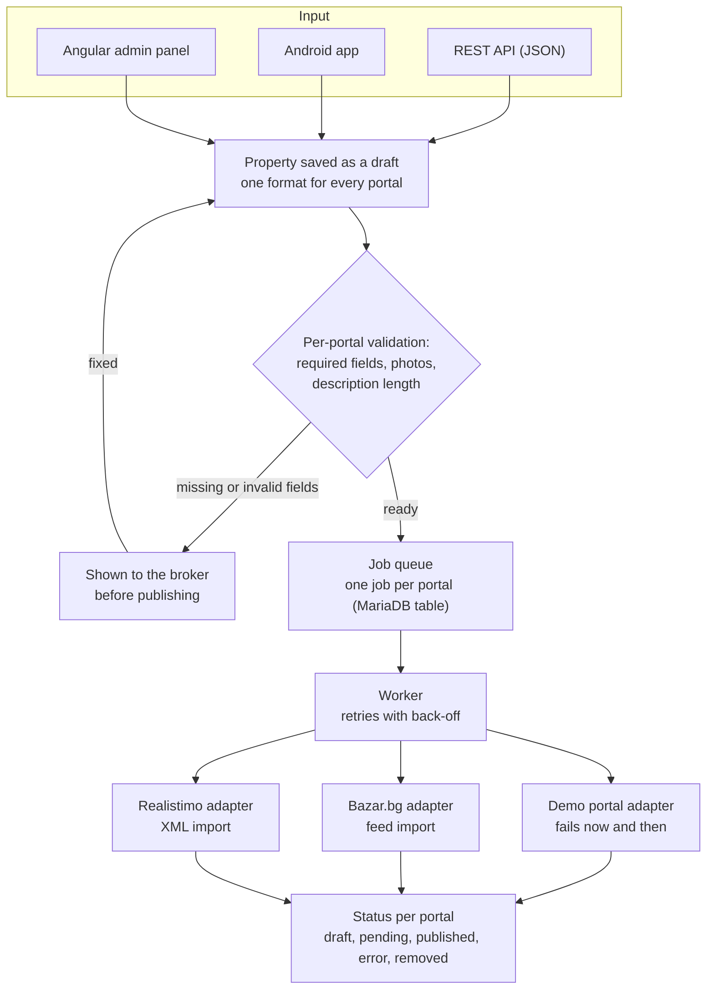
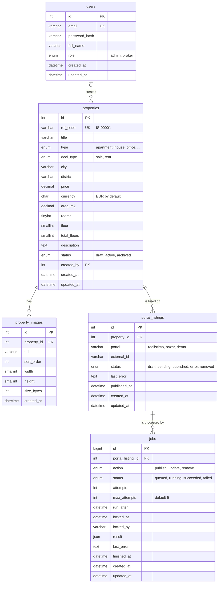

# ImotSync

**Prepare a property once, publish it to several Bulgarian real estate portals, and see its status on each of them in one place.**

ImotSync is a portfolio project: an admin panel, a REST API with a background job queue, portal adapters built on the portals' official import feeds, and a small Android companion app for brokers in the field.

## The problem

A real estate agency usually advertises the same property on several portals. Each portal has its own form, its own required fields, photo limits and description rules, so a broker types the same listing again and again. When the price changes or the property is sold, every portal has to be updated by hand, and it is easy to miss one.

ImotSync keeps the property in one portal-independent format, checks it against each portal's requirements before publishing, sends it through each portal's official import method in the background, and shows the result per portal: published, pending, failed (with the reason) or removed.

## How it works

This is the target design; [Current status](#current-status) says what is built so far.



1. **Input.** A property comes from the admin panel, the Android app or straight from the REST API, and is saved as a draft.
2. **Validation.** For every selected portal the system checks required fields, the number and size of photos and the description length, and lists what is missing before anything is sent.
3. **Queue.** "Publish" creates one job per portal. A Node.js worker processes them in order and retries failures with increasing, jittered delays.
4. **Adapter.** Each portal has its own module that turns the property into that portal's import format.
5. **Status.** The outcome is stored per portal and shown on the dashboard. A later price or photo change queues update jobs; bulk delete queues remove jobs.

More detail, including the state machines and the retry policy: [docs/architecture.md](docs/architecture.md).

## Current status

**Week 1 is complete: the REST API handles login, properties and photos; publishing to portals is not built yet.**

In place:

- Repository layout: `api/`, `web/`, `android/` (placeholder), `docs/`
- Docker Compose with MariaDB 11.8, plus an optional API container
- Knex migrations for the five tables and a demo seed with fictional data
- REST API ([details](#api)):
  - JWT login with a rate-limited login endpoint
  - property CRUD with search, filters, sorting and pagination
  - photo upload with processing: EXIF rotation, metadata (GPS) stripping, resizing to JPEG
  - request validation with express-validator and one consistent JSON error format
  - an OpenAPI 3.1 document with Swagger UI, checked against the real routes and responses by the tests
- `GET /api/health` with a database check, public `/uploads` for photos
- Angular admin panel shell with PrimeNG and Tailwind CSS
- GitHub Actions workflow: lint, format check, type check, unit and integration tests, builds

Next:

- Week 2: job worker, adapter interface, Realistimo, Bazar.bg and Demo portal adapters
- Week 3: admin panel screens (property list, form, pre-publish check, job log)
- Week 4: Android app, deployment with a demo account

The full plan is in the [roadmap](#roadmap).

## Stack

| Part             | Technologies                                                                                                              | What it demonstrates                               |
| ---------------- | ------------------------------------------------------------------------------------------------------------------------- | -------------------------------------------------- |
| Admin panel      | Angular 21, PrimeNG 21, Tailwind CSS 4, Vitest                                                                            | Tables with filters, validated forms, bulk actions |
| API              | Node.js 24, Express 5, TypeScript, express-validator, JWT (jose), express-rate-limit, OpenAPI 3.1 with Swagger UI, Vitest | A clean, documented, tested REST API               |
| Queue and worker | `jobs` table in MariaDB (queue schema in place); _planned:_ Node.js worker with retries (no Redis needed)                 | Background jobs, retries with back-off, resilience |
| Portal adapters  | _Planned:_ XML / JSON feeds following each portal's official import documentation                                         | Integrations with external systems                 |
| Database         | MariaDB 11.8, Knex migrations and seeds, mysql2                                                                           | Data modelling, migrations, UTF-8 (Cyrillic) data  |
| Photos           | multer, sharp (format check, rotation, metadata stripping, resizing), local storage; _planned:_ S3-compatible storage     | Safe file uploads and image processing             |
| Mobile app       | _Planned:_ Kotlin, Jetpack Compose, Room, Retrofit, WorkManager, CameraX                                                  | Offline work and syncing with the API              |
| Infrastructure   | Docker Compose, GitHub Actions                                                                                            | One-command setup, automated checks on every push  |

**Why Angular 21 and PrimeNG 21.** PrimeNG 22 is no longer published under the MIT license: it uses PrimeTek's own PrimeUI License and ships with a license manager. The admin panel therefore stays on PrimeNG 21, the latest MIT-licensed line, and on Angular 21, which that line supports. Moving to Angular 22 would also need Node.js 24.15 or newer (Angular 22 requires `^24.15.0` on Node 24), so `.nvmrc` would then be pinned to that version.

## Repository layout

```text
imotsync/
├── api/                  Node.js REST API (Express 5, TypeScript, Knex): auth, properties, photos,
│                         OpenAPI docs, migrations, seed; requests.http for trying the API
├── web/                  Angular admin panel (PrimeNG, Tailwind CSS)
├── android/              Kotlin companion app (placeholder until Week 4)
├── docs/                 Architecture notes
├── .github/workflows/    CI pipeline
├── docker-compose.yml    MariaDB, plus an optional API container
└── .env.example          Configuration template (copy to .env)
```

## Quick start

### Prerequisites

- [Node.js 24](https://nodejs.org/) (the version is pinned in `.nvmrc`) with npm
- [Docker Desktop](https://www.docker.com/products/docker-desktop/) (or Docker Engine with Compose v2+), running

### Windows (PowerShell)

From the repository root:

```powershell
Copy-Item .env.example .env
docker compose up -d --wait db

cd api
npm ci
npm run db:migrate
npm run db:seed
npm run dev
```

In a second terminal, from the repository root:

```powershell
cd web
npm ci
npm start
```

### macOS / Linux

From the repository root:

```bash
cp .env.example .env
docker compose up -d --wait db

cd api
npm ci
npm run db:migrate
npm run db:seed
npm run dev
```

In a second terminal, from the repository root:

```bash
cd web
npm ci
npm start
```

`docker compose up -d --wait db` starts only MariaDB and returns once it reports healthy, so the migrations do not race the database start.

### Check that it runs

- Admin panel: open <http://localhost:4200>. The dev server proxies `/api` requests to the API on port 3000.
- API health: `curl.exe http://localhost:3000/api/health` in PowerShell (`curl` on macOS/Linux) should return
  `{"status":"ok","db":"up","version":"...","uptimeSeconds":...}`. If the database is unreachable it answers `503` with `"status":"degraded"`.
- API docs: open <http://localhost:3000/api/docs> for Swagger UI; [Try it](#try-it) shows how to log in there.

### Why the database is on port 3307

The MariaDB container listens on 3306 inside Docker but is published on **host port 3307**, so it does not clash with a MariaDB or MySQL server that may already be installed on your machine. The API running on your machine connects to `127.0.0.1:3307` (`DB_HOST` / `DB_PORT` in `.env`); inside Compose the API container connects to `db:3306`. To use another host port, change `DB_PORT` in `.env`.

### Option: run the API in Docker too

The API container runs with `NODE_ENV=production`, where the API requires a `JWT_SECRET` of at least 32 characters. The `dev-only-...` placeholder from `.env.example` is public, so the container never uses it: when `JWT_SECRET` is empty or starts with `dev-only`, the container generates a random secret at each start and logs a warning. That is enough for a local demo, but login tokens then stop working whenever the container restarts. To keep them valid, put a random value of your own in `.env`, for example the output of:

```bash
node -e "console.log(require('crypto').randomBytes(32).toString('hex'))"
```

Build and start MariaDB and the API container:

```bash
docker compose up -d --build --wait
```

The container applies pending migrations and then starts the server on <http://localhost:3000>. Once `/api/health` returns `"status":"ok"`, load the demo data:

```bash
docker compose exec api node dist/db/seed.js
```

The admin panel still runs with `npm start` in `web/`. Stop everything with `docker compose down`; add `-v` to also delete the database and uploads volumes.

### Troubleshooting

- **Port 3307 is already in use**: set another `DB_PORT` in `.env` and run `docker compose up -d --wait db` again.
- **PowerShell says running scripts is disabled** when you type `npm`: run `npm.cmd` instead (for example `npm.cmd ci`).
- **Health check returns `"db":"down"`**: check that the database container is running and healthy with `docker compose ps`.

### Demo accounts

The seed creates two accounts. Their password is `SEED_DEMO_PASSWORD` from `.env` (default `demo1234`).

| Email                   | Role   | Name        |
| ----------------------- | ------ | ----------- |
| `admin@imotsync.local`  | admin  | Demo Admin  |
| `broker@imotsync.local` | broker | Demo Broker |

Log in with either account through `POST /api/auth/login` ([Try it](#try-it)). Both roles can currently use every endpoint; nothing is admin-only yet. All seeded properties are made up.

## API

The REST API runs at `http://localhost:3000/api` (the admin panel's dev server also proxies `http://localhost:4200/api` to it). Requests and responses are JSON, except photo upload, which is `multipart/form-data`. The full reference is the OpenAPI 3.1 document at `/api/openapi.json`, browsable in Swagger UI at `/api/docs`.

### Try it

**Swagger UI**, with the API running (`npm run dev` in `api/`) and the demo data seeded:

1. Open <http://localhost:3000/api/docs>.
2. Open `POST /api/auth/login`, click **Try it out**, send `{"email": "admin@imotsync.local", "password": "demo1234"}` and copy `accessToken` from the response.
3. Click **Authorize**, paste the token (without the `Bearer` prefix) and confirm. Swagger UI keeps it across page reloads; every other endpoint can now be called from the page.

**[`api/requests.http`](api/requests.http)** holds ready-made requests (health, login, the property and photo endpoints, the OpenAPI document) for the `.http` file support in Visual Studio 2022 and for the REST Client extension in VS Code. Run them from top to bottom: the login request stores the token that every later request sends, the create request stores the new property's id, and the `photos` request stores the ids of its photos for the reorder and delete-photo requests. The requests go to `http://localhost:3000`, set in a variable in the file.

Every request works in both editors except the photo upload, which needs VS Code's REST Client: Visual Studio 2022 cannot put a file into a multipart body. The upload sends two of the seeded demo photos; change the file paths to send your own. In Visual Studio 2022, upload through Swagger UI or with the `curl.exe` command in the upload request's comment instead, then run the `photos` request before the reorder and delete-photo requests.

### Authentication

1. `POST /api/auth/login` with `{"email", "password"}` returns `{"accessToken", "tokenType": "Bearer", "expiresIn", "user": {"id", "email", "fullName", "role"}}`. `expiresIn` is in seconds.
2. Every other request sends the token in the header `Authorization: Bearer <accessToken>`. The admin panel and the Android app will use the same header.
3. A token is a JWT valid for 8 hours by default (`JWT_TTL_SECONDS`). There is no refresh token yet: once the token expires the API answers `401 UNAUTHORIZED` and the client logs in again.

- **Public:** `GET /api/health`, `POST /api/auth/login`, `GET /api/openapi.json`, Swagger UI at `/api/docs`, and photo files under `/uploads` (portals download photos by URL). Everything else under `/api` needs a valid token.
- **Same answer for every failed login:** an unknown email and a wrong password both get `401 INVALID_CREDENTIALS`, and both take about as long, so the API does not reveal which emails have accounts. Emails are matched case-insensitively.
- **Rate limit:** `POST /api/auth/login` allows 10 attempts per 15 minutes per IP address; further attempts get `429 TOO_MANY_REQUESTS` with the standard `RateLimit` headers. Behind a reverse proxy, set `TRUST_PROXY` to the number of proxies or to their addresses ([Behind a reverse proxy](#behind-a-reverse-proxy)) so the limit applies to the client's address, not the proxy's.

### Endpoints

| Method   | Path                                    | Token | What it does                                              | Success                     |
| -------- | --------------------------------------- | ----- | --------------------------------------------------------- | --------------------------- |
| `GET`    | `/api/health`                           | no    | API and database status                                   | 200 (503 if the DB is down) |
| `POST`   | `/api/auth/login`                       | no    | Log in and get a token                                    | 200                         |
| `GET`    | `/api/auth/me`                          | yes   | The user the token belongs to: `{"user": {...}}`          | 200                         |
| `GET`    | `/api/properties`                       | yes   | List properties with search, filters, sorting, pagination | 200                         |
| `POST`   | `/api/properties`                       | yes   | Create a property                                         | 201 with `Location`         |
| `GET`    | `/api/properties/{id}`                  | yes   | One property with its photos and portal listings          | 200                         |
| `PATCH`  | `/api/properties/{id}`                  | yes   | Change some fields of a property                          | 200                         |
| `DELETE` | `/api/properties/{id}`                  | yes   | Delete a property and its photos                          | 204                         |
| `POST`   | `/api/properties/{id}/images`           | yes   | Upload photos (`multipart/form-data`, field `photos`)     | 201                         |
| `PUT`    | `/api/properties/{id}/images/order`     | yes   | Reorder the photos: `{"imageIds": [...]}`                 | 200                         |
| `DELETE` | `/api/properties/{id}/images/{imageId}` | yes   | Delete one photo                                          | 204                         |
| `GET`    | `/api/openapi.json`                     | no    | The OpenAPI 3.1 document                                  | 200                         |
| `GET`    | `/api/docs`                             | no    | Swagger UI                                                | HTML page                   |

Create and update return the full property; upload returns the new photos and reorder returns all photos in their new order, so the client sees the result without a second request.

### Listing properties

`GET /api/properties` returns `{"data": [...], "meta": {"page", "pageSize", "total", "totalPages"}}`. Each item is a summary: the main fields, the first photo's URL (`coverImageUrl`), the number of photos, the status on each portal and the user who created it. `GET /api/properties/{id}` adds the description, every photo in order and the full portal listing records.

| Query parameter              | Meaning                                                                                                                                                                                                         |
| ---------------------------- | --------------------------------------------------------------------------------------------------------------------------------------------------------------------------------------------------------------- |
| `page`, `pageSize`           | Page number (1 to 1,000,000, default 1) and page size (1 to 100, default 20)                                                                                                                                    |
| `q`                          | Text search in the reference code, title, city and district, up to 100 characters; works with Cyrillic                                                                                                          |
| `status`, `type`, `dealType` | One value or a comma-separated list, for example `type=apartment,house`; the values are those in [Property fields](#property-fields)                                                                            |
| `city`                       | Exact city name, case-insensitive, up to 100 characters                                                                                                                                                         |
| `priceMin`, `priceMax`       | Price range, both ends included: numbers from 0 with at most two decimals; `priceMax` may not be below `priceMin`                                                                                               |
| `portal`                     | `realistimo`, `bazar` or `demo`: properties that have a listing on that portal                                                                                                                                  |
| `portalStatus`               | One value or a comma-separated list of listing statuses (`draft`, `pending`, `published`, `error`, `removed`), for example `portalStatus=pending,error`: on the portal given in `portal`, or else on any portal |
| `sort`                       | `createdAt`, `updatedAt`, `price`, `areaM2`, `refCode` or `city`; a leading `-` sorts descending. Default `-updatedAt`                                                                                          |

For example, the properties for sale whose Bazar.bg listing failed, most expensive first: `GET /api/properties?dealType=sale&portal=bazar&portalStatus=error&sort=-price`. An unknown query parameter or an invalid value gets `400 VALIDATION_ERROR`, so a misspelt filter is reported instead of silently ignored.

### Property fields

`POST /api/properties` needs `type`, `dealType` and `city`; everything else is optional. `PATCH /api/properties/{id}` takes any subset of the same fields with the same rules.

| Field                  | Rules                                                                                                                                                                                                                                                                                                                  |
| ---------------------- | ---------------------------------------------------------------------------------------------------------------------------------------------------------------------------------------------------------------------------------------------------------------------------------------------------------------------- |
| `type`                 | `apartment`, `house`, `office`, `shop`, `land`, `garage` or `other`                                                                                                                                                                                                                                                    |
| `dealType`             | `sale` or `rent`                                                                                                                                                                                                                                                                                                       |
| `city`                 | Required; up to 100 characters, and neither empty nor `null` (also in a `PATCH`)                                                                                                                                                                                                                                       |
| `refCode`              | 3 to 32 letters, digits, `_` or `-`; unique (`409 CONFLICT` if taken); cannot be changed later. Left out, empty or `null`, it becomes `IS-` plus the id in five digits, such as `IS-00042`. Codes of the form `IS-<number>` (in any letter case) are reserved for these generated codes and get `400 VALIDATION_ERROR` |
| `title`, `district`    | Up to 200 and 100 characters                                                                                                                                                                                                                                                                                           |
| `price`                | 0 to 9,999,999,999.99, at most two decimals                                                                                                                                                                                                                                                                            |
| `currency`             | Three capital letters, an ISO 4217 code such as `EUR`; default `EUR`                                                                                                                                                                                                                                                   |
| `areaM2`               | More than 0, up to 999,999.99, at most two decimals                                                                                                                                                                                                                                                                    |
| `rooms`                | 0 to 255                                                                                                                                                                                                                                                                                                               |
| `floor`, `totalFloors` | -5 to 200 and 0 to 200; `floor` may not be higher than `totalFloors` when both are set                                                                                                                                                                                                                                 |
| `description`          | Up to 20,000 characters and 65,535 bytes in UTF-8 (the size of the database column)                                                                                                                                                                                                                                    |
| `status`               | `draft` (default), `active` or `archived`                                                                                                                                                                                                                                                                              |

`refCode` is fixed because every portal receives it to recognise the listing on re-import. Text is trimmed, and an empty optional text becomes `null`. In a `PATCH`, `null` clears `title`, `district`, `price`, `areaM2`, `rooms`, `floor`, `totalFloors` or `description`; an empty body is rejected. Unknown fields are rejected in both requests, so a typo in a field name is reported instead of silently ignored.

### Photos

- **Upload:** `POST /api/properties/{id}/images` as `multipart/form-data` (any other body gets `415 UNSUPPORTED_MEDIA_TYPE`) with 1 to 20 files in the `photos` field, each up to 15 MB. A file over 15 MB gets `413 PAYLOAD_TOO_LARGE`; no files, more than 20, or any other form field get `400 VALIDATION_ERROR`. A property holds at most 40 photos; an upload that would go over gets `409 CONFLICT`. New photos go after the existing ones.
- **Upload limits:** a whole upload body may be at most 301 MB (20 photos of 15 MB plus 1 MB for the multipart boundaries and part headers). A body whose `Content-Length` declares more gets `413 PAYLOAD_TOO_LARGE` before any of it is read, and the connection is closed; a body sent without a declared length is cut off by closing the connection as soon as it passes that size. The whole body also has to arrive within 60 seconds; a slower upload, or one that stops sending, gets `408 REQUEST_TIMEOUT` and the connection is closed, so on a slow connection send fewer photos per request. The photos are held in memory while they are processed, so each API process handles at most 2 uploads at a time: a further upload gets `429 TOO_MANY_REQUESTS` with `Retry-After: 10` (seconds) before its body is read, and can simply be sent again.
- **Formats:** JPEG, PNG, WebP and AVIF, recognised from the file's content, not from its name or declared type. Anything else, or a damaged file, gets `415 UNSUPPORTED_MEDIA_TYPE` naming the file. Images below 400 px on the short side get `400 VALIDATION_ERROR`, and so do images above 50 megapixels, which are refused from their header before they are decoded.
- **Processing:** every photo is turned upright using its EXIF orientation, stripped of all metadata (phone photos carry the GPS position where they were taken), scaled down to fit within 2048 × 2048 px (never enlarged) and saved as JPEG.
- **Storage:** files are stored as `properties/<propertyId>/<random UUID>.jpg` under `UPLOAD_DIR` and served at `/uploads/properties/...`; the response gives each photo's `url`, `width`, `height` and `sizeBytes`.
- **Order and delete:** `PUT /api/properties/{id}/images/order` takes `{"imageIds": [...]}` listing every photo of the property exactly once, in the new order. `DELETE /api/properties/{id}/images/{imageId}` deletes one photo and its file. Every photo change updates the property's `updatedAt`.

### Deleting a property

`DELETE /api/properties/{id}` deletes the property with its photos (rows and files) and its portal listing and job records. While any of its portal listings is `pending` or `published`, it answers `409 CONFLICT` instead: the property has to be removed from the portals first. Removing a listing from a portal is a job that arrives with the worker in Week 2. A listing in `error` does not block the delete yet, even though a failed update can leave the earlier version online; how `remove` jobs treat such listings is decided with the worker.

### Errors

Every error has the same shape: `{"error": {"code", "message", "details"?}}`. `details` is present on validation errors and lists each problem by field, at most one per field. Their `message` sums the problems up: `Invalid <field>: <problem>` when there is one, `Request validation failed for: <fields>` when there are several. For example, `POST /api/properties` with `{"type": "apartment", "dealType": "sale", "price": -5}` gets:

```json
{
  "error": {
    "code": "VALIDATION_ERROR",
    "message": "Request validation failed for: price, city",
    "details": [
      {
        "field": "price",
        "message": "must be a number from 0 to 9999999999.99 with at most 2 decimals"
      },
      { "field": "city", "message": "is required" }
    ]
  }
}
```

Messages are meant for people and may change, so clients should rely on `code` (and, for validation errors, on each `field`).

| Status | Code                     | When                                                                                                                                                                        |
| ------ | ------------------------ | --------------------------------------------------------------------------------------------------------------------------------------------------------------------------- |
| 400    | `VALIDATION_ERROR`       | Invalid path, query or body, including unknown fields and ids that are not integers; also a photo that is too small or too large in pixels, or too many files in one upload |
| 400    | `INVALID_JSON`           | The body is not valid JSON                                                                                                                                                  |
| 401    | `UNAUTHORIZED`           | Missing, invalid or expired token (the response has a `WWW-Authenticate: Bearer` header)                                                                                    |
| 401    | `INVALID_CREDENTIALS`    | Wrong email or password                                                                                                                                                     |
| 403    | `FORBIDDEN`              | The user's role may not do this (nothing is admin-only yet)                                                                                                                 |
| 404    | `NOT_FOUND`              | Unknown property, photo or route. An unknown path under `/api` answers `401 UNAUTHORIZED` until a valid token is sent, and `404` after that                                 |
| 408    | `REQUEST_TIMEOUT`        | A photo upload whose body did not arrive within 60 seconds; the connection is closed ([Photos](#photos))                                                                    |
| 409    | `CONFLICT`               | Duplicate `refCode`, more than 40 photos, or deleting a property still listed on a portal                                                                                   |
| 413    | `PAYLOAD_TOO_LARGE`      | A JSON body over 1 MB, a photo over 15 MB, or a photo upload body over 301 MB in all ([Photos](#photos))                                                                    |
| 415    | `UNSUPPORTED_MEDIA_TYPE` | A body that is not `application/json` (not `multipart/form-data` for a photo upload), or an uploaded file that is not a JPEG, PNG, WebP or AVIF image                       |
| 429    | `TOO_MANY_REQUESTS`      | Too many login attempts, or a photo upload while the API process already handles 2; both answers carry a `Retry-After` header (seconds)                                     |
| 500    | `INTERNAL_ERROR`         | Unexpected failure; with `NODE_ENV=production` the details stay in the server log                                                                                           |

## Configuration

All settings live in one `.env` file at the repository root. The API reads it when it runs on your machine; Docker Compose reads it to fill in the values it passes to its containers (see the note below the table).

| Variable                            | Default (from `.env.example`)     | Purpose                                                                                                                                                                              |
| ----------------------------------- | --------------------------------- | ------------------------------------------------------------------------------------------------------------------------------------------------------------------------------------ |
| `NODE_ENV`                          | `development`                     | `production` hides error details and protects the seed                                                                                                                               |
| `API_PORT`                          | `3000`                            | API port                                                                                                                                                                             |
| `CORS_ORIGIN`                       | `http://localhost:4200`           | Allowed browser origin(s), comma-separated                                                                                                                                           |
| `TRUST_PROXY`                       | not set (`false`)                 | Only behind a reverse proxy: the number of proxies or their addresses; `true` stops the API when `NODE_ENV=production` ([Behind a reverse proxy](#behind-a-reverse-proxy))           |
| `JWT_SECRET`                        | public `dev-only-...` placeholder | Signing key for login tokens; when `NODE_ENV=production` it must be at least 32 characters and not a `dev-only-...` placeholder ([API container](#option-run-the-api-in-docker-too)) |
| `JWT_TTL_SECONDS`                   | not set (`28800`, 8 hours)        | Lifetime of a login token in seconds, from 60 to 2592000 (30 days); any other value stops the API at startup                                                                         |
| `UPLOAD_DIR`                        | `./uploads`                       | Photo storage; relative paths resolve from `api/`                                                                                                                                    |
| `DB_HOST`, `DB_PORT`                | `127.0.0.1`, `3307`               | Database address as seen from your machine                                                                                                                                           |
| `DB_NAME`, `DB_USER`, `DB_PASSWORD` | `imotsync`, `imotsync`, ...       | Application database and user                                                                                                                                                        |
| `DB_ROOT_PASSWORD`                  | `root_dev`                        | MariaDB root password; only used to set up the integration-test database                                                                                                             |
| `SEED_DEMO_PASSWORD`                | `demo1234`                        | Password of the seeded demo accounts                                                                                                                                                 |
| `ALLOW_DEMO_SEED`                   | not set                           | Set to `true` to allow the seed when `NODE_ENV=production` (the Compose demo stack does)                                                                                             |

The API container in Docker Compose receives only the variables listed under `environment` in `docker-compose.yml`: some come from `.env`, others are fixed there (for example `NODE_ENV` and `UPLOAD_DIR`). A variable that is not listed there has no effect on the container, even when it is set in `.env`.

### Behind a reverse proxy

When clients reach the API directly, leave `TRUST_PROXY` unset. Behind a reverse proxy (nginx, Caddy, a load balancer), every request seems to come from the proxy's address, so all clients would share its 10 login attempts. `TRUST_PROXY` sets Express' `trust proxy`, which decides how much of the `X-Forwarded-For` header the API believes:

| Value                                          | Meaning                                                                                                                                                   |
| ---------------------------------------------- | --------------------------------------------------------------------------------------------------------------------------------------------------------- |
| `false` (default)                              | No proxy. The client's address is the connection's address and `X-Forwarded-For` is ignored                                                               |
| A number of hops, usually `1`                  | Exactly the number of proxies in front of the API (more trusts an entry the client wrote). Only when the API's port cannot be reached except through them |
| Addresses, subnets or presets, comma-separated | The proxies' own addresses, such as `10.0.0.5`, `10.0.0.0/8` or `fd00::/8`, or the presets `loopback`, `linklocal` and `uniquelocal`. The safest choice   |

The proxy must add the client's address to `X-Forwarded-For` (in nginx: `proxy_set_header X-Forwarded-For $proxy_add_x_forwarded_for;`).

Docker Compose passes `TRUST_PROXY` (and `JWT_TTL_SECONDS`) from `.env` to the API container as well, with the same defaults. Addresses are then the ones the container sees: a proxy running on the host usually connects from the Docker network's gateway address, not from `loopback`.

Do not use `true`. It trusts every hop, so the API takes the left-most `X-Forwarded-For` entry as the client's address. The client writes that entry itself, even behind a proxy that appends to the header, so it could send a new address with every attempt and get around the login limit. With `NODE_ENV=production` the API therefore refuses `true` and stops at startup with an error that asks for the number of proxies or their addresses instead. In development and tests it accepts the value, and express-rate-limit logs an `ERR_ERL_PERMISSIVE_TRUST_PROXY` warning about it.

## Scripts

### API (run in `api/`)

| Script                            | What it does                                                                          |
| --------------------------------- | ------------------------------------------------------------------------------------- |
| `npm run dev`                     | Start the API with reload on change (`tsx watch`)                                     |
| `npm run build`                   | Compile TypeScript to `dist/`                                                         |
| `npm start`                       | Run the compiled API (`node dist/server.js`)                                          |
| `npm run typecheck`               | Type-check sources and tests                                                          |
| `npm run lint`                    | ESLint                                                                                |
| `npm run format` / `format:check` | Format with Prettier / check formatting                                               |
| `npm test`                        | Unit tests (Vitest); no database needed                                               |
| `npm run test:integration`        | Integration tests against the Docker MariaDB, in a separate `imotsync_test` database  |
| `npm run db:migrate`              | Apply pending migrations                                                              |
| `npm run db:rollback`             | Roll back the last migration batch                                                    |
| `npm run db:status`               | List applied and pending migrations                                                   |
| `npm run db:seed`                 | Load the demo data (refused when `NODE_ENV=production` unless `ALLOW_DEMO_SEED=true`) |
| `npm run db:reset`                | Roll back everything, migrate to latest and seed (deletes local data)                 |

The compiled equivalents used in the container are `node dist/db/migrate.js latest|rollback|status|reset` and `node dist/db/seed.js`.

### Web (run in `web/`)

| Script                            | What it does                                                     |
| --------------------------------- | ---------------------------------------------------------------- |
| `npm start`                       | Dev server on <http://localhost:4200>, `/api` proxied to the API |
| `npm run build`                   | Production build                                                 |
| `npm test`                        | Unit tests (Vitest), single run                                  |
| `npm run lint`                    | ESLint (angular-eslint)                                          |
| `npm run format` / `format:check` | Format with Prettier / check formatting                          |

### Continuous integration

[`.github/workflows/ci.yml`](.github/workflows/ci.yml) runs on every push and pull request:

- **api**: lint, format check, type check, unit tests, build, a smoke run of the compiled build as Docker Compose runs it (`migrate.js latest` and `status`, `seed.js`, then `server.js` until `/api/health` reports `"status":"ok"`), integration tests, and a Docker image build. The smoke run and the integration tests use a MariaDB 11.8 service container.
- **web**: lint, format check, unit tests, production build.
- **repo**: Prettier check of the files outside `api/` and `web/` (README, docs, workflow, Compose file) with the root config.

To run the last check locally, from the repository root (use `--write` instead of `--check` to fix the files):

```bash
npx prettier@3.10.1 --check README.md docs .github .vscode docker-compose.yml .prettierrc.json
```

## Data model



- **`ref_code`** (`IS-00001`, ...) is the property's own stable code. It is sent to every portal so that a re-import updates the existing listing instead of creating a duplicate.
- **`portal`** is a `VARCHAR` adapter key, not an `ENUM`, so adding a portal adapter needs no migration. Each property has at most one row per portal.
- **Statuses**: `properties.status` is the agency's own lifecycle (draft, active, archived); `portal_listings.status` is the state on one portal; `jobs.status` is the state of one queued operation. Drafts may be incomplete, which is why most property fields are nullable; the pre-publish check reports what each portal still needs.
- Every application table is InnoDB with `utf8mb4` / `utf8mb4_unicode_ci`, set explicitly in its migration (Bulgarian text, Cyrillic), and every `DATETIME` is stored in UTC. Prices default to EUR, Bulgaria's currency since 1 January 2026.

## Portals

| Portal      | Import method                                           | State                                                                                                            |
| ----------- | ------------------------------------------------------- | ---------------------------------------------------------------------------------------------------------------- |
| Realistimo  | XML import, following Realistimo's public documentation | Planned for Week 2                                                                                               |
| Bazar.bg    | Listing import via a feed (XML or JSON)                 | Planned for Week 2                                                                                               |
| Demo portal | Fake adapter inside this project, no network calls      | Planned for Week 2. It fails some attempts on purpose so that error statuses and retries are visible             |
| imot.bg     | Official import                                         | The next adapter, not built yet: API access requires authorization from imot.bg and at least 500 active listings |

## Principles

- **Official import methods only.** Adapters use the import feeds and APIs that the portals publish for agencies. No scraping, no automated logins into portal accounts.
- **Fictional demo data.** Every seeded property, address and account is made up.
- **Nothing reaches real portals from the demo.** The demo runs on fictional data and is never connected to a real portal account.
- **Photos carry no hidden data.** Every upload is re-encoded without its metadata, so the GPS position a phone records never reaches a portal.
- Secrets stay out of the repository: configuration comes from `.env`, which is git-ignored.

## Roadmap

About four weeks, with something working at the end of each week.

**Week 1: foundation and API**

- [x] Repository with `api`, `web` and `android` folders
- [x] Docker Compose with MariaDB and a seed script with sample data
- [x] Migrations for the five tables
- [x] Express API: JWT login, CRUD for properties, photo upload
- [x] Validation with express-validator and Swagger docs

**Week 2: publishing**

- [ ] Worker for the `jobs` table with retries and increasing back-off
- [ ] Common adapter interface: `validate()`, `publish()`, `update()`, `remove()`
- [ ] Realistimo adapter: XML following their public documentation
- [ ] Bazar.bg adapter: XML or JSON feed
- [ ] A "Demo portal" adapter that sometimes returns an error, so statuses and retries are visible
- [ ] Unit tests for the adapters

**Week 3: admin panel**

- [ ] Angular project with PrimeNG and Tailwind, login and route guard (the shell with PrimeNG and Tailwind is in place)
- [ ] Property list: filters, status per portal, bulk delete and bulk publish
- [ ] Property form with photo upload and reordering
- [ ] Pre-publish check: which fields are missing for which portal
- [ ] Job log page with a "Retry" button

**Week 4: Android and launch**

- [ ] Kotlin Android app: login, photos from the camera, a short form, sending as a draft
- [ ] Offline drafts in Room, sent when there is a connection
- [ ] Deployment with Docker Compose and a demo account
- [ ] GitHub Actions: build and tests on every push (the workflow file is in place)
- [ ] README screenshots and a 2-minute video

## Adding a new portal

> **Planned.** The adapter interface arrives in Week 2; this is the intended process.

1. Read the portal's official import documentation and note its format, required fields, photo rules and how it identifies a listing on re-import (ImotSync sends `ref_code`).
2. Create an adapter module in the API that implements the common interface:

   ```ts
   interface PortalAdapter {
     readonly key: string; // stored in portal_listings.portal, e.g. 'realistimo'
     validate(property: PropertyWithImages): ValidationIssue[];
     publish(property: PropertyWithImages): Promise<AdapterResult>;
     update(property: PropertyWithImages, listing: PortalListing): Promise<AdapterResult>;
     remove(listing: PortalListing): Promise<AdapterResult>;
   }
   ```

   `validate()` feeds the pre-publish check; the other three are called by the worker, which handles retries, back-off and status updates.

3. Register the adapter under a new key. The `portal` column is a `VARCHAR`, so no migration is needed.
4. Add unit tests with fictional properties and the portal's documented examples.
5. Add the portal to the table above.

The full sketch is in [docs/architecture.md](docs/architecture.md#portal-adapter-interface).

## More documentation

- [Architecture](docs/architecture.md): components, API conventions, authentication, the photo pipeline, state machines, retry policy, adapters and feeds
- API reference: Swagger UI at <http://localhost:3000/api/docs> while the API runs, and [`api/requests.http`](api/requests.http) ([Try it](#try-it))
- [Android app](android/README.md): the planned companion app

## License

License: to be decided.
