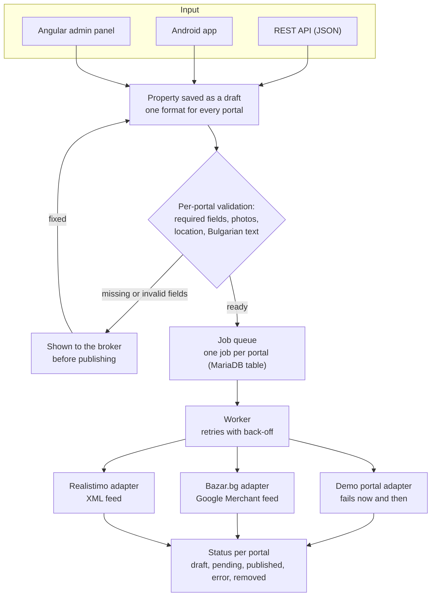
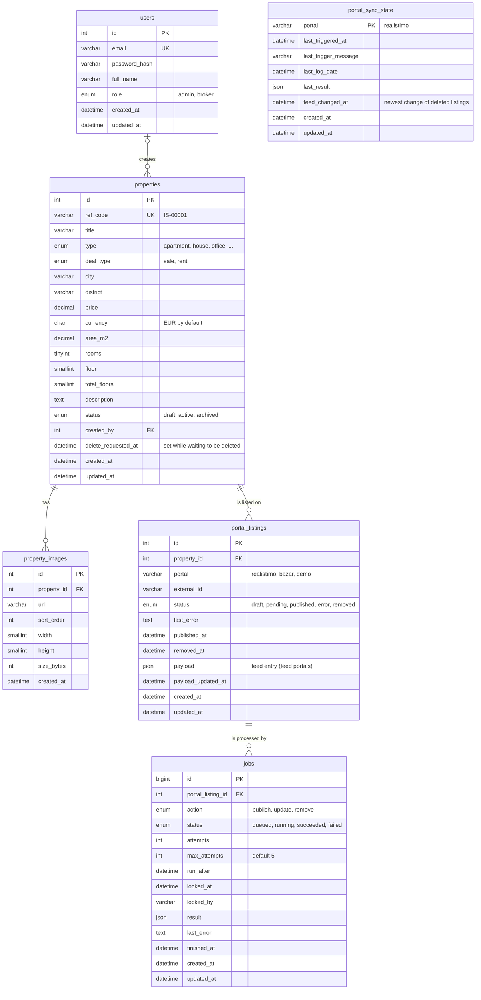

# ImotSync

**Prepare a property once, publish it to several Bulgarian real estate portals, and see its status on each of them in one place.**

ImotSync is a portfolio project: an admin panel, a REST API with a background job queue, portal adapters built on the portals' official import feeds, and a small Android companion app for brokers in the field.

## The problem

A real estate agency usually advertises the same property on several portals. Each portal has its own form, its own required fields, photo limits and description rules, so a broker types the same listing again and again. When the price changes or the property is sold, every portal has to be updated by hand, and it is easy to miss one.

ImotSync keeps the property in one portal-independent format, checks it against each portal's requirements before publishing, sends it through each portal's official import method in the background, and shows the result per portal: published, pending, failed (with the reason) or removed.

## How it works

The backend part of this is built; the admin panel screens and the Android app follow ([Current status](#current-status)).



1. **Input.** A property comes from the admin panel, the Android app or straight from the REST API, and is saved as a draft.
2. **Validation.** For every selected portal the system checks that portal's documented rules (price, floor area, a location the portal knows, photos, Bulgarian text without contact details, ...) and lists what is missing before anything is sent.
3. **Queue.** "Publish" creates one job per portal. A Node.js worker processes them in order and retries failures with increasing, jittered delays.
4. **Adapter.** Each portal has its own module that turns the property into that portal's import format: the feeds that Realistimo and Bazar.bg download from ImotSync, or a call to the portal for push portals such as the demo.
5. **Status.** The outcome is stored per portal and shown on the dashboard. A later price or photo change queues update jobs; unpublish and bulk delete queue remove jobs.

More detail: [Publishing](#publishing) below, [docs/architecture.md](docs/architecture.md) for the state machines, the queue and the retry policy, and [docs/portals.md](docs/portals.md) for each portal's format and rules.

## Current status

**Week 2 is complete: properties are checked against each portal's rules and published in the background to Realistimo, Bazar.bg and a demo portal, with retries and a job log. The admin panel screens come next.**

In place:

- Repository layout: `api/`, `web/`, `android/` (placeholder), `docs/`
- Docker Compose with MariaDB 11.8, plus optional API and worker containers
- Knex migrations for six tables and a demo seed with fictional data, including listings in every state and feeds with content
- REST API ([details](#api)):
  - JWT login with a rate-limited login endpoint
  - property CRUD with search, filters, sorting and pagination
  - photo upload with processing: EXIF rotation, metadata (GPS) stripping, resizing to JPEG
  - pre-publish checks, publish and unpublish, bulk publish and bulk delete, a job log with retry
  - request validation with express-validator and one consistent JSON error format
  - an OpenAPI 3.1 document with Swagger UI, checked against the real routes and responses by the tests
- Publishing ([details](#publishing)):
  - a job queue in MariaDB that keeps each listing's jobs in order and merges repeated changes
  - a worker process with retries, exponential back-off with jitter, a sweep for abandoned jobs and graceful shutdown
  - one adapter interface (`validate`, `publish`, `update`, `remove`) with three adapters: Realistimo (XML feed per its documentation, location ids from its geo list, optional import sync over its REST API), Bazar.bg (Google Merchant feed, checks from its General Terms) and a demo portal that fails on purpose
  - token-protected feed URLs for the portals to download, with `ETag` / `304` support
  - unit tests for every adapter, integration tests for the queue, the worker, the endpoints and the feeds
- `GET /api/health` with a database check, public `/uploads` for photos
- Angular admin panel shell with PrimeNG and Tailwind CSS
- GitHub Actions workflow: lint, format check, type check, unit and integration tests, builds, a run of the compiled worker

Next:

- Week 3: admin panel screens (property list, form, pre-publish check, job log)
- Week 4: Android app, deployment with a demo account

The full plan is in the [roadmap](#roadmap).

## Stack

| Part             | Technologies                                                                                                                                          | What it demonstrates                               |
| ---------------- | ----------------------------------------------------------------------------------------------------------------------------------------------------- | -------------------------------------------------- |
| Admin panel      | Angular 21, PrimeNG 21, Tailwind CSS 4, Vitest                                                                                                        | Tables with filters, validated forms, bulk actions |
| API              | Node.js 24, Express 5, TypeScript, express-validator, JWT (jose), express-rate-limit, OpenAPI 3.1 with Swagger UI, Vitest                             | A clean, documented, tested REST API               |
| Queue and worker | `jobs` table in MariaDB claimed with `FOR UPDATE SKIP LOCKED`, Node.js worker process with retries (no Redis needed)                                  | Background jobs, retries with back-off, resilience |
| Portal adapters  | XML feeds built with fast-xml-parser (Realistimo's import format, Google Merchant RSS for Bazar.bg), a REST client tested against a local fake server | Integrations with external systems                 |
| Database         | MariaDB 11.8, Knex migrations and seeds, mysql2                                                                                                       | Data modelling, migrations, UTF-8 (Cyrillic) data  |
| Photos           | multer, sharp (format check, rotation, metadata stripping, resizing), local storage; _planned:_ S3-compatible storage                                 | Safe file uploads and image processing             |
| Mobile app       | _Planned:_ Kotlin, Jetpack Compose, Room, Retrofit, WorkManager, CameraX                                                                              | Offline work and syncing with the API              |
| Infrastructure   | Docker Compose, GitHub Actions                                                                                                                        | One-command setup, automated checks on every push  |

**Why Angular 21 and PrimeNG 21.** PrimeNG 22 is no longer published under the MIT license: it uses PrimeTek's own PrimeUI License and ships with a license manager. The admin panel therefore stays on PrimeNG 21, the latest MIT-licensed line, and on Angular 21, which that line supports. Moving to Angular 22 would also need Node.js 24.15 or newer (Angular 22 requires `^24.15.0` on Node 24), so `.nvmrc` would then be pinned to that version.

## Repository layout

```text
imotsync/
├── api/                  Node.js REST API and job worker (Express 5, TypeScript, Knex): auth, properties,
│                         photos, publishing queue, portal adapters, feeds, OpenAPI docs, migrations,
│                         seed; requests.http for trying the API
├── web/                  Angular admin panel (PrimeNG, Tailwind CSS)
├── android/              Kotlin companion app (placeholder until Week 4)
├── docs/                 Architecture and portal integration notes
├── .github/workflows/    CI pipeline
├── docker-compose.yml    MariaDB, plus optional API and worker containers
└── .env.example          Configuration template (copy to .env)
```

## Quick start

### Prerequisites

- [Node.js 24](https://nodejs.org/) (the version is pinned in `.nvmrc`) with npm
- [Docker Desktop](https://www.docker.com/products/docker-desktop/) (or Docker Engine with Compose v2+), running

### Windows (PowerShell)

From the repository root:

```powershell
Copy-Item .env.example .env
docker compose up -d --wait db

cd api
npm ci
npm run db:migrate
npm run db:seed
npm run dev
```

In a second terminal, from the repository root, start the worker, which processes the publishing jobs:

```powershell
cd api
npm run dev:worker
```

In a third terminal, from the repository root:

```powershell
cd web
npm ci
npm start
```

### macOS / Linux

From the repository root:

```bash
cp .env.example .env
docker compose up -d --wait db

cd api
npm ci
npm run db:migrate
npm run db:seed
npm run dev
```

In a second terminal, from the repository root, start the worker, which processes the publishing jobs:

```bash
cd api
npm run dev:worker
```

In a third terminal, from the repository root:

```bash
cd web
npm ci
npm start
```

`docker compose up -d --wait db` starts only MariaDB and returns once it reports healthy, so the migrations do not race the database start. The seed leaves a few publishing jobs queued, so the worker has something to do as soon as it starts.

### Check that it runs

- Admin panel: open <http://localhost:4200>. The dev server proxies `/api` requests to the API on port 3000.
- API health: `curl.exe http://localhost:3000/api/health` in PowerShell (`curl` on macOS/Linux) should return
  `{"status":"ok","db":"up","version":"...","uptimeSeconds":...}`. If the database is unreachable it answers `503` with `"status":"degraded"`.
- API docs: open <http://localhost:3000/api/docs> for Swagger UI; [Try it](#try-it) shows how to log in there.
- Feeds: <http://localhost:3000/feeds/realistimo/dev-only-feed-token.xml> and <http://localhost:3000/feeds/bazar/dev-only-feed-token.xml> list the seeded published listings ([Feeds](#feeds)).

### Why the database is on port 3307

The MariaDB container listens on 3306 inside Docker but is published on **host port 3307**, so it does not clash with a MariaDB or MySQL server that may already be installed on your machine. The API running on your machine connects to `127.0.0.1:3307` (`DB_HOST` / `DB_PORT` in `.env`); inside Compose the API container connects to `db:3306`. To use another host port, change `DB_PORT` in `.env`.

### Option: run the API and the worker in Docker too

The API and worker containers run with `NODE_ENV=production`, where `JWT_SECRET` and `FEED_TOKEN` must each be at least 32 characters. The `dev-only-...` placeholders from `.env.example` are public, so the API container never uses them: when either value is empty or starts with `dev-only`, it generates a random one at each start and logs a warning. That is enough for a local demo, but login tokens then stop working whenever the API container restarts, and the feed URLs change with every restart (`GET /api/portals` shows the current ones). To keep them stable, put random values of your own in `.env`, for example the output of:

```bash
node -e "console.log(require('crypto').randomBytes(32).toString('hex'))"
```

Build and start MariaDB, the API and the worker:

```bash
docker compose up -d --build --wait
```

The API container applies pending migrations and then starts the server on <http://localhost:3000>; the worker container starts once the API reports healthy. Load the demo data in a one-off container of the `api` service, which goes through the same start-up step (the placeholder check above) as the API:

```bash
docker compose run --rm api node dist/db/seed.js
```

The admin panel still runs with `npm start` in `web/`. Follow the worker with `docker compose logs -f worker`. Stop everything with `docker compose down`; add `-v` to also delete the database and uploads volumes.

- **Each container gets only its own secrets.** The API receives `JWT_SECRET`, `FEED_TOKEN` and the seed settings; the worker receives `REALISTIMO_API_KEY`, and neither receives the other's. The worker signs no login tokens and serves no feeds, and its configuration never reads either value.
- **No privileges.** Both containers run as the image's unprivileged `node` user on a read-only file system, with every Linux capability dropped and `no-new-privileges`; only the uploads volume and `/tmp` are writable.
- **Local addresses.** `PUBLIC_BASE_URL` defaults to `http://localhost:3000`, so the feeds and their photo URLs work on this machine only. A real portal needs the API's public HTTPS origin there ([Feeds](#feeds)). With `NODE_ENV=production` the configuration refuses such a local address unless `ALLOW_INSECURE_PUBLIC_BASE_URL=true`, which the Compose stack sets by default because it is a local run of the production build. With a public HTTPS `PUBLIC_BASE_URL`, set `ALLOW_INSECURE_PUBLIC_BASE_URL=false` in `.env` so the check applies.

### Troubleshooting

- **Port 3307 is already in use**: set another `DB_PORT` in `.env` and run `docker compose up -d --wait db` again.
- **PowerShell says running scripts is disabled** when you type `npm`: run `npm.cmd` instead (for example `npm.cmd ci`).
- **Health check returns `"db":"down"`**: check that the database container is running and healthy with `docker compose ps`.
- **Listings stay `pending`**: no worker is running. Start one with `npm run dev:worker` in `api/` (in Docker: `docker compose logs worker`).

### Demo accounts

The seed creates two accounts. Their password is `SEED_DEMO_PASSWORD` from `.env` (default `demo1234`).

| Email                   | Role   | Name        |
| ----------------------- | ------ | ----------- |
| `admin@imotsync.local`  | admin  | Demo Admin  |
| `broker@imotsync.local` | broker | Demo Broker |

Log in with either account through `POST /api/auth/login` ([Try it](#try-it)). Both roles can currently use every endpoint; nothing is admin-only yet. All seeded properties are made up.

## Publishing

### How a property goes out

1. **Check.** `GET /api/properties/{id}/checks` runs every portal's rules against the property and lists what each portal still needs, for example "Realistimo needs the floor area (m²)." Nothing is sent.
2. **Publish.** `POST /api/properties/{id}/publish` with `{"portals": ["realistimo", "bazar", "demo"]}`. If a selected portal reports an issue, the API answers `422 NOT_READY` with the issues and queues nothing. Otherwise a draft property becomes active, each portal's listing moves to `pending` with one job queued, and the API answers `202` with the listings and jobs.
3. **Worker.** The worker picks the job up, checks the property again (a property archived in the meantime is not sent) and calls the portal's adapter. For Realistimo and Bazar.bg it stores the listing's entry for their feed; the demo portal is called directly. Temporary failures are retried with growing delays; the listing ends as `published`, or as `error` with the reason.
4. **Changes follow.** Editing a property or its photos queues `update` jobs by itself for every listing that is online, also one in `error` whose earlier version is still on the portal. `POST /api/properties/{id}/unpublish` queues `remove` jobs for the listings that are (or may be) online, and bulk publish and bulk delete do the same for up to 100 properties at once.

Each listing's jobs run one at a time and in order, and a change that arrives while a job is still waiting is merged into it instead of piling up. The rules, the claim query and the retry policy are in [docs/architecture.md](docs/architecture.md#publishing-pipeline).

### Portals

| Portal      | Key          | Method                                                                                                                                   | State                                                                                                            |
| ----------- | ------------ | ---------------------------------------------------------------------------------------------------------------------------------------- | ---------------------------------------------------------------------------------------------------------------- |
| Realistimo  | `realistimo` | XML feed in Realistimo's documented import format, with location ids from Realistimo's geo list; optional import sync over its REST API  | Built and tested; going live needs onboarding with Realistimo (agency and broker ids, feed registration)         |
| Bazar.bg    | `bazar`      | Google Merchant (RSS 2.0) feed for Bazar.bg's Premium import; removed listings stay in it as out of stock so that Bazar.bg archives them | Built and tested; going live needs a Premium account and a one-time category mapping                             |
| Demo portal | `demo`       | Fake portal inside this project, no network calls                                                                                        | Built. It fails some attempts on purpose so that error statuses and retries are visible                          |
| imot.bg     |              | Official API                                                                                                                             | The next adapter, not built yet: API access requires authorization from imot.bg and at least 500 active listings |

[docs/portals.md](docs/portals.md) has each portal's official sources, field mapping, validation rules (and the documented reason for each) and what has to be confirmed with the portal. The demo's listings are made up and never imported into the live portals: the feed URLs are not registered with any portal and the tests use local fake servers.

### Running the worker

The worker is a separate process. From `api/`:

| Command               | Use                                                                                              |
| --------------------- | ------------------------------------------------------------------------------------------------ |
| `npm run dev:worker`  | Development: keeps running and reloads on change                                                 |
| `npm run worker:once` | Processes every job that is due, then exits; handy right after `npm run db:seed`                 |
| `npm run worker`      | The compiled worker (`node dist/worker.js`) after `npm run build`; `-- --once` for a single pass |

It runs `WORKER_CONCURRENCY` jobs at a time (default 2) and looks for due jobs every `WORKER_POLL_INTERVAL_MS` (1 second) when idle. Several workers can run side by side: row locks keep them from taking the same job. Ctrl+C (or `SIGTERM`) stops it gracefully: no new jobs, the ones in flight finish first. Every minute it also finishes the property deletions that nothing holds back any more ([Deleting a property](#deleting-a-property)), and every hour it deletes the photo files that no photo and no feed entry refers to any more; `--once` does both once, after the jobs. With `REALISTIMO_API_KEY` set, the worker also asks Realistimo to import the changed feed and brings import errors back to the listings ([details](docs/portals.md#import-results-over-the-rest-api-optional)); it is off by default. The worker does not need `JWT_SECRET` or `FEED_TOKEN` and ignores them.

### The demo portal's failures

The demo portal waits `DEMO_PORTAL_LATENCY_MS` (400 ms) per call and then fails with probability `DEMO_PORTAL_FAILURE_RATE` (0.3). Most failures are temporary (HTTP 503, or HTTP 429 with a wait), and the worker retries them after roughly 15–30 s, 30–60 s, 1–2 min and 2–4 min; one in six is a permanent rejection (HTTP 422), which moves the listing to `error` at once. Publish a few properties to `demo` and follow `GET /api/jobs` to see both. Set the rate to `0` for a demo where everything succeeds, or to `1` to see everything fail.

### Feeds

Realistimo and Bazar.bg download their listings from ImotSync:

| Portal     | Feed URL with the default settings                               |
| ---------- | ---------------------------------------------------------------- |
| Realistimo | `http://localhost:3000/feeds/realistimo/dev-only-feed-token.xml` |
| Bazar.bg   | `http://localhost:3000/feeds/bazar/dev-only-feed-token.xml`      |

- **No login, a token instead.** Portals download feeds without credentials, so the last part of the URL is `FEED_TOKEN`; a wrong token gets `404`. `GET /api/portals` returns the current URLs. With `NODE_ENV=production`, `FEED_TOKEN` must be at least 32 characters and not a `dev-only` placeholder; changing it changes the URLs registered with the portals.
- **Public address.** Feed URLs and the photo URLs inside the feeds start with `PUBLIC_BASE_URL`. For a real portal it must be the API's public HTTPS address, since the portal downloads both from there; with `NODE_ENV=production` the API and the worker refuse to start with an `http://` or local address, unless `ALLOW_INSECURE_PUBLIC_BASE_URL=true` marks a local run of the production build (the Docker Compose stack, CI).
- **Changing the address.** Each stored entry keeps the photo URLs that its job built, so after `PUBLIC_BASE_URL` changes, the feeds keep pointing at the old address until each listing gets a new entry. Restart the API and the worker with the new value, then publish the live properties again, one portal at a time: list them with `GET /api/properties?portal=bazar&portalStatus=published` and send their ids to `POST /api/properties/bulk/publish` with `"portals": ["bazar"]` (up to 100 per request), which queues an `update` job for each; then the same for `realistimo`. Out-of-stock Bazar.bg items keep their old URLs until they leave the feed. With the demo data, `npm run db:reset` rebuilds every entry instead.
- **Built from stored entries.** Each successful job stores the listing's feed entry; a request renders the stored entries, so the feed always shows what the last successful job produced. Responses carry `ETag` and `Last-Modified`, and an unchanged feed answers `304 Not Modified`. The API keeps the last rendered copy of each feed and serves it again until the feed changes (or for at most a minute), so repeated downloads do not rebuild it.
- **Removal.** Realistimo removes an offer that is missing from its feed, so a removed listing simply leaves it, and the feed's `updated` date still moves, so Realistimo imports the change. Bazar.bg archives a listing that is out of stock, so a removed listing stays in its feed as `out_of_stock` for `BAZAR_REMOVED_RETENTION_DAYS` (30) before it is dropped. A property is not deleted while its feed still serves such a removal ([Deleting a property](#deleting-a-property)).
- **Content right after a reset.** `npm run db:seed` builds the entries of the seeded published listings with the real adapters, so both feeds show listings straight away.

### Job log and retry

- `GET /api/jobs` is the job log, newest first, with filters (`status`, `portal`, `action`, `propertyId`) and pagination. Each job shows its action, status, attempts (`attempts` of `maxAttempts`), when it may run next (`runAfter`), which worker holds it (`lockedBy`, `lockedAt`), `lastError`, `result`, `finishedAt`, and its listing (`id`, `portal`, `status`) and property (`id`, `refCode`, `title`).
- `result` is `{message, externalId?, details?}` after a success and `{error, retryable, httpStatus?, code?, errorId?, retryInSeconds?}` after a failed attempt, so the log shows whether a failure will be retried and when. An unexpected error (a bug, a database problem) is shown only as `Unexpected error while processing the job (see worker logs)` with an `errorId`; the details are in the worker's log under that id.
- `POST /api/jobs/{id}/retry` queues a failed job again as a new job with the same action; the failed one stays in the log. It answers `409 CONFLICT` for a job that has not failed, is not its listing's newest job, or whose listing already has a job in progress, and for a `publish` or `update` of an archived property.

## API

The REST API runs at `http://localhost:3000/api` (the admin panel's dev server also proxies `http://localhost:4200/api` to it). Requests and responses are JSON, except photo upload, which is `multipart/form-data`. The full reference is the OpenAPI 3.1 document at `/api/openapi.json`, browsable in Swagger UI at `/api/docs`.

### Try it

**Swagger UI**, with the API running (`npm run dev` in `api/`) and the demo data seeded:

1. Open <http://localhost:3000/api/docs>.
2. Open `POST /api/auth/login`, click **Try it out**, send `{"email": "admin@imotsync.local", "password": "demo1234"}` and copy `accessToken` from the response.
3. Click **Authorize**, paste the token (without the `Bearer` prefix) and confirm. Swagger UI keeps it across page reloads; every other endpoint can now be called from the page.

**[`api/requests.http`](api/requests.http)** holds ready-made requests for the `.http` file support in Visual Studio 2022 and for the REST Client extension in VS Code: health and login, the property and photo endpoints, then publishing (the portal list, the pre-publish check, publish, the job log, unpublish), both feeds and the OpenAPI document. Run them from top to bottom: the login request stores the token that every later request sends, the create request stores the new property's id, and the `photos` request stores the ids of its photos for the reorder and delete-photo requests. The publishing requests use the seeded property 1; run `npm run worker:once` (or keep `npm run dev:worker` running) to carry out the jobs they queue. The requests go to `http://localhost:3000` and the feed requests use the default `FEED_TOKEN`, both set in variables at the top of the file.

Every request works in both editors except the photo upload, which needs VS Code's REST Client: Visual Studio 2022 cannot put a file into a multipart body. The upload sends two of the seeded demo photos; change the file paths to send your own. In Visual Studio 2022, upload through Swagger UI or with the `curl.exe` command in the upload request's comment instead, then run the `photos` request before the reorder and delete-photo requests.

### Authentication

1. `POST /api/auth/login` with `{"email", "password"}` returns `{"accessToken", "tokenType": "Bearer", "expiresIn", "user": {"id", "email", "fullName", "role"}}`. `expiresIn` is in seconds.
2. Every other request sends the token in the header `Authorization: Bearer <accessToken>`. The admin panel and the Android app will use the same header.
3. A token is a JWT valid for 8 hours by default (`JWT_TTL_SECONDS`). There is no refresh token yet: once the token expires the API answers `401 UNAUTHORIZED` and the client logs in again.

- **Public:** `GET /api/health`, `POST /api/auth/login`, `GET /api/openapi.json`, Swagger UI at `/api/docs`, photo files under `/uploads` (portals download photos by URL), and the portal feeds under `/feeds`, protected by the `FEED_TOKEN` in their URL ([Feeds](#feeds)). Everything else under `/api` needs a valid token.
- **Same answer for every failed login:** an unknown email and a wrong password both get `401 INVALID_CREDENTIALS`, and both take about as long, so the API does not reveal which emails have accounts. Emails are matched case-insensitively.
- **Rate limit:** `POST /api/auth/login` allows 10 attempts per 15 minutes per IP address; further attempts get `429 TOO_MANY_REQUESTS` with the standard `RateLimit` headers. Behind a reverse proxy, set `TRUST_PROXY` to the number of proxies or to their addresses ([Behind a reverse proxy](#behind-a-reverse-proxy)) so the limit applies to the client's address, not the proxy's.

### Endpoints

| Method   | Path                                    | Token        | What it does                                                                      | Success                                  |
| -------- | --------------------------------------- | ------------ | --------------------------------------------------------------------------------- | ---------------------------------------- |
| `GET`    | `/api/health`                           | no           | API and database status                                                           | 200 (503 if the DB is down)              |
| `POST`   | `/api/auth/login`                       | no           | Log in and get a token                                                            | 200                                      |
| `GET`    | `/api/auth/me`                          | yes          | The user the token belongs to: `{"user": {...}}`                                  | 200                                      |
| `GET`    | `/api/properties`                       | yes          | List properties with search, filters, sorting, pagination                         | 200                                      |
| `POST`   | `/api/properties`                       | yes          | Create a property                                                                 | 201 with `Location`                      |
| `GET`    | `/api/properties/{id}`                  | yes          | One property with its photos and portal listings                                  | 200                                      |
| `PATCH`  | `/api/properties/{id}`                  | yes          | Change some fields of a property; queues updates for its listings that are online | 200                                      |
| `DELETE` | `/api/properties/{id}`                  | yes          | Delete a property that is not on any portal, with its photos                      | 204 (202 when the deletion is scheduled) |
| `POST`   | `/api/properties/{id}/images`           | yes          | Upload photos (`multipart/form-data`, field `photos`)                             | 201                                      |
| `PUT`    | `/api/properties/{id}/images/order`     | yes          | Reorder the photos: `{"imageIds": [...]}`                                         | 200                                      |
| `DELETE` | `/api/properties/{id}/images/{imageId}` | yes          | Delete one photo                                                                  | 204                                      |
| `GET`    | `/api/properties/{id}/checks`           | yes          | Pre-publish check per portal; `?portals=realistimo,bazar` (default: all)          | 200                                      |
| `POST`   | `/api/properties/{id}/publish`          | yes          | Publish to portals: `{"portals": [...]}`                                          | 202                                      |
| `POST`   | `/api/properties/{id}/unpublish`        | yes          | Remove from portals: `{"portals": [...]}`, optional (default: all)                | 202                                      |
| `POST`   | `/api/properties/bulk/publish`          | yes          | Publish up to 100 properties: `{"propertyIds": [...], "portals": [...]}`          | 200                                      |
| `POST`   | `/api/properties/bulk/delete`           | yes          | Delete up to 100 properties, removing them from the portals first                 | 200                                      |
| `GET`    | `/api/portals`                          | yes          | The portals with their mode and feed URL                                          | 200                                      |
| `GET`    | `/api/jobs`                             | yes          | The job log, with filters and pagination                                          | 200                                      |
| `GET`    | `/api/jobs/{id}`                        | yes          | One job                                                                           | 200                                      |
| `POST`   | `/api/jobs/{id}/retry`                  | yes          | Queue a failed job again                                                          | 202                                      |
| `GET`    | `/feeds/{portal}/{token}.xml`           | `FEED_TOKEN` | A feed portal's feed (XML)                                                        | 200 (304 if unchanged)                   |
| `GET`    | `/api/openapi.json`                     | no           | The OpenAPI 3.1 document                                                          | 200                                      |
| `GET`    | `/api/docs`                             | no           | Swagger UI                                                                        | HTML page                                |

Create and update return the full property; upload returns the new photos and reorder returns all photos in their new order, so the client sees the result without a second request.

### Publishing endpoints

- **Check:** `GET /api/properties/{id}/checks` answers `{"data": [{"portal", "displayName", "ready", "issues": [{"field", "message"}]}]}` and changes nothing.
- **Publish:** `POST /api/properties/{id}/publish` takes `{"portals": [...]}` with at least one known portal key, each at most once. If any selected portal reports an issue, it answers `422 NOT_READY` with `details: [{"portal", "field", "message"}]` and queues nothing; an archived property gets `409 CONFLICT`. Otherwise it answers `202` with `{"data": {"listings": [...], "jobs": [...]}}`: a listing that is not live gets a `publish` job, a live one an `update` job, and for a `pending` one the request is merged into its waiting job where possible.
- **Unpublish:** `POST /api/properties/{id}/unpublish` takes `{"portals": [...]}` (optional, default: every portal) and queues `remove` jobs for the listings that are live or pending. A listing that never went out gets no job: a `draft` listing is deleted, and one in `error` after a first publish that never went through becomes `removed` at once (its job history stays). It answers `202` like publish.
- **Bulk publish:** `POST /api/properties/bulk/publish` takes `{"propertyIds": [...], "portals": [...]}` with 1 to 100 distinct ids and answers `200` with `{"data": [{"propertyId", "ok", "jobs"?, "issues"?, "error"?}]}`. A property with issues, an archived property or an unknown id is reported with `ok: false` and its `error` (`NOT_READY` with the `issues`, `CONFLICT` or `NOT_FOUND`) and skipped; the others are queued. An unexpected error (a lost database connection, for example) is logged and reported for its property as `INTERNAL_ERROR`, and the others still go ahead.
- **Bulk delete:** `POST /api/properties/bulk/delete` takes `{"propertyIds": [...]}` and answers `200` with `{"data": [{"propertyId", "result", "error"?}]}`, where `result` is `deleted`, `removal_queued`, `deletion_scheduled`, `not_found` or `error` (an unexpected error, logged, with `error` set to `INTERNAL_ERROR`; the other properties go ahead) ([Deleting a property](#deleting-a-property)).
- **Portals:** `GET /api/portals` answers `{"data": [{"key", "displayName", "mode", "feedUrl"}]}`; `feedUrl` is `null` for push portals.
- **Jobs:** `GET /api/jobs` takes `status`, `action` and `portal` (each one value or a comma-separated list), `propertyId`, `page`, `pageSize` and `sort` (`createdAt`, `updatedAt`, `runAfter`, `finishedAt` or `id`, with a leading `-` for descending; default `-createdAt`) and answers `{"data": [...], "meta": {...}}` like the property list; `GET /api/jobs/{id}` returns one job, `POST /api/jobs/{id}/retry` answers `202` with the new job ([Job log and retry](#job-log-and-retry)).

### Listing properties

`GET /api/properties` returns `{"data": [...], "meta": {"page", "pageSize", "total", "totalPages"}}`. Each item is a summary: the main fields, the first photo's URL (`coverImageUrl`), the number of photos, the status on each portal and the user who created it. `GET /api/properties/{id}` adds the description, every photo in order and the full portal listing records.

| Query parameter              | Meaning                                                                                                                                                                                                         |
| ---------------------------- | --------------------------------------------------------------------------------------------------------------------------------------------------------------------------------------------------------------- |
| `page`, `pageSize`           | Page number (1 to 1,000,000, default 1) and page size (1 to 100, default 20)                                                                                                                                    |
| `q`                          | Text search in the reference code, title, city and district, up to 100 characters; works with Cyrillic                                                                                                          |
| `status`, `type`, `dealType` | One value or a comma-separated list, for example `type=apartment,house`; the values are those in [Property fields](#property-fields)                                                                            |
| `city`                       | Exact city name, case-insensitive, up to 100 characters                                                                                                                                                         |
| `priceMin`, `priceMax`       | Price range, both ends included: numbers from 0 with at most two decimals; `priceMax` may not be below `priceMin`                                                                                               |
| `portal`                     | `realistimo`, `bazar` or `demo`: properties that have a listing on that portal                                                                                                                                  |
| `portalStatus`               | One value or a comma-separated list of listing statuses (`draft`, `pending`, `published`, `error`, `removed`), for example `portalStatus=pending,error`: on the portal given in `portal`, or else on any portal |
| `sort`                       | `createdAt`, `updatedAt`, `price`, `areaM2`, `refCode` or `city`; a leading `-` sorts descending. Default `-updatedAt`                                                                                          |

For example, the properties for sale whose Bazar.bg listing failed, most expensive first: `GET /api/properties?dealType=sale&portal=bazar&portalStatus=error&sort=-price`. An unknown query parameter or an invalid value gets `400 VALIDATION_ERROR`, so a misspelt filter is reported instead of silently ignored.

### Property fields

`POST /api/properties` needs `type`, `dealType` and `city`; everything else is optional. `PATCH /api/properties/{id}` takes any subset of the same fields with the same rules.

| Field                  | Rules                                                                                                                                                                                                                                                                                                                  |
| ---------------------- | ---------------------------------------------------------------------------------------------------------------------------------------------------------------------------------------------------------------------------------------------------------------------------------------------------------------------- |
| `type`                 | `apartment`, `house`, `office`, `shop`, `land`, `garage` or `other`                                                                                                                                                                                                                                                    |
| `dealType`             | `sale` or `rent`                                                                                                                                                                                                                                                                                                       |
| `city`                 | Required; up to 100 characters, and neither empty nor `null` (also in a `PATCH`)                                                                                                                                                                                                                                       |
| `refCode`              | 3 to 32 letters, digits, `_` or `-`; unique (`409 CONFLICT` if taken); cannot be changed later. Left out, empty or `null`, it becomes `IS-` plus the id in five digits, such as `IS-00042`. Codes of the form `IS-<number>` (in any letter case) are reserved for these generated codes and get `400 VALIDATION_ERROR` |
| `title`, `district`    | Up to 200 and 100 characters                                                                                                                                                                                                                                                                                           |
| `price`                | 0 to 9,999,999,999.99, at most two decimals                                                                                                                                                                                                                                                                            |
| `currency`             | Three capital letters, an ISO 4217 code such as `EUR`; default `EUR`                                                                                                                                                                                                                                                   |
| `areaM2`               | More than 0, up to 999,999.99, at most two decimals                                                                                                                                                                                                                                                                    |
| `rooms`                | 0 to 255                                                                                                                                                                                                                                                                                                               |
| `floor`, `totalFloors` | -5 to 200 and 0 to 200; `floor` may not be higher than `totalFloors` when both are set                                                                                                                                                                                                                                 |
| `description`          | Up to 20,000 characters and 65,535 bytes in UTF-8 (the size of the database column)                                                                                                                                                                                                                                    |
| `status`               | `draft` (default), `active` or `archived`                                                                                                                                                                                                                                                                              |

`refCode` is fixed because every portal receives it to recognise the listing on re-import. Text is trimmed, and an empty optional text becomes `null`. In a `PATCH`, `null` clears `title`, `district`, `price`, `areaM2`, `rooms`, `floor`, `totalFloors` or `description`; an empty body is rejected. Unknown fields are rejected in both requests, so a typo in a field name is reported instead of silently ignored.

### Photos

- **Upload:** `POST /api/properties/{id}/images` as `multipart/form-data` (any other body gets `415 UNSUPPORTED_MEDIA_TYPE`) with 1 to 20 files in the `photos` field, each up to 15 MB. A file over 15 MB gets `413 PAYLOAD_TOO_LARGE`; no files, more than 20, or any other form field get `400 VALIDATION_ERROR`. A property holds at most 40 photos; an upload that would go over gets `409 CONFLICT`. New photos go after the existing ones.
- **Upload limits:** a whole upload body may be at most 301 MB (20 photos of 15 MB plus 1 MB for the multipart boundaries and part headers). A body whose `Content-Length` declares more gets `413 PAYLOAD_TOO_LARGE` before any of it is read, and the connection is closed; a body sent without a declared length is cut off by closing the connection as soon as it passes that size. The whole body also has to arrive within 60 seconds; a slower upload, or one that stops sending, gets `408 REQUEST_TIMEOUT` and the connection is closed, so on a slow connection send fewer photos per request. The photos are held in memory while they are processed, so each API process handles at most 2 uploads at a time: a further upload gets `429 TOO_MANY_REQUESTS` with `Retry-After: 10` (seconds) before its body is read, and can simply be sent again.
- **Formats:** JPEG, PNG, WebP and AVIF, recognised from the file's content, not from its name or declared type. Anything else, or a damaged file, gets `415 UNSUPPORTED_MEDIA_TYPE` naming the file. Images below 400 px on the short side get `400 VALIDATION_ERROR`, and so do images above 50 megapixels, which are refused from their header before they are decoded.
- **Processing:** every photo is turned upright using its EXIF orientation, stripped of all metadata (phone photos carry the GPS position where they were taken), scaled down to fit within 2048 × 2048 px (never enlarged) and saved as JPEG.
- **Storage:** files are stored as `properties/<propertyId>/<random UUID>.jpg` under `UPLOAD_DIR` and served at `/uploads/properties/...`; the response gives each photo's `url`, `width`, `height` and `sizeBytes`.
- **Order and delete:** `PUT /api/properties/{id}/images/order` takes `{"imageIds": [...]}` listing every photo of the property exactly once, in the new order. `DELETE /api/properties/{id}/images/{imageId}` deletes one photo; the file is deleted later by the worker's photo sweep ([Photo files](#deleting-a-property)). Every photo change updates the property's `updatedAt`.

### Deleting a property

`DELETE /api/properties/{id}` deletes the property with its photos and its portal listing and job records, and answers `204` (or `202` while Bazar.bg still serves its removal, see below). While any of its portal listings is `pending` or still on its portal (`published`, or `error` after a failed update or remove), it answers `409 CONFLICT` instead, pointing to unpublish or bulk delete: the property has to come off the portals first.

`POST /api/properties/bulk/delete` does that in one step for up to 100 properties. A property without live listings is deleted at once (`deleted`). Otherwise it is archived, marked for deletion (`delete_requested_at`) and gets `remove` jobs (`removal_queued`); the worker deletes the property once nothing of it is online any more. A listing in `error` after a failed update or remove counts as live here, since the earlier version may still be online; while it stays in `error` the property waits, archived, and the job log's retry (or bulk delete again) queues the removal once more.

- **Bazar.bg sees the removal first.** A listing removed from Bazar.bg stays in its feed as out of stock for `BAZAR_REMOVED_RETENTION_DAYS`, so that Bazar.bg, which downloads the feed only every 6 to 24 hours, archives it instead of the item just vanishing (a feed that suddenly shrinks by more than 30% makes Bazar.bg stop the import). That entry lives in the listing row, so the property is kept until the period has passed: bulk delete then answers `deletion_scheduled`, and `DELETE /api/properties/{id}` archives the property and answers `202` with `{"data": {"result": "deletion_scheduled"}}`. The worker deletes it once the period has passed (it checks every minute).
- **Changing your mind.** Setting the status of a property that is waiting to be deleted back to `active` or `draft` (`PATCH /api/properties/{id}`) cancels the deletion for good; publishing it before that is refused with `409`, which says so.
- **Photo files.** Deleting a photo or a property removes its rows at once, but the files stay while a feed entry may still link to them: the worker's hourly photo sweep deletes the files under `UPLOAD_DIR/properties/` that no photo and no stored feed entry refers to and that are older than an hour. The demo photos under `UPLOAD_DIR/demo/` belong to the seed, which replaces them.

### Errors

Every error has the same shape: `{"error": {"code", "message", "details"?}}`. `details` is present on validation errors and lists each problem by field, at most one per field (on `422 NOT_READY` it lists each portal's issues instead). Their `message` sums the problems up: `Invalid <field>: <problem>` when there is one, `Request validation failed for: <fields>` when there are several. For example, `POST /api/properties` with `{"type": "apartment", "dealType": "sale", "price": -5}` gets:

```json
{
  "error": {
    "code": "VALIDATION_ERROR",
    "message": "Request validation failed for: price, city",
    "details": [
      {
        "field": "price",
        "message": "must be a number from 0 to 9999999999.99 with at most 2 decimals"
      },
      { "field": "city", "message": "is required" }
    ]
  }
}
```

Messages are meant for people and may change, so clients should rely on `code` (and, for validation errors, on each `field`).

| Status | Code                     | When                                                                                                                                                                                                                                           |
| ------ | ------------------------ | ---------------------------------------------------------------------------------------------------------------------------------------------------------------------------------------------------------------------------------------------- |
| 400    | `VALIDATION_ERROR`       | Invalid path, query or body, including unknown fields, unknown portal keys and ids that are not integers; also a photo that is too small or too large in pixels, or too many files in one upload                                               |
| 400    | `INVALID_JSON`           | The body is not valid JSON                                                                                                                                                                                                                     |
| 401    | `UNAUTHORIZED`           | Missing, invalid or expired token (the response has a `WWW-Authenticate: Bearer` header)                                                                                                                                                       |
| 401    | `INVALID_CREDENTIALS`    | Wrong email or password                                                                                                                                                                                                                        |
| 403    | `FORBIDDEN`              | The user's role may not do this (nothing is admin-only yet)                                                                                                                                                                                    |
| 404    | `NOT_FOUND`              | Unknown property, photo, job or route. An unknown path under `/api` answers `401 UNAUTHORIZED` until a valid token is sent, and `404` after that. (A feed URL with an unknown portal or a wrong token gets a plain-text `404`.)                |
| 408    | `REQUEST_TIMEOUT`        | A photo upload whose body did not arrive within 60 seconds; the connection is closed ([Photos](#photos))                                                                                                                                       |
| 409    | `CONFLICT`               | Duplicate `refCode`, more than 40 photos, deleting a property still listed on a portal, publishing an archived property, or retrying a job that has not failed, is not its listing's newest job or whose listing already has a job in progress |
| 413    | `PAYLOAD_TOO_LARGE`      | A JSON body over 1 MB, a photo over 15 MB, or a photo upload body over 301 MB in all ([Photos](#photos))                                                                                                                                       |
| 415    | `UNSUPPORTED_MEDIA_TYPE` | A body that is not `application/json` (not `multipart/form-data` for a photo upload), or an uploaded file that is not a JPEG, PNG, WebP or AVIF image                                                                                          |
| 422    | `NOT_READY`              | Publishing a property that does not meet a selected portal's rules; `details` lists `portal`, `field` and `message` for each issue                                                                                                             |
| 429    | `TOO_MANY_REQUESTS`      | Too many login attempts, or a photo upload while the API process already handles 2; both answers carry a `Retry-After` header (seconds)                                                                                                        |
| 500    | `INTERNAL_ERROR`         | Unexpected failure; with `NODE_ENV=production` the details stay in the server log                                                                                                                                                              |

## Configuration

All settings live in one `.env` file at the repository root. The API reads it when it runs on your machine; Docker Compose reads it to fill in the values it passes to its containers (see the note below the table).

| Variable                            | Default (from `.env.example`)     | Purpose                                                                                                                                                                                                                          |
| ----------------------------------- | --------------------------------- | -------------------------------------------------------------------------------------------------------------------------------------------------------------------------------------------------------------------------------- |
| `NODE_ENV`                          | `development`                     | `production` hides error details and protects the seed                                                                                                                                                                           |
| `API_PORT`                          | `3000`                            | API port                                                                                                                                                                                                                         |
| `CORS_ORIGIN`                       | `http://localhost:4200`           | Allowed browser origin(s), comma-separated                                                                                                                                                                                       |
| `TRUST_PROXY`                       | not set (`false`)                 | Only behind a reverse proxy: the number of proxies or their addresses; `true` stops the API when `NODE_ENV=production` ([Behind a reverse proxy](#behind-a-reverse-proxy))                                                       |
| `JWT_SECRET`                        | public `dev-only-...` placeholder | Signing key for login tokens; when `NODE_ENV=production` it must be at least 32 characters and not a `dev-only-...` placeholder ([API container](#option-run-the-api-and-the-worker-in-docker-too)); the worker does not read it |
| `JWT_TTL_SECONDS`                   | not set (`28800`, 8 hours)        | Lifetime of a login token in seconds, from 60 to 2592000 (30 days); any other value stops the API at startup                                                                                                                     |
| `UPLOAD_DIR`                        | `./uploads`                       | Photo storage; relative paths resolve from `api/`                                                                                                                                                                                |
| `DB_HOST`, `DB_PORT`                | `127.0.0.1`, `3307`               | Database address as seen from your machine                                                                                                                                                                                       |
| `DB_NAME`, `DB_USER`, `DB_PASSWORD` | `imotsync`, `imotsync`, ...       | Application database and user                                                                                                                                                                                                    |
| `DB_ROOT_PASSWORD`                  | `root_dev`                        | MariaDB root password; only used to set up the integration-test database                                                                                                                                                         |
| `SEED_DEMO_PASSWORD`                | `demo1234`                        | Password of the seeded demo accounts                                                                                                                                                                                             |
| `ALLOW_DEMO_SEED`                   | not set                           | Set to `true` to allow the seed when `NODE_ENV=production` (the Compose demo stack does)                                                                                                                                         |

Publishing ([Publishing](#publishing)); every one of these is optional:

| Variable                                  | Default (from `.env.example`)      | Purpose                                                                                                                                                                                                                                                                                                                    |
| ----------------------------------------- | ---------------------------------- | -------------------------------------------------------------------------------------------------------------------------------------------------------------------------------------------------------------------------------------------------------------------------------------------------------------------------- |
| `PUBLIC_BASE_URL`                         | `http://localhost:3000`            | The API's public origin (`http` or `https`, no path, no trailing slash). Feed URLs and the feeds' photo URLs start with it; for real portals, the public HTTPS address. When `NODE_ENV=production` it must be an `https://` origin that is not `localhost` or `127.0.0.1`. After a change, publish again ([Feeds](#feeds)) |
| `ALLOW_INSECURE_PUBLIC_BASE_URL`          | not set                            | Set to `true` to allow an `http://` or local `PUBLIC_BASE_URL` when `NODE_ENV=production`: only for a local run of the production build (the Docker Compose stack, CI), never for a server portals reach                                                                                                                   |
| `FEED_TOKEN`                              | public `dev-only-...` placeholder  | Secret last part of the feed URLs: 8 to 128 letters, digits, `-` or `_`; when `NODE_ENV=production` at least 32 characters and not a `dev-only-...` placeholder ([Feeds](#feeds), [Docker](#option-run-the-api-and-the-worker-in-docker-too)); the worker does not read it                                                 |
| `WORKER_CONCURRENCY`                      | not set (`2`)                      | Jobs one worker runs at a time, 1 to 16                                                                                                                                                                                                                                                                                    |
| `WORKER_POLL_INTERVAL_MS`                 | not set (`1000`)                   | How often an idle worker looks for due jobs, 100 to 60000 ms                                                                                                                                                                                                                                                               |
| `JOB_TIMEOUT_SECONDS`                     | not set (`60`)                     | Time budget for one portal call, 1 to 3600 s; on shutdown, how long the worker waits for jobs in flight                                                                                                                                                                                                                    |
| `JOB_LOCK_TIMEOUT_SECONDS`                | not set (`300`)                    | A job running longer than this is treated as abandoned (crashed worker) and queued again or failed; must be at least `JOB_TIMEOUT_SECONDS` + 60                                                                                                                                                                            |
| `RETRY_BASE_SECONDS`, `RETRY_CAP_SECONDS` | not set (`30`, `3600`)             | Retry back-off: `random(0.5, 1) * min(cap, base * 2^(attempts - 1))` seconds; the cap may not be below the base                                                                                                                                                                                                            |
| `DEMO_PORTAL_FAILURE_RATE`                | `0.3`                              | Share of demo portal calls that fail, 0 to 1 ([failures](#the-demo-portals-failures))                                                                                                                                                                                                                                      |
| `DEMO_PORTAL_LATENCY_MS`                  | not set (`400`)                    | Simulated duration of a demo portal call, 0 to 60000 ms                                                                                                                                                                                                                                                                    |
| `REALISTIMO_AGENCY_UID`                   | not set (`imotsync-demo`)          | The agency's id in Realistimo (`agency_uid` in the feed), assigned by Realistimo at onboarding                                                                                                                                                                                                                             |
| `REALISTIMO_API_KEY`                      | not set (empty: sync off)          | API key from Realistimo; turns on the optional import sync in the worker                                                                                                                                                                                                                                                   |
| `REALISTIMO_API_BASE_URL`                 | not set (`https://realistimo.com`) | Origin of Realistimo's REST API (no path); `https://` when `NODE_ENV=production`                                                                                                                                                                                                                                           |
| `REALISTIMO_SYNC_INTERVAL_SECONDS`        | not set (`900`)                    | How often the worker runs the Realistimo import sync, 60 to 86400 s                                                                                                                                                                                                                                                        |
| `BAZAR_REMOVED_RETENTION_DAYS`            | not set (`30`)                     | How long a removed listing stays in the Bazar.bg feed as out of stock, 1 to 365 days; a deleted property is kept (archived) until then ([Deleting a property](#deleting-a-property))                                                                                                                                       |
| `PUBLIC_LISTING_URL_TEMPLATE`             | not set (none)                     | Link to the listing on the agency's own website for the Bazar.bg feed: an http(s) URL that contains `{refCode}`, e.g. `https://agency.example/properties/{refCode}`                                                                                                                                                        |

The API and worker containers in Docker Compose receive only the variables listed under `environment` in `docker-compose.yml`: some come from `.env`, others are fixed there (for example `NODE_ENV` and `UPLOAD_DIR`). A variable that is not listed there has no effect on the containers, even when it is set in `.env`. The secrets go only to the container that uses them: `JWT_SECRET`, `FEED_TOKEN` and the seed settings to the API, `REALISTIMO_API_KEY` to the worker ([Docker](#option-run-the-api-and-the-worker-in-docker-too)).

### Behind a reverse proxy

When clients reach the API directly, leave `TRUST_PROXY` unset. Behind a reverse proxy (nginx, Caddy, a load balancer), every request seems to come from the proxy's address, so all clients would share its 10 login attempts. `TRUST_PROXY` sets Express' `trust proxy`, which decides how much of the `X-Forwarded-For` header the API believes:

| Value                                          | Meaning                                                                                                                                                   |
| ---------------------------------------------- | --------------------------------------------------------------------------------------------------------------------------------------------------------- |
| `false` (default)                              | No proxy. The client's address is the connection's address and `X-Forwarded-For` is ignored                                                               |
| A number of hops, usually `1`                  | Exactly the number of proxies in front of the API (more trusts an entry the client wrote). Only when the API's port cannot be reached except through them |
| Addresses, subnets or presets, comma-separated | The proxies' own addresses, such as `10.0.0.5`, `10.0.0.0/8` or `fd00::/8`, or the presets `loopback`, `linklocal` and `uniquelocal`. The safest choice   |

The proxy must add the client's address to `X-Forwarded-For` (in nginx: `proxy_set_header X-Forwarded-For $proxy_add_x_forwarded_for;`).

Docker Compose passes `TRUST_PROXY` (and `JWT_TTL_SECONDS`) from `.env` to the API container as well, with the same defaults. Addresses are then the ones the container sees: a proxy running on the host usually connects from the Docker network's gateway address, not from `loopback`.

Do not use `true`. It trusts every hop, so the API takes the left-most `X-Forwarded-For` entry as the client's address. The client writes that entry itself, even behind a proxy that appends to the header, so it could send a new address with every attempt and get around the login limit. With `NODE_ENV=production` the API therefore refuses `true` and stops at startup with an error that asks for the number of proxies or their addresses instead. In development and tests it accepts the value, and express-rate-limit logs an `ERR_ERL_PERMISSIVE_TRUST_PROXY` warning about it.

## Scripts

### API (run in `api/`)

| Script                            | What it does                                                                          |
| --------------------------------- | ------------------------------------------------------------------------------------- |
| `npm run dev`                     | Start the API with reload on change (`tsx watch`)                                     |
| `npm run dev:worker`              | Start the worker with reload on change (`tsx watch`)                                  |
| `npm run worker:once`             | Process every job that is due, then exit                                              |
| `npm run build`                   | Compile TypeScript to `dist/`                                                         |
| `npm start`                       | Run the compiled API (`node dist/server.js`)                                          |
| `npm run worker`                  | Run the compiled worker (`node dist/worker.js`)                                       |
| `npm run typecheck`               | Type-check sources and tests                                                          |
| `npm run lint`                    | ESLint                                                                                |
| `npm run format` / `format:check` | Format with Prettier / check formatting                                               |
| `npm test`                        | Unit tests (Vitest); no database needed                                               |
| `npm run test:integration`        | Integration tests against the Docker MariaDB, in a separate `imotsync_test` database  |
| `npm run db:migrate`              | Apply pending migrations                                                              |
| `npm run db:rollback`             | Roll back the last migration batch                                                    |
| `npm run db:status`               | List applied and pending migrations                                                   |
| `npm run db:seed`                 | Load the demo data (refused when `NODE_ENV=production` unless `ALLOW_DEMO_SEED=true`) |
| `npm run db:reset`                | Roll back everything, migrate to latest and seed (deletes local data)                 |
| `npm run geo:realistimo`          | Download Realistimo's full geo list ([details](docs/portals.md#locations))            |

The compiled equivalents used in the containers are `node dist/db/migrate.js latest|rollback|status|reset`, `node dist/db/seed.js` and `node dist/worker.js` (with `--once` for a single pass).

### Web (run in `web/`)

| Script                            | What it does                                                     |
| --------------------------------- | ---------------------------------------------------------------- |
| `npm start`                       | Dev server on <http://localhost:4200>, `/api` proxied to the API |
| `npm run build`                   | Production build                                                 |
| `npm test`                        | Unit tests (Vitest), single run                                  |
| `npm run lint`                    | ESLint (angular-eslint)                                          |
| `npm run format` / `format:check` | Format with Prettier / check formatting                          |

### Continuous integration

[`.github/workflows/ci.yml`](.github/workflows/ci.yml) runs on every push and pull request:

- **api**: lint, format check, type check, unit tests, build, a smoke run of the compiled build as Docker Compose runs it (`migrate.js latest` and `status`, `seed.js`, then `server.js` until `/api/health` reports `"status":"ok"`), a single pass of the compiled worker over the seeded jobs (`worker.js --once` with the real adapters and the demo portal's failures turned off, which must exit with code 0 and succeed with every job it claims), integration tests, and a Docker image build. The smoke runs and the integration tests use a MariaDB 11.8 service container.
- **web**: lint, format check, unit tests, production build.
- **repo**: Prettier check of the files outside `api/` and `web/` (README, docs, workflow, Compose file) with the root config.

To run the last check locally, from the repository root (use `--write` instead of `--check` to fix the files):

```bash
npx prettier@3.10.1 --check README.md docs .github .vscode docker-compose.yml .prettierrc.json
```

## Data model



Six tables: the five above plus `portal_sync_state`, which stands alone. Week 1 created the first five (migrations `0001` to `0005`); Week 2 added `0006_add_publishing_columns` (the listing's feed entry and removal time, the property's deletion mark), `0007_create_portal_sync_state` and `0008_add_feed_changed_at`.

- **`ref_code`** (`IS-00001`, ...) is the property's own stable code. It is sent to every portal so that a re-import updates the existing listing instead of creating a duplicate.
- **`portal`** is a `VARCHAR` adapter key, not an `ENUM`, so adding a portal adapter needs no migration. Each property has at most one row per portal.
- **`payload`** is what a feed portal's feed serves for the listing, as the last successful job built it, and `payload_updated_at` when that happened; the feed endpoint renders these and nothing else. `removed_at` records the last successful removal.
- **`delete_requested_at`** marks a property that is archived and waiting to be deleted (bulk delete while its `remove` jobs run, or a delete deferred while Bazar.bg still serves its removal); the worker deletes the property once nothing holds it back, and setting the status back to `active` or `draft` clears it.
- **`portal_sync_state`** holds per-portal feed state, one row per portal: the optional Realistimo import sync's state (last trigger and its answer, last import log and result), and `feed_changed_at`, the newest change date (`payload_updated_at`) of that portal's listings that were deleted together with their property. The listing rows go with the property, so this column keeps the feed's last change from falling back: the feeds' change date (Realistimo's `<updated>`, the `Last-Modified` header) and the Realistimo sync's check for a changed feed take it into account.
- **`jobs`** is both the queue and the job log: `run_after` schedules retries, `locked_by` / `locked_at` show which worker holds a running job, `result` and `last_error` keep the last attempt's outcome.
- **Statuses**: `properties.status` is the agency's own lifecycle (draft, active, archived); `portal_listings.status` is the state on one portal; `jobs.status` is the state of one queued operation. Drafts may be incomplete, which is why most property fields are nullable; the pre-publish check reports what each portal still needs.
- Every application table is InnoDB with `utf8mb4` / `utf8mb4_unicode_ci`, set explicitly in its migration (Bulgarian text, Cyrillic), and every `DATETIME` is stored in UTC. Prices default to EUR, Bulgaria's currency since 1 January 2026.

## Principles

- **Official import methods only.** Adapters use the import feeds and APIs that the portals publish for agencies. No scraping, no automated logins into portal accounts.
- **Fictional demo data.** Every seeded property, address and account is made up.
- **Nothing reaches real portals from the demo.** The demo runs on fictional data and is never connected to a real portal account: its feed URLs are not registered with any portal, the Realistimo import sync is off unless an API key is set, and the tests talk to local fake servers only.
- **No invented portal facts.** Every adapter follows the portal's published documentation; whatever the documentation leaves open is listed in [docs/portals.md](docs/portals.md) as a point to confirm with the portal, not guessed.
- **Photos carry no hidden data.** Every upload is re-encoded without its metadata, so the GPS position a phone records never reaches a portal.
- Secrets stay out of the repository: configuration comes from `.env`, which is git-ignored.

## Roadmap

About four weeks, with something working at the end of each week.

**Week 1: foundation and API**

- [x] Repository with `api`, `web` and `android` folders
- [x] Docker Compose with MariaDB and a seed script with sample data
- [x] Migrations for the five tables
- [x] Express API: JWT login, CRUD for properties, photo upload
- [x] Validation with express-validator and Swagger docs

**Week 2: publishing**

- [x] Worker for the `jobs` table with retries and increasing back-off
- [x] Common adapter interface: `validate()`, `publish()`, `update()`, `remove()`
- [x] Realistimo adapter: XML following their public documentation
- [x] Bazar.bg adapter: XML or JSON feed
- [x] A "Demo portal" adapter that sometimes returns an error, so statuses and retries are visible
- [x] Unit tests for the adapters

**Week 3: admin panel**

- [ ] Angular project with PrimeNG and Tailwind, login and route guard (the shell with PrimeNG and Tailwind is in place)
- [ ] Property list: filters, status per portal, bulk delete and bulk publish
- [ ] Property form with photo upload and reordering
- [ ] Pre-publish check: which fields are missing for which portal
- [ ] Job log page with a "Retry" button

**Week 4: Android and launch**

- [ ] Kotlin Android app: login, photos from the camera, a short form, sending as a draft
- [ ] Offline drafts in Room, sent when there is a connection
- [ ] Deployment with Docker Compose and a demo account
- [ ] GitHub Actions: build and tests on every push (the workflow file is in place)
- [ ] README screenshots and a 2-minute video

## Adding a new portal

Every portal plugs into one contract, [`api/src/portals/types.ts`](api/src/portals/types.ts). The queue, the worker, retries and back-off, the listing statuses, the pre-publish check, the job log and the feed endpoint are shared, so an adapter only translates. imot.bg, the next portal on the list, serves as the worked example; it is not built because API access requires authorization from imot.bg and at least 500 active listings ([why](docs/portals.md#imotbg)).

1. **Start from the official documentation.** Write down in [docs/portals.md](docs/portals.md) what the portal documents: method, required fields, how a listing is identified on update (ImotSync sends `refCode`), how it is removed, photo rules, location lists, which errors are temporary, and what is left to confirm with the portal. For imot.bg this needs the authorization first.
2. **Pick the mode.** A portal that downloads a feed is `feed`: `publish` and `update` return the listing's `payload`, `remove` returns `null` or a payload that marks the listing as gone, and a `FeedRenderer` turns the stored payloads into the document served at `/feeds/<key>/<FEED_TOKEN>.xml` (Realistimo, Bazar.bg). A portal with an API that receives listings is `push`: the adapter calls it and returns the portal's id (the demo portal). The example below assumes imot.bg's API receives listings, which makes it a push adapter; its documentation decides.
3. **Write the adapter** in `api/src/portals/<key>/`, here `api/src/portals/imotbg/`. Everything portal-specific stays in that folder:

   ```ts
   import type { PortalAdapter, ValidationIssue } from '../types.js';

   // ImotBgClient wraps imot.bg's API exactly as its documentation describes it.
   export function createImotBgAdapter(client: ImotBgClient): PortalAdapter {
     return {
       key: 'imotbg', // stored in portal_listings.portal
       displayName: 'imot.bg',
       mode: 'push',

       validate(property) {
         const issues: ValidationIssue[] = [];
         // One check per documented rule, each with a message that names imot.bg.
         return issues;
       },

       async publish(property, _listing, ctx) {
         const { id } = await client.save(toImotBgListing(property), ctx.signal);
         return { externalId: id, message: 'Published on imot.bg' };
       },

       async update(property, listing, ctx) {
         await client.save(toImotBgListing(property, listing.externalId), ctx.signal);
         return { externalId: listing.externalId, message: 'Updated on imot.bg' };
       },

       async remove(listing, _property, ctx) {
         if (listing.externalId) await client.delete(listing.externalId, ctx.signal);
         return { message: 'Removed from imot.bg' };
       },
     };
   }
   ```

   `validate()` is pure (no I/O): the API runs it in the pre-publish check and the publish request, and the worker again before each `publish` and `update`. The other three receive the job's `AbortSignal`, which fires after `JOB_TIMEOUT_SECONDS` or on shutdown. To fail, throw a `PortalError`: `new PortalError(message, true, { httpStatus: 503 })` is retried with back-off (with `retryAfterMs` as the minimum wait), `new PortalError(message, false)` fails the job at once and moves the listing to `error` with the message. Anything else that is thrown counts as retryable.

4. **Register it** with one entry in `PORTAL_FACTORIES` in [`api/src/portals/registry.ts`](api/src/portals/registry.ts), a function from the configuration to `{ adapter, feedRenderer? }` (the renderer is required for a feed portal). `createPortalRegistry(config)` builds every entry for the API and the worker, so the portal then appears in `GET /api/portals`, the pre-publish check, the publish requests and, for a feed portal, under `/feeds`. The key must be unique, 1 to 32 lower-case letters, digits, `-` or `_`, starting with a letter. The `portal` column is a `VARCHAR`, so no migration is needed. Credentials become new optional settings in `api/src/config.ts`, `.env.example` and `docker-compose.yml`.
5. **Test it** in `api/test/unit/portals/<key>/`: the validation rules, the mapping, and the API client against a local fake HTTP server (`node:http` on an ephemeral port), never the real portal: a test-wide guard (`api/test/support/network-guard.ts`) fails any test that connects to a host other than this machine.
6. **Document it**: its section in [docs/portals.md](docs/portals.md) and a row in the [portals table](#portals).

The contract's types are described in [docs/architecture.md](docs/architecture.md#portal-adapter-interface).

## More documentation

- [Architecture](docs/architecture.md): components, API conventions, authentication, the photo pipeline, the publishing pipeline, state machines, retry policy, claiming jobs, the worker and the adapter interface
- [Portals](docs/portals.md): each portal's official import method, what ImotSync sends, validation rules and their reasons, and what to confirm with the portal
- API reference: Swagger UI at <http://localhost:3000/api/docs> while the API runs, and [`api/requests.http`](api/requests.http) ([Try it](#try-it))
- [Android app](android/README.md): the planned companion app

## License

License: to be decided.
