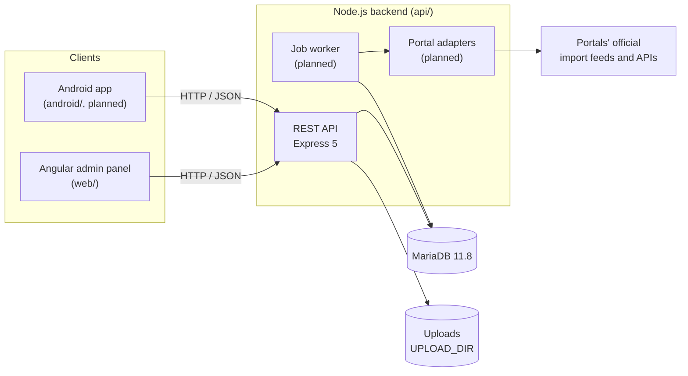
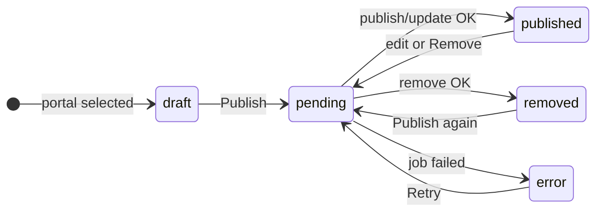
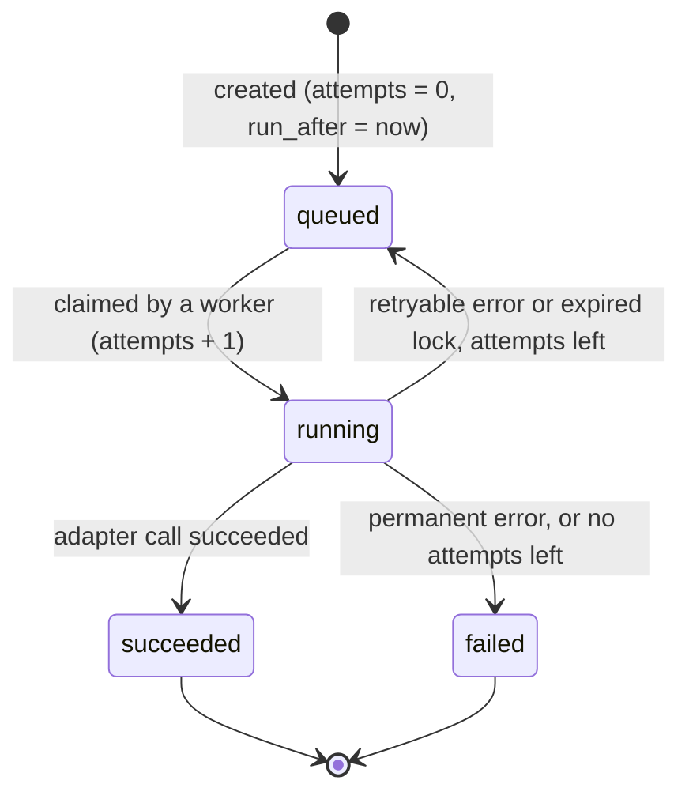

# Architecture

This document describes how ImotSync is put together and how publishing is meant to work. Parts marked **planned** are design decisions for later weeks of the [roadmap](../README.md#roadmap), not existing code.

## Components



| Component            | Responsibility                                                                                                                     | Status                              |
| -------------------- | ---------------------------------------------------------------------------------------------------------------------------------- | ----------------------------------- |
| Admin panel (`web/`) | Brokers and admins manage properties, run the pre-publish check, publish in bulk and follow the status per portal and the job log. | Shell in place, screens planned     |
| REST API (`api/`)    | Single entry point for the admin panel, the Android app and integrations: auth, properties, photos, publish requests, job log.     | Health check in place, rest planned |
| Database (MariaDB)   | Source of truth for users, properties, photos, per-portal listing state and the job queue. Schema is managed with Knex migrations. | In place                            |
| Uploads storage      | Photo files under `UPLOAD_DIR`, served read-only at `/uploads/*`. Resizing with sharp is planned.                                  | Static serving in place             |
| Job worker           | Claims due jobs from the `jobs` table, calls the matching adapter, records the outcome and schedules retries.                      | Planned (Week 2)                    |
| Portal adapters      | One module per portal: validate a property against the portal's rules and translate it into the portal's import format.            | Planned (Week 2)                    |
| Android app          | Field capture: login, camera photos, a short form, offline drafts synced to the API.                                               | Planned (Week 4)                    |

The worker lives in the same codebase as the API. Because jobs are claimed with row locks (see [Claiming jobs safely](#claiming-jobs-safely)), it can run inside the API process for a small demo or as one or more separate processes, without changes to the queue.

## Request flow: publishing a property (planned)

1. A property is created as a draft (`properties.status = 'draft'`) with its photos in `property_images`.
2. The broker selects portals. For each one the API runs that adapter's `validate()` and returns the list of problems (missing fields, too few or too large photos, description too long) without sending anything.
3. "Publish" upserts one `portal_listings` row per selected portal (unique on `property_id, portal`), sets it to `pending` and queues one `publish` job for it, in one transaction (see the rules below).
4. The worker claims the job, calls the adapter, and writes the outcome to the job (`result`, `last_error`) and to the listing (`status`, `external_id`, `published_at`, `last_error`).
5. A later change to price or photos queues `update` jobs for the portals where the listing is published. Bulk delete queues `remove` jobs.

Planned rules that keep a listing consistent:

- **One job at a time per listing, in order.** The jobs of one portal listing run one at a time, in the order they were queued: the worker starts a job only when no older job for the same listing is still `queued` (for example waiting for a retry) or `running`. So a running job is always its listing's oldest unfinished job, and an `update` never overtakes the `publish` before it.
- **Merge instead of piling up.** A change that arrives while the listing's newest unfinished job is still `queued` is merged into that job: adapters always send the property's current data, so a queued `publish` followed by a price change stays a single `publish`. A change that arrives while that job is `running` queues one new job behind it. A listing therefore has at most two unfinished jobs: the one in progress (running, or queued again to wait for a retry) and one queued behind it.
- **Queueing is serialised per listing.** Every transaction that queues or merges a job, or records a job's outcome, first locks the listing's row (`SELECT ... FROM portal_listings WHERE id = ? FOR UPDATE`) and then reads the listing's unfinished jobs with `FOR UPDATE`. Two requests for the same listing therefore never both insert a job, a merge never lands on a job a worker has just started, and a listing's job ids follow the order in which its jobs were queued, which the claim query below relies on.
- **Remove before delete.** Deleting a property row cascades to its `portal_listings` and `jobs` rows, so bulk delete first archives the property and queues `remove` jobs; the row is deleted only after every portal reports `removed`.

## Status state machines

The three status columns describe different things and change independently:

- `properties.status` (`draft`, `active`, `archived`) is the agency's own lifecycle of the property.
- `portal_listings.status` is the state of the property on one portal.
- `jobs.status` is the state of one queued operation against one portal.

### Portal listing (`portal_listings.status`)



- `draft`: the portal is selected for the property, nothing has been sent yet.
- `pending`: a `publish`, `update` or `remove` job for this listing is queued or running. "Publish" queues a `publish` job; editing a published property (price, photos, text) queues an `update` job; "Remove" or bulk delete queues a `remove` job.
- `published` / `removed`: the last job succeeded. `published_at` records when the listing was first published successfully.
- `error`: the last job failed after its final attempt, or with an error that retrying cannot fix; the reason is in `last_error`. "Retry" (or fixing the property and publishing again) queues a new job. If an `update` fails, the listing may still be live on the portal with its previous data, which `external_id` and `published_at` show.

### Job (`jobs.status`)



- `succeeded` and `failed` are final and set `finished_at`. `result` holds the outcome of the last attempt and `last_error` its error message, so the `jobs` table doubles as the job log.
- The "Retry" button on the job log (planned) does not reopen a failed job: it queues a new job for the same listing and action, so the history of the failed one stays intact.

## Retry policy (planned)

| Setting          | Plan                                                                                                                                           |
| ---------------- | ---------------------------------------------------------------------------------------------------------------------------------------------- |
| Attempts         | `max_attempts` is stored per job with a default of 5, so a single job can be given more attempts.                                              |
| Back-off         | Exponential with jitter: `delay = random(0.5, 1) * min(cap, base * 2^(attempts - 1))`, for example `base` 30 s and `cap` 1 h.                  |
| Scheduling       | On a retryable failure the job goes back to `queued` with `run_after = now + delay`; the worker only claims jobs whose `run_after` has passed. |
| Retryable errors | Network errors, timeouts, HTTP 5xx and 429 (a `Retry-After` header, if present, sets the minimum delay).                                       |
| Permanent errors | Validation errors and other 4xx responses: the job fails immediately and the listing moves to `error` with the reason.                         |

With these example values, the delays before attempts 2 to 5 are roughly 15–30 s, 30–60 s, 1–2 min and 2–4 min. Jitter spreads retries out, so many jobs that failed together (for example during a portal outage) do not all retry at the same moment.

Retries are safe to repeat because every portal receives the property's stable `ref_code`, which the portal uses to recognise an existing listing on re-import instead of creating a duplicate.

## Claiming jobs safely

Several workers (or several API instances) may poll the same table. A worker claims a job inside a short transaction:

```sql
START TRANSACTION;

-- The oldest due job whose listing has no older unfinished job.
SELECT j.id
  FROM jobs j
 WHERE j.status = 'queued'
   AND j.run_after <= UTC_TIMESTAMP()
   AND NOT EXISTS (SELECT 1
                     FROM jobs o
                    WHERE o.portal_listing_id = j.portal_listing_id
                      AND o.id < j.id
                      AND o.status IN ('queued', 'running'))
 ORDER BY j.run_after, j.id
 LIMIT 1
   FOR UPDATE SKIP LOCKED;

UPDATE jobs
   SET status = 'running',
       locked_at = UTC_TIMESTAMP(),
       locked_by = :workerId,
       attempts = attempts + 1
 WHERE id = :id;

COMMIT;
```

- `FOR UPDATE SKIP LOCKED` (MariaDB 10.6 and later) makes concurrent workers skip rows another transaction has already locked, instead of waiting or claiming the same job twice. The query uses the `(status, run_after)` index, and the `NOT EXISTS` check uses the `portal_listing_id` index.
- The `NOT EXISTS` subquery is a plain snapshot read: it takes no locks and cannot see a claim that another worker has not committed yet. That is why it does not just test for a `running` job, which would let two workers start two queued jobs of the same listing at the same moment. It asks whether any **older** job of the listing is still unfinished, and a job moving from `queued` to `running` does not change that answer, so the newer job is held back either way. This relies on the per-listing rules [above](#request-flow-publishing-a-property-planned): a listing's jobs are queued one after another, so a newer job always has a higher id.
- The claim never waits for a lock (`SKIP LOCKED`, plus a non-locking subquery), so it cannot deadlock with the transactions that lock a listing row and then its jobs.
- The adapter call happens **after** the commit, so no database lock is held during network I/O.
- `locked_by` identifies the worker (for example host name and process id) and `locked_at` when it took the job. A job still `running` long after `locked_at` (worker crashed or was restarted) is returned to `queued` by a periodic sweep, or marked `failed` if it has no attempts left.
- All `DATETIME` values are UTC, so `UTC_TIMESTAMP()` compares correctly with `run_after` and `locked_at`.

## Portal adapter interface

**Planned (Week 2).** A sketch of the common interface every portal adapter will implement:

```ts
/** Adapter key stored in portal_listings.portal, e.g. 'realistimo', 'bazar', 'demo'. */
export type PortalKey = string;

export interface ValidationIssue {
  /** Property field the issue is about, e.g. 'price', 'images', 'description'. */
  field: string;
  /** Human-readable message shown in the pre-publish check. */
  message: string;
}

export interface AdapterResult {
  /** Identifier assigned by the portal, when the portal reports one. */
  externalId?: string;
  /** Anything worth keeping in jobs.result, e.g. the portal's response summary. */
  details?: Record<string, unknown>;
}

/** Thrown by adapters; the worker uses `retryable` to decide between a retry and a failure. */
export class PortalError extends Error {
  readonly retryable: boolean;

  constructor(message: string, retryable: boolean) {
    super(message);
    this.name = 'PortalError';
    this.retryable = retryable;
  }
}

export interface PortalAdapter {
  readonly key: PortalKey;
  readonly displayName: string;

  /** Pure check against the portal's rules; no network calls. An empty array means ready. */
  validate(property: PropertyWithImages): ValidationIssue[];

  publish(property: PropertyWithImages): Promise<AdapterResult>;
  update(property: PropertyWithImages, listing: PortalListing): Promise<AdapterResult>;
  remove(listing: PortalListing): Promise<AdapterResult>;
}
```

`PropertyWithImages` and `PortalListing` are the API's own types for a property row with its ordered photos and a `portal_listings` row. Adapters receive these portal-independent types and do all mapping to the portal's format themselves, so the rest of the system never deals with portal-specific fields.

Adapters are registered in a map keyed by `PortalKey`. Because `portal_listings.portal` is a `VARCHAR`, a new adapter needs no migration.

## How portal feeds work

> **To be confirmed** against each portal's official documentation when its adapter is built. This section describes the general shapes only; it deliberately names no portal-specific fields, URLs or endpoints.

Portals offer agencies two broad kinds of official import:

- **Pull feed.** The agency publishes a feed (XML or JSON) at a URL, and the portal downloads it on its own schedule and imports the listings in it. In this model `publish` and `update` change what the next version of the feed contains, and `remove` takes the listing out of it (or marks it as removed, if the format has a way to say so). How quickly the portal picks up a change, and whether it reports import results back, depends on the portal.
- **Push import.** The agency's system sends listings to an import endpoint provided by the portal, using credentials the portal issues to the agency. Each call returns a result that the adapter records directly.

For each portal the adapter needs to settle, from the official documentation:

- the format and its required fields, and how the property's type, deal type and location map onto the portal's own lists;
- how listings are identified across imports (ImotSync supplies `ref_code` for this);
- photo rules (count, size, order) and whether photos are sent as files or referenced by URL, in which case they are served from `/uploads`;
- authentication and how a feed URL is protected;
- when a listing counts as `published`: after a successful push response, or after the portal confirms it imported the feed.

| Portal      | Import method                                     | Notes                                                                                                |
| ----------- | ------------------------------------------------- | ---------------------------------------------------------------------------------------------------- |
| Realistimo  | XML import, per Realistimo's public documentation | Planned for Week 2                                                                                   |
| Bazar.bg    | Listing import via a feed (XML or JSON)           | Planned for Week 2                                                                                   |
| Demo portal | In-process fake, no network                       | Fails a share of calls on purpose (both retryable and permanent errors) so retries and statuses show |
| imot.bg     | Official import                                   | Next adapter, not built: API access requires authorization and at least 500 active listings          |

ImotSync uses only these official import methods: no scraping and no automated logins into portal accounts. The demo never publishes to real portals.

## Cross-cutting decisions

- **Time.** Every `DATETIME` column stores UTC; conversion to local time happens in the clients.
- **Text encoding.** Every application table is created explicitly as InnoDB with `utf8mb4` / `utf8mb4_unicode_ci`, so Bulgarian (Cyrillic) titles and descriptions round-trip safely regardless of server defaults. (Knex's own bookkeeping tables, `knex_migrations` and `knex_migrations_lock`, get the server's default `utf8mb4` collation; they hold only migration names.)
- **Money.** `price` is `DECIMAL(12,2)` with a `currency` code, default `EUR` (Bulgaria's currency since 1 January 2026).
- **Errors.** The API always answers errors as `{"error":{"code":"...","message":"..."}}` and never includes stack traces when `NODE_ENV=production`.
- **Configuration.** One root `.env` file (see `.env.example`), read by Docker Compose and by the API when it runs outside Docker.
