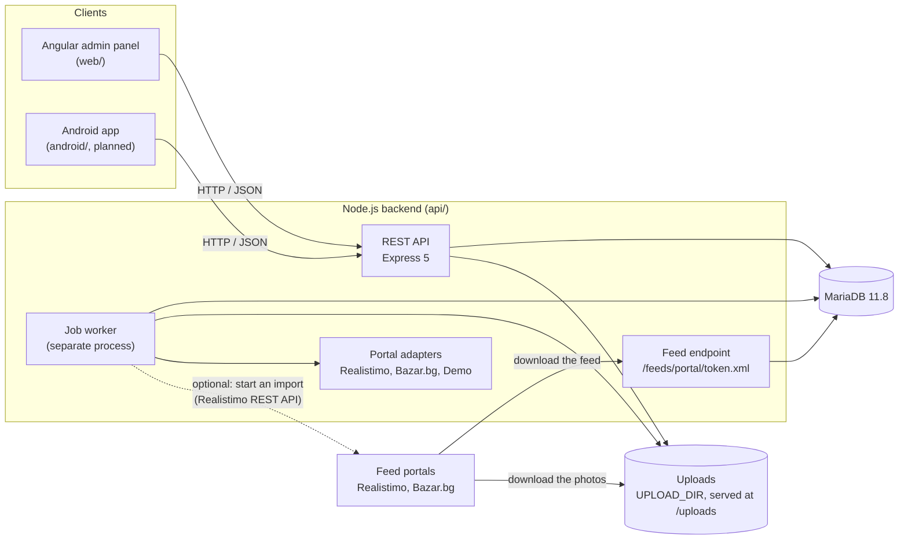
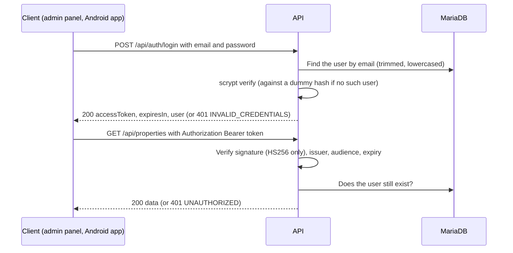
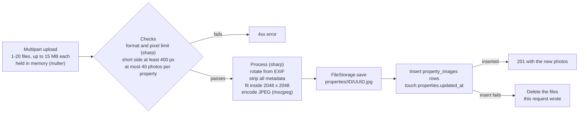
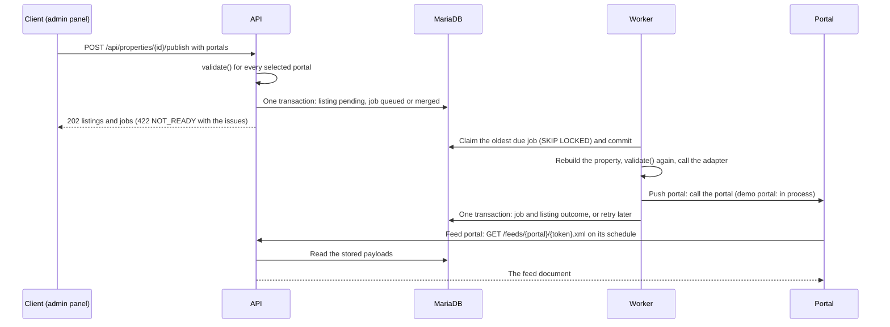
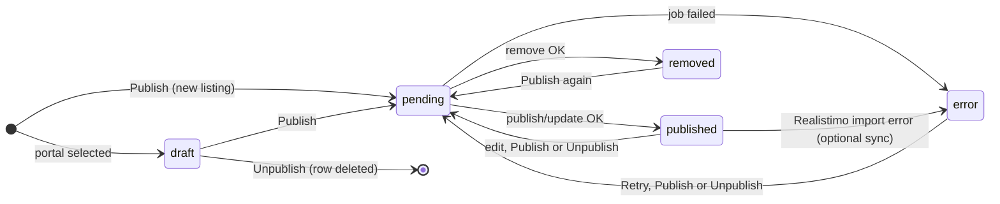
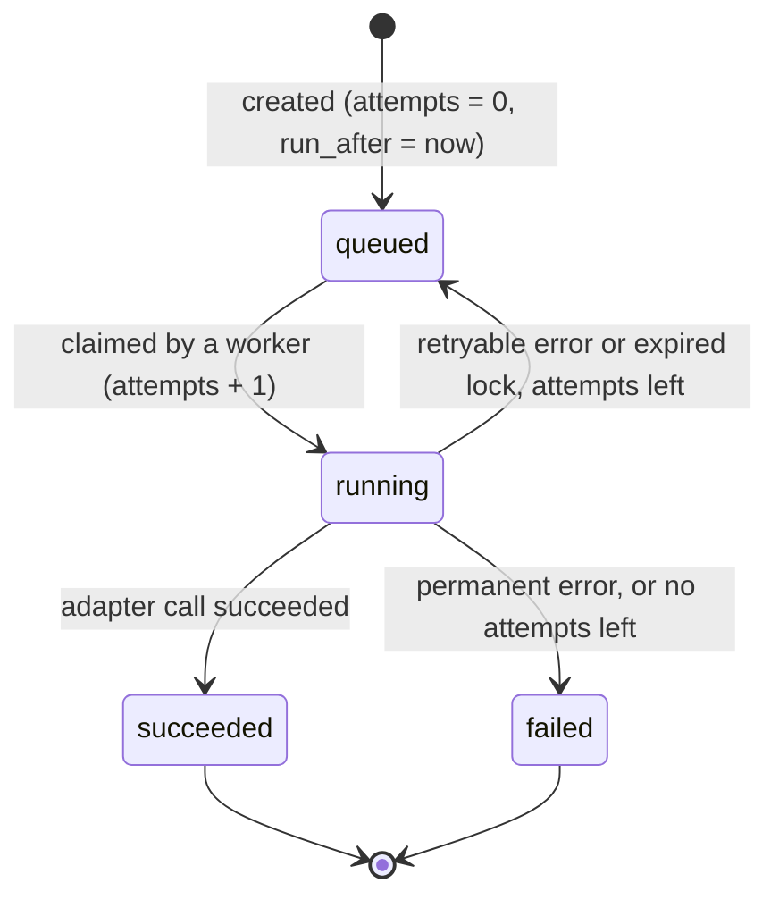

# Architecture

This document describes how ImotSync is put together and how publishing works. Parts marked **planned** are design decisions for later weeks of the [roadmap](../README.md#roadmap), not existing code. The portal-specific side (formats, field mappings, each portal's rules) is in [portals.md](portals.md).

## Components



| Component            | Responsibility                                                                                                                                                                                            | Status                                                          |
| -------------------- | --------------------------------------------------------------------------------------------------------------------------------------------------------------------------------------------------------- | --------------------------------------------------------------- |
| Admin panel (`web/`) | Brokers and admins manage properties, run the pre-publish check, publish in bulk and follow the status per portal and the job log.                                                                        | In place                                                        |
| REST API (`api/`)    | Single entry point for the admin panel, the Android app and integrations: auth, properties, photos, pre-publish checks, publish and unpublish requests, the job log.                                      | In place                                                        |
| Feed endpoint        | Serves each feed portal's feed, built from the payloads the jobs stored, at a URL protected by a token.                                                                                                   | In place                                                        |
| Database (MariaDB)   | Source of truth for users, properties, photos, per-portal listing state, the job queue and the portal sync state. Schema is managed with Knex migrations.                                                 | In place                                                        |
| Uploads storage      | Processed photo files behind a `FileStorage` interface, stored under `UPLOAD_DIR` and served read-only at `/uploads/*`.                                                                                   | Local disk in place; S3-compatible storage planned              |
| Job worker           | Claims due jobs from the `jobs` table, calls the matching adapter, records the outcome, schedules retries, finishes requested deletions, deletes unused photo files; optionally syncs Realistimo imports. | In place                                                        |
| Portal adapters      | One module per portal: validate a property against the portal's rules and translate it into the portal's import format.                                                                                   | Realistimo, Bazar.bg and Demo in place; imot.bg next, not built |
| Android app          | Field capture: login, camera photos, a short form, offline drafts synced to the API.                                                                                                                      | Planned (Week 4)                                                |

The worker lives in the same codebase as the API but runs as its own process (see [Worker process](#worker-process)). Because jobs are claimed with row locks (see [Claiming jobs safely](#claiming-jobs-safely)), one or more workers can run next to one or more API instances without changes to the queue.

## API conventions

The same API serves the admin panel, the Android app and integrations, so every endpoint follows the same rules. The endpoint list and the field rules are in the [README](../README.md#api); the complete contract is the OpenAPI document described below.

- **Code layout.** Each feature is a module under `api/src/modules/`: `auth` (login and the current user), `properties` (property CRUD and the list), `images` (a property's photos), `publishing` (pre-publish checks, publish and unpublish, the bulk actions, the portal list) and `jobs` (the job log and retry). Every module has the same five files, `<module>.router.ts`, `.validators.ts`, `.service.ts`, `.repository.ts` and `.mappers.ts`: a thin router that wires the validation chains to the service and sends the responses, express-validator chains, a service with the business rules and transactions, a repository that holds the SQL, and mappers between database rows and API objects. Helpers specific to a module sit next to them: in `auth` the token service (`tokens.ts`), `requireAuth` (`require-auth.ts`) and the login rate limit (`login-rate-limit.ts`); in `properties` the filter and sort whitelist (`list-query.ts`); in `images` the multipart upload (`photo-upload.ts`), the sharp checks and processing (`image-processing.ts`) and the storage folders of the photos (`stored-files.ts`). Shared code is in `api/src/lib/` (validation middleware, `HttpError`, password hashing, file storage in `storage.ts`, the upload concurrency limit), the OpenAPI document in `api/src/openapi/`. Publishing has two more folders: `api/src/jobs/` holds the queue (the enqueue rules, the claim, recording outcomes, back-off, the stale-lock sweep, finishing requested deletions, the photo sweep) and the worker loop, whose entry point is `api/src/worker.ts`; `api/src/portals/` holds the adapter contract (`types.ts`), the registry and one folder per portal. Everything with side effects (database, configuration, logger, file storage), and the limits tests need to change (the login rate limit, the number of concurrent uploads, the upload body deadline, the health check timeout), is passed to `createApp(deps)`, so tests can replace it.
- **JSON shape.** Bodies use camelCase while the database uses snake_case; each resource has one mapper that converts its rows, so the naming changes in exactly one place. Dates are ISO 8601 strings in UTC (ending in `Z`), `DECIMAL` columns such as `price` and `areaM2` are JSON numbers, and ids are integers.
- **Pagination.** Lists take `page` (from 1) and `pageSize` (1 to 100, default 20) and answer `{"data": [...], "meta": {"page", "pageSize", "total", "totalPages"}}`.
- **Sorting and filtering.** `sort` names one field from a fixed list, with a leading `-` for descending, and ties are broken by `id` so that pages stay stable. Sort fields and filters reach SQL only through a whitelist that maps them to known columns; user input never becomes a column name, and values are always bound parameters. Enum filters take comma-separated lists. The text search `q` uses `LIKE` on the reference code, title, city and district, with the `LIKE` wildcards in the input escaped so they match literally. With the `utf8mb4_unicode_ci` collation, the search and the `city` filter are case-insensitive for Cyrillic as well as Latin text.
- **No N+1 queries.** A list page loads its properties, then the photos and the portal listings of all of them in batched queries, instead of one query per property.
- **Validation.** Every route validates its path, query and body with express-validator chains, and one shared middleware turns the results into `400 VALIDATION_ERROR` with `details: [{"field", "message"}]`. Bodies are checked exactly: an unknown field is an error, so a typo is reported instead of silently ignored. Text is trimmed and an empty optional text becomes `null`. (zod validates only the environment configuration.)
- **Errors.** Handlers throw an `HttpError` (or let an unexpected error escape), and the central error handler answers `{"error": {"code", "message", "details"?}}`. Unexpected errors become `500 INTERNAL_ERROR`; their details are logged, and with `NODE_ENV=production` they never reach the client.
- **Status codes.** `201` with a `Location` header for a created property, `204` without a body for deletes (`202` when a property's deletion is scheduled), `401` with `WWW-Authenticate: Bearer` when the token is missing or invalid. The full list of codes is in the [README](../README.md#errors).
- **OpenAPI as the contract.** The OpenAPI 3.1 document is written in TypeScript in `api/src/openapi/`, with reusable schemas for every request and response body, the error envelope and the pagination meta. It is served at `/api/openapi.json` and in Swagger UI at `/api/docs`, which keeps the token across page reloads. Helmet's Content Security Policy is relaxed only for `/api/docs`, as far as Swagger UI needs; every other response keeps the strict default. Tests keep the document honest: it must validate as OpenAPI, every route the app registers must be documented and every documented operation must exist, and the integration tests check real response bodies against the documented schemas. A copy is committed as `api/openapi.json` (`npm run openapi:export`; a unit test fails while it is stale), and the admin panel generates its TypeScript types from that copy, so a contract change becomes a type error in `web/` too.

## Authentication



- **Stateless JWT.** There is no session table: the token carries what the API needs, so any API instance can check it without a lookup in shared state. Tokens are signed with HS256 and `JWT_SECRET` using the [`jose`](https://github.com/panva/jose) library and carry these claims:

  | Claim        | Value                                                                   |
  | ------------ | ----------------------------------------------------------------------- |
  | `sub`        | The user's id, as a string                                              |
  | `role`       | `admin` or `broker`                                                     |
  | `iss`        | `imotsync`                                                              |
  | `aud`        | `imotsync-api`                                                          |
  | `iat`, `exp` | Issue time and expiry: `iat` + `JWT_TTL_SECONDS` (default 28800 s, 8 h) |

- **Strict verification.** Verification pins the algorithm to HS256, so a token with `alg: none` or any other algorithm is refused, and requires the issuer, the audience and an unexpired `exp`. `requireAuth` then checks that the user still exists, so deleting a user shuts them out at once rather than when the token expires. Any failure is `401 UNAUTHORIZED` with a `WWW-Authenticate: Bearer` header. `requireRole('admin')` answers `403 FORBIDDEN`; it is ready for admin-only endpoints, none of which exist yet.
- **Why a Bearer header for both clients.** The browser-based admin panel and the native Android app call the same API. A token in the `Authorization` header works identically for both (and for scripts and `api/requests.http`), whereas cookies belong to the browser. Because the browser never attaches the header on its own, cross-site request forgery does not apply. The trade-off is that a token held by the admin panel is readable by its JavaScript, so it relies on XSS defences (Angular's template escaping, Helmet's Content Security Policy) and on the short lifetime. The admin panel keeps the token in `localStorage` with its expiry, so a new tab stays signed in for the token's lifetime; it drops it on sign-out, at expiry and on any `401`, which sends the user to the login page and back to where they were (`web/src/app/core/auth/`). `sessionStorage` would end the session with every tab, and memory alone with every reload, for no gain against XSS: script that runs in the page can use the token wherever it is kept.
- **Lifetime and revocation.** A token lives 8 hours by default (`JWT_TTL_SECONDS`), about one working day. There is no refresh token yet, so the client logs in again when the token expires. A single stateless token cannot be revoked before it expires; deleting the user stops it through the existence check, and changing `JWT_SECRET` ends every session at once.
- **A login that reveals nothing.** The email is trimmed and lowercased before the lookup. An unknown email and a wrong password get the same `401 INVALID_CREDENTIALS`, and for an unknown email the API still runs a scrypt verification against a fixed dummy hash, so both answers take about as long and the timing does not give away which emails have accounts. Passwords are stored as scrypt hashes in PHC format with the OWASP-recommended parameters and compared in constant time (`api/src/lib/password.ts`).
- **Rate limiting.** `POST /api/auth/login` is limited with express-rate-limit to 10 attempts per 15 minutes per IP address; over the limit the API answers `429 TOO_MANY_REQUESTS` in the usual error format, with the standard `RateLimit` headers. Tests inject their own limits through `createApp(deps)`. Behind a reverse proxy every request would seem to come from the proxy's address, so `TRUST_PROXY` (Express' `trust proxy`) names the hops whose `X-Forwarded-For` entries the API believes: the number of proxies in front of the API (usually `1`), or a comma-separated list of the proxies' addresses, subnets or presets (`loopback`, `linklocal`, `uniquelocal`, `10.0.0.0/8`, ...). Express then takes as the client's address the entry that the outermost trusted proxy appended, which the client cannot forge. It stays `false` (the default) when clients reach the API directly, because they could otherwise forge that header to dodge the limit. A hop count must equal the number of proxies exactly (one more and the API believes an entry the client wrote) and assumes the API's port is reachable only through them. `true` is never appropriate: it trusts every hop, so the client-written left-most entry becomes the address and every attempt can claim a new one. The configuration check therefore refuses it when `NODE_ENV=production`, and the API does not start; in development and tests it is accepted, and express-rate-limit warns with `ERR_ERL_PERMISSIVE_TRUST_PROXY`. The README's [Behind a reverse proxy](../README.md#behind-a-reverse-proxy) has the details. With express-rate-limit's default in-memory store, each API process counts on its own; several instances would need a shared store.

## Photo pipeline



- **The content decides, not the client.** multer keeps the uploaded files in memory within fixed limits (15 MB per file, 20 files per request, no other form fields), so nothing unprocessed is ever written to disk. A file over 15 MB gets `413 PAYLOAD_TOO_LARGE`; more files, or any other field, get `400 VALIDATION_ERROR`. The whole body may be at most 301 MB (20 files of 15 MB plus 1 MB for the multipart framing): a larger declared `Content-Length` gets `413 PAYLOAD_TOO_LARGE` before the body is read, and a body without a declared length is cut off at that size by closing the connection. Since one upload can hold about 300 MB in memory, each API process handles at most 2 uploads at a time (`api/src/lib/concurrency-limit.ts`); a further one gets `429 TOO_MANY_REQUESTS` with `Retry-After` before its body is read. The body also has a deadline of 60 seconds, so a client that sends slowly or stops sending cannot hold an upload slot for long: it gets `408 REQUEST_TIMEOUT`, the connection is closed, and the slot is free again. The declared MIME type and the file extension are ignored: sharp reads the actual bytes, and only JPEG, PNG, WebP and AVIF pass. Anything else (GIF, SVG, TIFF, HEIC, a PDF, a text file renamed to `.jpg`) and any damaged file get `415 UNSUPPORTED_MEDIA_TYPE` naming the file.
- **Decompression bombs.** Before anything is decoded, the dimensions in the image header are checked against a limit of 50 megapixels, and sharp's `limitInputPixels` enforces the same limit while decoding. An image over it gets `400 VALIDATION_ERROR`, so a small file that claims enormous dimensions cannot exhaust the server's memory.
- **Minimum size.** A photo below 400 px on its short side is too small for a listing and gets `400 VALIDATION_ERROR`.
- **Processing.** `rotate()` applies the EXIF orientation to the pixels, so the photo stays upright once the orientation tag is gone. The output keeps no metadata at all: no EXIF (which on phone photos includes the GPS position and the device model), no XMP and no IPTC. The image is resized to fit inside 2048 × 2048 px without enlarging smaller ones and encoded as JPEG with mozjpeg at quality 82: a single, widely supported output format, so the portal adapters never need to convert photos.
- **Storage behind an interface.** `FileStorage` (`api/src/lib/storage.ts`) addresses files by a key such as `properties/12/<UUID>.jpg` and has six operations, all of which a new implementation must provide:

  | Operation              | Purpose                                                                                                           |
  | ---------------------- | ----------------------------------------------------------------------------------------------------------------- |
  | `save(key, data)`      | Writes a file, creating folders as needed                                                                         |
  | `delete(key)`          | Removes one file; a file that is already gone is not an error                                                     |
  | `deletePrefix(prefix)` | Removes everything under a folder key, such as `properties/12` once the property and its files are gone           |
  | `list(prefix)`         | Every file under a folder key with its modification time, for the worker's photo sweep                            |
  | `publicUrl(key)`       | The URL stored in `property_images.url`, from which clients and portals download the file                         |
  | `keyFromUrl(url)`      | Maps a stored URL back to its key, or `null` for a URL that does not point into this storage (nothing is deleted) |

  `LocalFileStorage` writes under `UPLOAD_DIR`, which Express serves at `/uploads`; an S3-compatible implementation can replace it later without changes to the routes. Files are stored as `properties/<propertyId>/<random UUID>.jpg`, so names are never derived from the client's file name and cannot be guessed from each other. Each `property_images` row records the public URL and the stored file's real `width`, `height` and `size_bytes`.

- **Path containment.** Deleting resolves the file path strictly inside `UPLOAD_DIR` and refuses anything that would escape it (for example through `..` segments), so even a corrupted URL in the database cannot remove other files. The seeded photos under `/uploads/demo/` belong to the seed, which replaces that folder on every run; deleting a seeded photo deletes its row only.
- **Files and rows stay consistent.** An upload writes the files first and then inserts the rows; if the insert fails, the files the request wrote are deleted again. Deleting a photo or a property removes the database rows (and queues the update jobs) but never the files: a feed portal may still be served a stored entry that links to them, until an update job replaces it, or for good when that job fails (for example because the last photo was deleted), and a broken image link can get the listing rejected. The files are deleted by the worker's photo sweep (`api/src/jobs/photo-gc.ts`, part of its [housekeeping](#worker-process)): at its first run and then hourly it deletes every file under `UPLOAD_DIR/properties/` that no `property_images` row and no `portal_listings.payload` refers to and that is older than one hour (an upload saves its files before their rows), and removes the folder of a property that no longer exists once it is empty. A file it cannot delete is logged and tried again at the next sweep, so the worst case is an orphaned file for a while, never a row or a feed entry that points at a missing one.
- **Order.** New photos go after the current highest `sort_order`. `PUT /api/properties/{id}/images/order` must list exactly the property's photo ids, with none missing, foreign or repeated, and rewrites `sort_order` as 0 to n-1 in one transaction. The first photo is the property's cover (`coverImageUrl` in the list). Every photo change updates `properties.updated_at`.
- **Public by design.** `/uploads` needs no token, because portals download the photos by URL. It is served read-only, without directory listings, and with `Cross-Origin-Resource-Policy: cross-origin` so that pages on other origins may show the photos.

## Publishing pipeline

Publishing is asynchronous. The API checks a property against each selected portal's rules and queues jobs in the database; the worker, a separate process, claims the jobs, calls the portal adapters and records the outcome. Feed portals then download their feeds from the API on their own schedule.



### Request flow: publishing a property

1. **Pre-publish check.** `GET /api/properties/{id}/checks?portals=a,b` (default: every portal) runs each adapter's `validate()` against the property's current data and answers `ready` and the `issues` (`field`, `message`) per portal. It changes nothing.
2. **Publish.** `POST /api/properties/{id}/publish` with `{"portals": [...]}` runs `validate()` for every selected portal first. If any portal reports an issue, the answer is `422 NOT_READY` with `details: [{"portal", "field", "message"}]` and nothing is queued; an archived property gets `409 CONFLICT`. Otherwise, in one transaction, a `draft` property becomes `active` and each portal gets a job according to its listing (one `portal_listings` row per property and portal):

   | Listing on that portal                                 | What happens                                                                                                     |
   | ------------------------------------------------------ | ---------------------------------------------------------------------------------------------------------------- |
   | None yet                                               | The listing is created and gets a `publish` job                                                                  |
   | `draft`, `removed`, or `error` while not on the portal | A `publish` job                                                                                                  |
   | `published`, or `error` while still on the portal      | An `update` job                                                                                                  |
   | `pending`                                              | Merged into its waiting job, or queued behind it, under the [rules below](#rules-that-keep-a-listing-consistent) |

   Every listing that gets a job moves to `pending`. The answer is `202` with the listings and jobs: `{"data": {"listings": [...], "jobs": [...]}}`.

3. **The worker runs the job.** It rebuilds the portal-independent `PortalProperty` from the current data (photos as absolute URLs under `PUBLIC_BASE_URL`, the broker from the property's creator). For `publish` and `update` it checks the property again: one that was archived in the meantime fails the job permanently with `The property is archived` (code `ARCHIVED`), like the API refuses to publish it, and `validate()` runs again, so an issue found now (the property changed after it was queued) fails the job permanently with `Validation failed: <field>: <message>; ...`. A `remove` is never validated, so a property that no longer meets a portal's rules can still be taken off it. Whether a `publish` or `update` job creates the listing or updates it is decided from the listing, not from the action it was queued with: a listing that is on the portal is updated, any other is published (the job log then shows the call that was made). Then it calls the adapter with an `AbortSignal` that fires after `JOB_TIMEOUT_SECONDS` and [records the outcome](#recording-the-outcome).
4. **Edits queue updates.** A `PATCH /api/properties/{id}` that really changes something, and every photo upload, reorder or deletion, queue an `update` job for each listing that is on its portal (`published`, or in `error` while still online, for example after a failed update or an import error reported by the portal), in the same transaction as the change; a `pending` listing gets the update through the merge rules (it is dropped when the listing is being removed). A listing in `error` because its removal failed is left alone: it was meant to go, and an update would put it back online and hide that failure. This is wider than "published only" on purpose: a broker who fixes the problem a portal reported must reach the listing. The adapters always send the current data, so one job covers any number of edits.
5. **Unpublish.** `POST /api/properties/{id}/unpublish` with `{"portals": [...]}` (default: every portal) queues a `remove` job, through the same rules, for every listing that is `pending` or on its portal. A listing that never went out gets no job: a `draft` listing is deleted, and one in `error` after a first publish that never went through (never published, no stored payload) becomes `removed` at once, keeping its job history. A `removed` listing with nothing pending is left as it is. It answers `202` like publish.
6. **Bulk actions.** `POST /api/properties/bulk/publish` takes 1 to 100 property ids and the portals. Each property goes through the same steps as a single publish, in its own transaction; a property with issues, an archived one and an unknown id are reported with `ok: false` and the `error` (`code`, `message`, plus the `issues` for `NOT_READY`) and skipped, without stopping the others (`200` with one result per property). Any other error (a lost database connection, for example) is logged and reported for its property as `INTERNAL_ERROR`, and the others still go ahead, so the answer always says which properties went through. `POST /api/properties/bulk/delete` is described under [Deleting a property](#deleting-a-property).

The pre-publish check, the publish request and the worker all build the same `PortalProperty` (`api/src/portals/property-loader.ts`), so they judge the same data.

A listing is **on the portal** when its last successful job left it there: it has been published (`published_at` is set) and not removed since (`removed_at` is empty). That covers a `published` listing and also one in `error` after a failed `update` or `remove`, which leaves the earlier version online. Such a listing gets an `update` rather than a `publish`, and it has to be removed before its property can be deleted.

### Rules that keep a listing consistent

- **One job at a time per listing, in order.** The jobs of one portal listing run one at a time, in the order they were queued: the worker starts a job only when no older job for the same listing is still `queued` (for example waiting for a retry) or `running`. So a running job is always its listing's oldest unfinished job, and an `update` never overtakes the `publish` before it.
- **Merge instead of piling up.** Adapters always send the property's current data, so a job that has not started yet already carries every later change. A request is therefore merged into the listing's newest unfinished job where that job will do the work, and queued behind it only where it will not:

  | Newest unfinished job      | Publish                                                           | Update (an edit)                                           | Remove                                                                           |
  | -------------------------- | ----------------------------------------------------------------- | ---------------------------------------------------------- | -------------------------------------------------------------------------------- |
  | None                       | New `publish` (`update` if the listing is on the portal)          | New `update` if the listing is on the portal, else nothing | New `remove` if the listing is on the portal, else nothing (see unpublish above) |
  | Queued `publish`           | Merged                                                            | Merged                                                     | Replaces it if it never ran, otherwise queued behind it                          |
  | Queued `update`            | Turns it into a `publish` (publish and update merge into publish) | Merged                                                     | Replaces it if it never ran, otherwise queued behind it                          |
  | Queued `remove`            | Replaces it if it never ran, otherwise a `publish` behind it      | Dropped                                                    | Merged                                                                           |
  | Running `publish`/`update` | Merged (the running job already sends the current data)           | Queued behind it                                           | Queued behind it                                                                 |
  | Running `remove`           | A `publish` queued behind it                                      | Dropped                                                    | Merged                                                                           |

  A job "never ran" when it is queued with no attempts; one that waits for a retry may already have reached the portal, so a removal must come after it. A listing therefore has at most two unfinished jobs: the one in progress (running, or queued again to wait for a retry) and one queued behind it. Queueing, merging or replacing moves the listing to `pending`.

- **Queueing is serialised per listing.** Every transaction that queues or merges a job, or records a job's outcome, first locks the listing's row (`SELECT ... FROM portal_listings WHERE id = ? FOR UPDATE`) and then reads the listing's unfinished jobs with `FOR UPDATE`. Two requests for the same listing therefore never both insert a job, a merge never lands on a job a worker has just started, and a listing's job ids follow the order in which its jobs were queued, which the claim query below relies on.
- **One lock order.** Every transaction that locks more than one of these rows takes them in the same order: the property, then its listings (by portal and id), then their jobs, then `portal_sync_state`. The API's writers (publish, unpublish, bulk actions, edits, photo changes, `DELETE /api/properties/{id}`, and retry, which reads the listing's property id first and then locks the property and the listing) and the worker's deletion of a property all follow it, so two transactions never wait for each other in a cycle; recording an outcome locks only the listing and its jobs.
- **Transactions that survive contention.** These transactions run at `READ COMMITTED`, so they take no gap locks (under `REPEATABLE READ`, two requests creating jobs for two new listings could lock the same index gap and deadlock), and one that InnoDB still rolls back for a deadlock or a lock wait timeout is run again, up to three more times (`api/src/jobs/transaction.ts`). Correctness does not depend on the isolation level: the rows that decide anything are read with `FOR UPDATE` after the listing is locked.

### Recording the outcome

The worker records each attempt in one transaction that locks the listing row first, like queueing does:

| Outcome                                     | Job                                                                                                                                                    | Listing                                                                                                                                                                                                                                                                 |
| ------------------------------------------- | ------------------------------------------------------------------------------------------------------------------------------------------------------ | ----------------------------------------------------------------------------------------------------------------------------------------------------------------------------------------------------------------------------------------------------------------------- |
| Success                                     | `succeeded`, `finished_at`, `result` = `{message, externalId?, details?}`                                                                              | `published` (`removed` after a `remove`, which sets `removed_at`; a publish or update clears it); `external_id` when the adapter returns one; `published_at` on the first successful publish; for feed portals `payload` and `payload_updated_at`; `last_error` cleared |
| Retryable error, attempts left              | Back to `queued` with `run_after` = now + [back-off](#retry-policy), `last_error`, `result` = `{error, retryable, httpStatus?, code?, retryInSeconds}` | Stays `pending`                                                                                                                                                                                                                                                         |
| Permanent error, or the last attempt failed | `failed`, `finished_at`, `last_error`, `result` = `{error, retryable, httpStatus?, code?, errorId?}`                                                   | `error`, with the reason in `last_error` (`Gave up after <n> attempts: ...` when retryable errors used up the attempts)                                                                                                                                                 |

In every case the job's lock (`locked_at`, `locked_by`) is released. If a newer job of the same listing is still unfinished, the listing stays `pending` whatever the outcome, because that job will decide its next state; this holds for a job the stale-lock sweep fails too. A worker records an outcome only for a job it still holds: if the [stale-lock sweep](#claiming-jobs-safely) has meanwhile handed the job on, the late result is dropped (and logged), so two workers never both write one attempt. After every final outcome (succeeded or failed) the worker checks whether the job's property is waiting to be deleted and [finishes that deletion](#deleting-a-property) when nothing blocks it any more.

### Feed portals and stored payloads

An adapter has a `mode` ([interface below](#portal-adapter-interface)):

- **`push`**: the adapter calls the portal during the job and returns what the portal answered (`externalId`, a message). The demo portal is a push adapter.
- **`feed`**: the portal downloads a feed from ImotSync. `publish` and `update` return the listing's entry in the portal's format (the `payload`, a JSON object) and the worker stores it in `portal_listings.payload` with `payload_updated_at`. `remove` returns what the feed keeps of a removed listing: Bazar.bg keeps the entry and serves it as `out_of_stock`, while Realistimo, which takes down any offer missing from its feed, returns `null` (the offer is left out); for a listing that never reached the feed there is nothing to keep (`null`). The worker stores whatever a feed adapter's `remove` returns, `null` included, with a new `payload_updated_at`, so a removal always moves the feed's change date (Realistimo's `updated`, the `Last-Modified` header) even though nothing of it is rendered. Realistimo and Bazar.bg are feed adapters, each built with `createFeedAdapter` (`api/src/portals/feed-adapter.ts`) from a spec of pure functions that compute the payload and the removal; the helper adds what every feed adapter shares (promise wrapping, abort check, a defensive validation that fails like the worker's).

`GET /feeds/{portal}/{token}.xml` reads every listing of the portal that has a stored payload and hands them as `FeedItem`s to the portal's `FeedRenderer`, a pure function from items to the feed document. An item's status comes from the last **successful** job, not from the listing's current status: it is `removed` when `removed_at` is set and `published` otherwise. A listing whose update is `pending`, or failed (`error`), is still online with its previous data, so it stays in the feed with its last good payload; dropping it would make the portal take the listing down. The renderer decides what to serve: Realistimo lists `published` items only, Bazar.bg also lists `removed` ones for `BAZAR_REMOVED_RETENTION_DAYS` after the removal.

Storing the payload, rather than rendering the feed from the properties on each request, means:

- the feed shows exactly what the last successful job produced, so an edit reaches a portal only through a job whose `validate()` passed, and the job log matches what the portal downloads;
- a feed request is one query over the stored payloads (joined only to `properties` for the reference code), without photos, users or any adapter logic;
- the renderers are pure functions, tested by parsing their output back.

For a feed portal, `published` therefore means "in the feed": the portal picks the change up at its next download. Realistimo can report import results back through its REST API ([below](#realistimo-import-sync)).

The feed endpoint is public (outside `/api`, no login), because portals download it without credentials and neither portal documents a way to authenticate the request. The path carries `FEED_TOKEN`, compared in constant time; an unknown portal, a push portal and a wrong token all get the same plain-text `404`, and the token is replaced by `***` in the request log (also for a request target in absolute form, `GET http://host/feeds/...`). Responses are XML with `charset=utf-8`, `Cache-Control: no-cache`, an `ETag` and a `Last-Modified` header, and a request with a matching `If-None-Match` or `If-Modified-Since` gets `304 Not Modified`. The feed's last change (`FeedRenderContext.lastChangedAt`, used for `Last-Modified` and Realistimo's `updated`) is the newest `payload_updated_at` of every listing of the portal, published and removed, or the portal's `portal_sync_state.feed_changed_at`, whichever is later: deleting a property deletes its listing rows, so the transaction that deletes it keeps the newest change date of those rows there first (the time of deletion for a row whose payload was still live), and the date never falls back. `GET /api/portals` returns every portal's key, display name, mode and feed URL (`PUBLIC_BASE_URL/feeds/<key>/<FEED_TOKEN>.xml`, `null` for push portals).

Each API process keeps the last rendered document of every feed, keyed by the feed's version: its last change, its number of items and a checksum of the change dates, read with one small aggregate query (`feedVersion` in `api/src/portals/feed-items.ts`). A request whose version matches is answered from that copy, with its `ETag` and `Last-Modified`, so repeated and conditional (`304`) requests neither load the payloads nor build and hash the XML again. A copy is not reused once it is older than a minute, because some output depends on the time alone (a removed Bazar.bg item dropping out after its retention period, Realistimo's `updated` moving to the current day), nor while its last change is less than five seconds old, because `payload_updated_at` has whole seconds and a second change within the same second would leave the version as it was.

### Deleting a property

Deleting a property row cascades to its `portal_listings` and `jobs` rows, so a property that is on a portal has to be taken off first. A listing row is also what a feed serves, so a removal that a feed still serves must outlive the property for a while: Bazar.bg downloads its feed only every 6 to 24 hours, archives an item that it sees as `out_of_stock`, and stops the whole import when the feed suddenly shrinks by more than 30%. An item that vanished together with its property could therefore stay live on Bazar.bg, and a bulk delete could stop the import. Such a removed listing whose stored payload the feed still serves (a "tombstone", within `BAZAR_REMOVED_RETENTION_DAYS` of the removal; `PortalRegistration.removedRetentionDays` in the registry; the feed renderer and these deletion rules both decide with `isRemovalStillServed` in `api/src/portals/removal-retention.ts`) keeps its property:

- **`DELETE /api/properties/{id}`** answers `409 CONFLICT` while any listing of the property is `pending` or on its portal (`published`, or `error` after a failed update or remove); the message names those listings and points to unpublish or bulk delete. When nothing is online but a tombstone is within its retention period, the property is archived and `properties.delete_requested_at` is set instead, and the answer is `202` with `{"data": {"result": "deletion_scheduled"}}`. Otherwise the property is deleted (`204`).
- **`POST /api/properties/bulk/delete`** takes 1 to 100 property ids and answers per property, one transaction each. A property none of whose listings is `pending` or on its portal, and without a tombstone, is deleted at once (`deleted`). One with such listings is archived, `delete_requested_at` is set and `remove` jobs are queued (`removal_queued`); one with only tombstones is archived and marked the same way, without jobs (`deletion_scheduled`). Unknown ids are `not_found`; an unexpected error is logged and reported for its property (`error`, with `INTERNAL_ERROR`), and the others go ahead.
- **The worker finishes the delete.** It deletes a property (the foreign keys cascade to its photos, listings and jobs) only while all of this holds: the property is still `archived` and `delete_requested_at` is set, it has no queued or running job, none of its listings is `pending` or on its portal (so a failed removal of a listing that is still online holds the delete back), and none is a tombstone within its retention period. It checks after every final job outcome, a failure included (a removal that failed for a listing that never reached the portal leaves nothing online), and its housekeeping checks every minute, so a delete whose last job failed, whose check threw, or whose tombstone has passed its retention period is completed later. The photo files are left to the [photo sweep](#photo-pipeline).
- **Cancelling.** Setting the property's status back to `active` or `draft` (`PATCH`) clears `delete_requested_at` in the same transaction, which cancels the deletion: the worker never deletes a property that has left `archived`, and a later removal cannot bring the old request back. Publishing a property that is waiting to be deleted is refused with `409`, which says so.

`PortalAdapter.remove()` receives the property as `null` when it is already gone, so a removal never depends on data that may have been deleted.

## Status state machines

The three status columns describe different things and change independently:

- `properties.status` (`draft`, `active`, `archived`) is the agency's own lifecycle of the property. Publishing makes a draft `active`; bulk delete (and `DELETE` of a property whose removal a feed still serves) archives a property that is waiting to be deleted, and setting it back to `active` or `draft` cancels that deletion.
- `portal_listings.status` is the state of the property on one portal.
- `jobs.status` is the state of one queued operation against one portal.

### Portal listing (`portal_listings.status`)



- `draft`: the portal is selected for the property, nothing has been sent yet.
- `pending`: a `publish`, `update` or `remove` job for this listing is queued or running.
- `published` / `removed`: the last job succeeded. `published_at` records when the listing was first published successfully and `removed_at` when it was removed. For a feed portal, `published` means the listing is in the feed.
- `error`: the last job failed after its final attempt, or with an error that retrying cannot fix; the reason is in `last_error`. With the optional [Realistimo import sync](#realistimo-import-sync), a Realistimo listing also moves here when Realistimo's import reports errors for its offer (`last_error` starts `Realistimo import:`). Retrying the job, or fixing the property and publishing again, queues a new job. If an `update` fails, the listing may still be live on the portal with its previous data, which is why such a listing gets an `update` (not a `publish`) and why unpublish removes it.

### Job (`jobs.status`)



- `succeeded` and `failed` are final and set `finished_at`. `result` holds the outcome of the last attempt and `last_error` its error message, so the `jobs` table doubles as the job log: `GET /api/jobs` lists it with filters (`status`, `portal`, `action`, `propertyId`), and `GET /api/jobs/{id}` returns one job with its listing and property.
- **Retry** (`POST /api/jobs/{id}/retry`) does not reopen a failed job: it queues a new job for the same listing and action, so the history of the failed one stays intact. Only a `failed` job that is its listing's newest job, while nothing else is queued or running for the listing, can be retried; anything else gets `409 CONFLICT`, and so does retrying a `publish` or `update` of an archived property or a job of a portal this deployment has no adapter for. Retry locks the property, then the listing, like every other writer, so it cannot race a `DELETE` of the property. The listing moves to `pending` and the answer is `202` with the new job.

## Retry policy

| Setting          | Value                                                                                                                                                                                                                                                                                                                                                                                                                                                                                                                                                                                                                                                                                                 |
| ---------------- | ----------------------------------------------------------------------------------------------------------------------------------------------------------------------------------------------------------------------------------------------------------------------------------------------------------------------------------------------------------------------------------------------------------------------------------------------------------------------------------------------------------------------------------------------------------------------------------------------------------------------------------------------------------------------------------------------------- |
| Attempts         | `max_attempts` is stored per job, default 5, so a single job can be given more attempts.                                                                                                                                                                                                                                                                                                                                                                                                                                                                                                                                                                                                              |
| Back-off         | Exponential with jitter: `delay = random(0.5, 1) * min(RETRY_CAP_SECONDS, RETRY_BASE_SECONDS * 2^(attempts - 1))`, by default with a base of 30 s and a cap of 1 h, and never shorter than the adapter's `retryAfterMs` (`api/src/jobs/backoff.ts`).                                                                                                                                                                                                                                                                                                                                                                                                                                                  |
| Settings         | `RETRY_BASE_SECONDS` (default 30) and `RETRY_CAP_SECONDS` (default 3600) from the configuration; the API and the worker refuse to start when the cap is below the base.                                                                                                                                                                                                                                                                                                                                                                                                                                                                                                                               |
| Scheduling       | On a retryable failure the job goes back to `queued` with `run_after = now + delay`; the worker only claims jobs whose `run_after` has passed.                                                                                                                                                                                                                                                                                                                                                                                                                                                                                                                                                        |
| Time budget      | Each adapter call gets an `AbortSignal` that fires after `JOB_TIMEOUT_SECONDS` (default 60, at most 3600). The worker also stops waiting at that moment, so an adapter that ignores the signal cannot hold a slot.                                                                                                                                                                                                                                                                                                                                                                                                                                                                                    |
| Retryable errors | A `PortalError` with `retryable: true` (network errors, timeouts, HTTP 5xx, HTTP 429 with its `Retry-After` as `retryAfterMs`), a call that runs out of its time budget (`code` `TIMEOUT`) or is cut short by a shutdown (`SHUTDOWN`), an expired lock (`LOCK_EXPIRED`), and any unexpected exception (`UNEXPECTED`), since a bug or an outage may be temporary. An unexpected exception is stored only as `Unexpected error while processing the job (see worker logs). Error id: <id>`, with the same `errorId` in `result`: its message may hold SQL, server details or file paths, which every logged-in user could read in the job log, so the details go to the worker log only, under that id. |
| Permanent errors | A `PortalError` with `retryable: false` (a portal that rejects the listing, invalid credentials), validation issues found by the worker (`VALIDATION`, recorded as `Validation failed: <field>: <message>; ...`) and a property archived after its job was queued (`ARCHIVED`): the job fails at once and the listing moves to `error` with the reason.                                                                                                                                                                                                                                                                                                                                               |

With the default values, the delays before attempts 2 to 5 are roughly 15–30 s, 30–60 s, 1–2 min and 2–4 min. Jitter spreads retries out, so many jobs that failed together (for example during a portal outage) do not all retry at the same moment.

Retries are safe to repeat because every portal receives the property's stable `ref_code`, which the portal uses to recognise an existing listing on re-import instead of creating a duplicate.

## Claiming jobs safely

Several workers may poll the same table. A worker claims a job inside a short transaction:

```sql
START TRANSACTION;

-- The oldest due job whose listing has no older unfinished job.
SELECT j.id
  FROM jobs j
 WHERE j.status = 'queued'
   AND j.run_after <= UTC_TIMESTAMP()
   AND NOT EXISTS (SELECT 1
                     FROM jobs o
                    WHERE o.portal_listing_id = j.portal_listing_id
                      AND o.id < j.id
                      AND o.status IN ('queued', 'running'))
 ORDER BY j.run_after, j.id
 LIMIT 1
   FOR UPDATE SKIP LOCKED;

UPDATE jobs
   SET status = 'running',
       locked_at = UTC_TIMESTAMP(),
       locked_by = :workerId,
       attempts = attempts + 1
 WHERE id = :id;

COMMIT;
```

- `FOR UPDATE SKIP LOCKED` (MariaDB 10.6 and later) makes concurrent workers skip rows another transaction has already locked, instead of waiting or claiming the same job twice. The query uses the `(status, run_after)` index, and the `NOT EXISTS` check uses the `portal_listing_id` index.
- The `NOT EXISTS` subquery is a plain snapshot read: it takes no locks and cannot see a claim that another worker has not committed yet. That is why it does not just test for a `running` job, which would let two workers start two queued jobs of the same listing at the same moment. It asks whether any **older** job of the listing is still unfinished, and a job moving from `queued` to `running` does not change that answer, so the newer job is held back either way. This relies on the per-listing rules [above](#rules-that-keep-a-listing-consistent): a listing's jobs are queued one after another, so a newer job always has a higher id.
- The claim never waits for a lock (`SKIP LOCKED`, plus a non-locking subquery), so it cannot deadlock with the transactions that lock a listing row and then its jobs.
- The adapter call happens **after** the commit, so no database lock is held during network I/O.
- In the code (`api/src/jobs/claim.ts`) the query has one more condition: the job's listing must belong to a portal this worker has an adapter for. It is a scalar subquery on `portal_listings`, so the claim still locks no listing row. A job for a portal the deployment has no adapter for stays `queued`, visible in the job log, instead of failing.
- `locked_by` identifies the worker as `hostname:pid:random` and `locked_at` records when it took the job.
- **Stale-lock sweep.** A job still `running` more than `JOB_LOCK_TIMEOUT_SECONDS` (default 300) after `locked_at` belongs to a worker that crashed or was killed. Every worker cycle returns such jobs to `queued` (after the usual back-off) when they have attempts left, and otherwise fails them and moves their listing to `error` (unless a newer job of the listing waits); the job's error names the worker that held the lock. Each job is checked again under the listing lock, so a job its worker finished in the meantime is left alone. A job holds its lock for more than the adapter call: loading and validating the property (the `JOB_TIMEOUT_SECONDS` budget starts at the claim and covers this), recording the outcome (which may wait for locks and is retried after a deadlock), and on a stop the 5-second grace period. The configuration therefore requires `JOB_LOCK_TIMEOUT_SECONDS` to be at least `JOB_TIMEOUT_SECONDS` + 60, so a job that is still being worked on is never swept and a push portal never gets the same call twice.
- All `DATETIME` values are UTC, so `UTC_TIMESTAMP()` compares correctly with `run_after` and `locked_at`.

## Worker process

The worker is a separate Node.js process, [`api/src/worker.ts`](../api/src/worker.ts), in the same codebase as the API: it shares the configuration, the database layer and the portal adapters, but serves no HTTP.

- **Slots.** It runs up to `WORKER_CONCURRENCY` jobs at a time (default 2, from 1 to 16). A free slot claims the next due job; when none is due, the worker polls again every `WORKER_POLL_INTERVAL_MS` (default 1000 ms). Each cycle also runs the stale-lock sweep.
- **Housekeeping.** Besides the jobs, every worker runs a `maintenance` task (`api/src/jobs/worker.ts`): every minute it finishes the [requested property deletions](#deleting-a-property) that nothing blocks any more, and at its first run and then hourly it runs the photo sweep, which deletes the [unused photo files](#photo-pipeline). The deletions come first, so their files go in the same run.
- **Configuration.** The worker reads the same configuration as the API (`loadConfig('worker')`) except `JWT_SECRET` and `FEED_TOKEN`: it signs no login tokens and serves no feeds, so it never needs them and starts without them.
- **Several workers.** Workers can run side by side, as processes or containers, without any change: the claim query keeps them from taking the same job or two jobs of one listing.
- **Logs.** Structured pino logs: `Job started`, then `Job succeeded`, `Job will be retried` or `Job failed` for every job, with `workerId`, `jobId`, `action`, `portal`, `listingId`, `propertyId`, `attempt`, the duration and, on failure, the error, whether it is retryable and the seconds until the retry. Start and stop are logged with the worker's counters.
- **Graceful shutdown.** On `SIGINT` or `SIGTERM` it stops claiming, lets the jobs in flight finish within `JOB_TIMEOUT_SECONDS` plus 5 seconds to record their outcome, aborts any adapter call still running after that (recorded as a retryable failure), then closes the database pool.
- **`--once`.** Processes jobs until none is due and none is running, then runs each periodic task once (the housekeeping, and the Realistimo sync when it is on) and exits with code 0; for CI, cron and tests. Jobs that are waiting for a retry are not due, so they are left for a later run. An invalid configuration or a fatal error ends the process with code 1.
- **Adapters.** [`api/src/portals/registry.ts`](../api/src/portals/registry.ts) builds them: `createPortalRegistry(config)` configures every entry of `PORTAL_FACTORIES` and returns the adapters by key, plus the feed renderers of the feed portals. The API uses the same registry for the checks, the list of portal keys a publish request may name, `GET /api/portals` and the feeds.

Run it with `npm run dev:worker` (reload on change), `npm run worker:once`, or compiled with `npm run worker` (`node dist/worker.js`). Docker Compose runs it as the `worker` service, which starts once the API container is healthy, so the migrations have been applied.

## Realistimo import sync

Optional, and off unless `REALISTIMO_API_KEY` is set. Realistimo imports the registered feed on its own schedule; its REST API can also start an import at once and report the result, which brings per-offer import errors back to the listings. When the key is set, the worker runs one sync cycle every `REALISTIMO_SYNC_INTERVAL_SECONDS` (default 900), next to its jobs:

1. **Read the import log.** A completed import it has not processed yet is processed once: its date and result are stored, and every Realistimo listing whose offer came back with errors moves to `error`, with `last_error` starting `Realistimo import:`.
2. **Trigger an import** only when the feed has changed (a newer `payload_updated_at` among the Realistimo listings, removals included, or a newer `feed_changed_at`) since the last import ImotSync queued, no import is pending or running, the time is inside Realistimo's import window (08:00 to 20:59, Europe/Sofia) and 30 minutes have passed since the latest import ImotSync knows of. The answer is recorded.

A failed API call (network error, timeout, rejected key) ends the cycle; a failed request to start an import is recorded as `error: ...`, and the next cycle tries again. An answer that needs a person rather than a retry (`agency-not-found`, `no-feed`, or an answer the client does not know) is logged as a warning, and the sync does not ask again until the feed changes or an hour has passed. The client never follows a redirect (the API key would go along to wherever it points): a `3xx` answer is a permanent error that names the target. One cycle runs at a time across all workers: a cycle holds the MariaDB user lock `imotsync:realistimo-sync` (`GET_LOCK`, on a connection of its own) from loading the state until it has saved it, and a worker that finds the lock taken skips its cycle, so two workers never both start an import. The cycle's decisions are pure functions (`api/src/portals/realistimo/sync.ts`), unit-tested with a fake client, while the HTTP client is tested against a local fake server; the worker loads and saves the state and updates the listings. The state lives in `portal_sync_state`, one row per portal. The sync columns are used only for `realistimo`; `feed_changed_at` is kept for every feed portal:

| Column                     | Meaning                                                                                                                                                                                                                                                                               |
| -------------------------- | ------------------------------------------------------------------------------------------------------------------------------------------------------------------------------------------------------------------------------------------------------------------------------------- |
| `portal`                   | Primary key, the adapter key                                                                                                                                                                                                                                                          |
| `last_triggered_at`        | When ImotSync last queued an import (Realistimo answered `queued`)                                                                                                                                                                                                                    |
| `last_trigger_message`     | The outcome of the latest request to start an import, for example `queued` or `cooldown` (at most 100 characters)                                                                                                                                                                     |
| `last_log_date`            | Date of the latest completed import log that was processed                                                                                                                                                                                                                            |
| `last_result`              | JSON summary: the latest request to start an import, and the latest processed import's result, counters and error types                                                                                                                                                               |
| `feed_changed_at`          | The newest change date of listings on this portal that were deleted together with their property (migration `0008`). The listing rows go with the property, so this keeps the feed's last change from falling back, for the feed's dates and for this sync's check for a changed feed |
| `created_at`, `updated_at` |                                                                                                                                                                                                                                                                                       |

The client, its outcomes and the documented limits are described in [portals.md](portals.md#import-results-over-the-rest-api-optional).

## Portal adapter interface

The contract between the publishing core and the adapters is [`api/src/portals/types.ts`](../api/src/portals/types.ts). Adapters only ever see portal-independent types; everything portal-specific (field names, enumerations, location ids, XML layout) stays in the adapter's folder, `api/src/portals/<key>/`.

```ts
export interface PortalAdapter {
  readonly key: PortalKey;
  readonly displayName: string;
  readonly mode: PortalMode;

  /** Pure check against the portal's rules; no I/O. An empty array means ready. */
  validate(property: PortalProperty): ValidationIssue[];

  publish(
    property: PortalProperty,
    listing: PortalListingInfo,
    ctx: AdapterContext,
  ): Promise<AdapterOutcome>;

  update(
    property: PortalProperty,
    listing: PortalListingInfo,
    ctx: AdapterContext,
  ): Promise<AdapterOutcome>;

  /** The property may already be gone (null) when the listing is removed after a delete. */
  remove(
    listing: PortalListingInfo,
    property: PortalProperty | null,
    ctx: AdapterContext,
  ): Promise<AdapterOutcome>;
}
```

| Type                | What it carries                                                                                                                                                                                                 |
| ------------------- | --------------------------------------------------------------------------------------------------------------------------------------------------------------------------------------------------------------- |
| `PortalProperty`    | The property's current data, its photos in display order as absolute URLs with their sizes, and its broker (the creator: id, name, e-mail)                                                                      |
| `PortalListingInfo` | The `portal_listings` row: status, `externalId`, `publishedAt`, the stored `payload` and `payloadUpdatedAt`                                                                                                     |
| `AdapterContext`    | `now`, the attempt number (1 on the first try) and the `AbortSignal` that fires on timeout or shutdown                                                                                                          |
| `AdapterOutcome`    | A short message for the job log, and optionally `externalId` (push portals), `payload` (feed portals; `null` drops the listing from the feed) and `details`                                                     |
| `ValidationIssue`   | `field` and an English `message`, shown in the pre-publish check                                                                                                                                                |
| `PortalError`       | What adapters throw: a message, `retryable`, and optionally `code`, `httpStatus` and `retryAfterMs`                                                                                                             |
| `FeedItem`          | One stored listing as the feed endpoint hands it to a renderer: `refCode`, `status` (`published` or `removed`, from the last successful job), `payload`, `payloadUpdatedAt`                                     |
| `FeedRenderer`      | For feed portals: a content type and `render(items, {now, publicBaseUrl, lastChangedAt})`, which turns the stored payloads into the feed document; `lastChangedAt` is the feed's last change, removals included |

`validate()` is pure, so the API can run it in the pre-publish check and the publish request, and the worker again before calling the portal. Adapters are registered in [`api/src/portals/registry.ts`](../api/src/portals/registry.ts) (`PORTAL_FACTORIES`), which checks that each key is unique, 1 to 32 lower-case letters, digits, `-` or `_` starting with a letter (it is stored in `portal_listings.portal` and is a path segment of the feed URL), and that every feed adapter comes with a renderer. Because `portal_listings.portal` is a `VARCHAR`, a new adapter needs no migration; the README's [Adding a new portal](../README.md#adding-a-new-portal) walks through the steps.

## Portal integrations

The portal-specific details (each portal's official documentation, what ImotSync sends and how, identification, updates and removal, photos, locations, validation rules and what must be confirmed with the portal) are in [portals.md](portals.md). In short:

| Portal      | Mode   | Method                                                                                                |
| ----------- | ------ | ----------------------------------------------------------------------------------------------------- |
| Realistimo  | `feed` | XML feed in Realistimo's documented format; optional REST call to start an import and read its result |
| Bazar.bg    | `feed` | Google Merchant (RSS 2.0) feed, which Bazar.bg's Premium import reads directly                        |
| Demo portal | `push` | In-process fake that fails a share of calls on purpose (retryable and permanent errors)               |
| imot.bg     |        | Next adapter, not built: API access requires authorization and at least 500 active listings           |

ImotSync uses only these official import methods: no scraping and no automated logins into portal accounts. The demo's made-up listings are never imported into the live portals.

## Cross-cutting decisions

- **Time.** Every `DATETIME` column stores UTC; conversion to local time happens in the clients, and in the adapters where a portal expects Bulgarian local time (Realistimo's feed dates and import window use Europe/Sofia).
- **Text encoding.** Every application table is created explicitly as InnoDB with `utf8mb4` / `utf8mb4_unicode_ci`, so Bulgarian (Cyrillic) titles and descriptions round-trip safely regardless of server defaults. (Knex's own bookkeeping tables, `knex_migrations` and `knex_migrations_lock`, get the server's default `utf8mb4` collation; they hold only migration names.)
- **Money.** `price` is `DECIMAL(12,2)` with a `currency` code, default `EUR` (Bulgaria's currency since 1 January 2026).
- **Errors.** The API always answers errors as `{"error":{"code":"...","message":"..."}}`, with a `details` list on validation errors, and never includes stack traces when `NODE_ENV=production` (see [API conventions](#api-conventions)).
- **Configuration.** One root `.env` file (see `.env.example`), read by Docker Compose and by the API and the worker when they run outside Docker. The API and worker containers have no `.env` of their own: they receive only the variables listed under `environment` in `docker-compose.yml`, and each only the secrets it uses (`JWT_SECRET` and `FEED_TOKEN` for the API, `REALISTIMO_API_KEY` for the worker; the worker's configuration does not read the API's secrets at all). Both run unprivileged on a read-only file system. With `NODE_ENV=production` the configuration also refuses a `PUBLIC_BASE_URL` that is not a public `https://` origin (portals download the feeds, whose URL carries `FEED_TOKEN`, and the photos from it), unless `ALLOW_INSECURE_PUBLIC_BASE_URL=true` says that this is a local run of the production build, and an `http://` `REALISTIMO_API_BASE_URL`.
- **Tests never reach a real portal.** A test-wide guard (`api/test/support/network-guard.ts`, in the `setupFiles` of both Vitest configurations) fails any test that opens a connection to a host other than this machine, and the worker processes that tests spawn get `REALISTIMO_API_KEY` empty (or pointed at a local fake) explicitly, whatever the developer's `.env` holds. Tests that depend on time (the Realistimo import window, polling cadence, retention periods) use injected clocks instead of the real time and sleeps.
