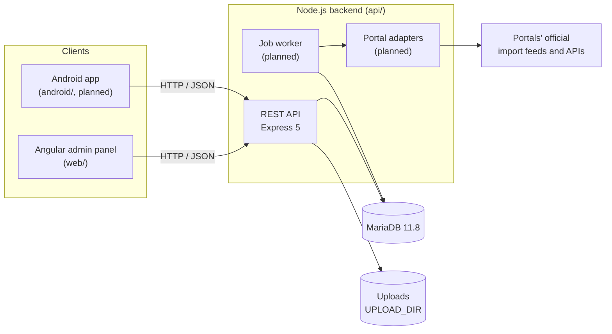
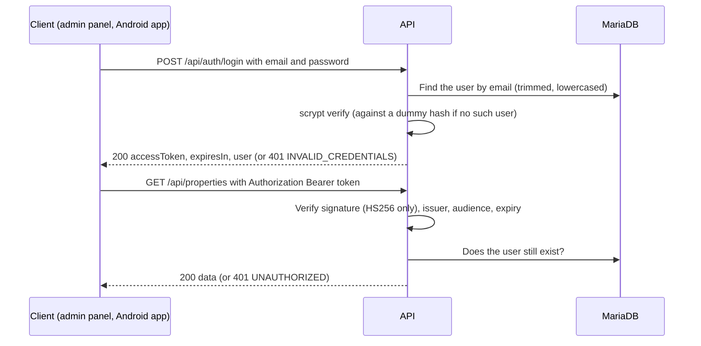
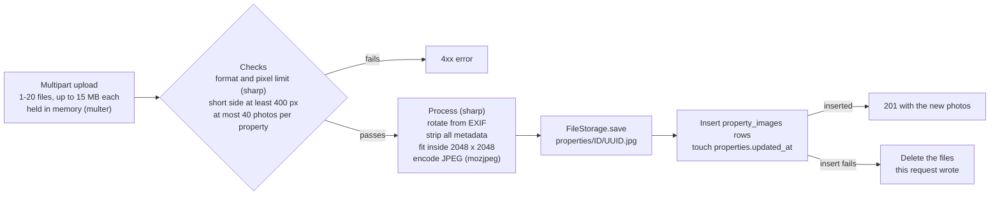
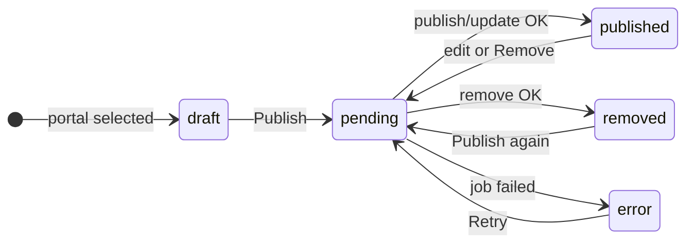
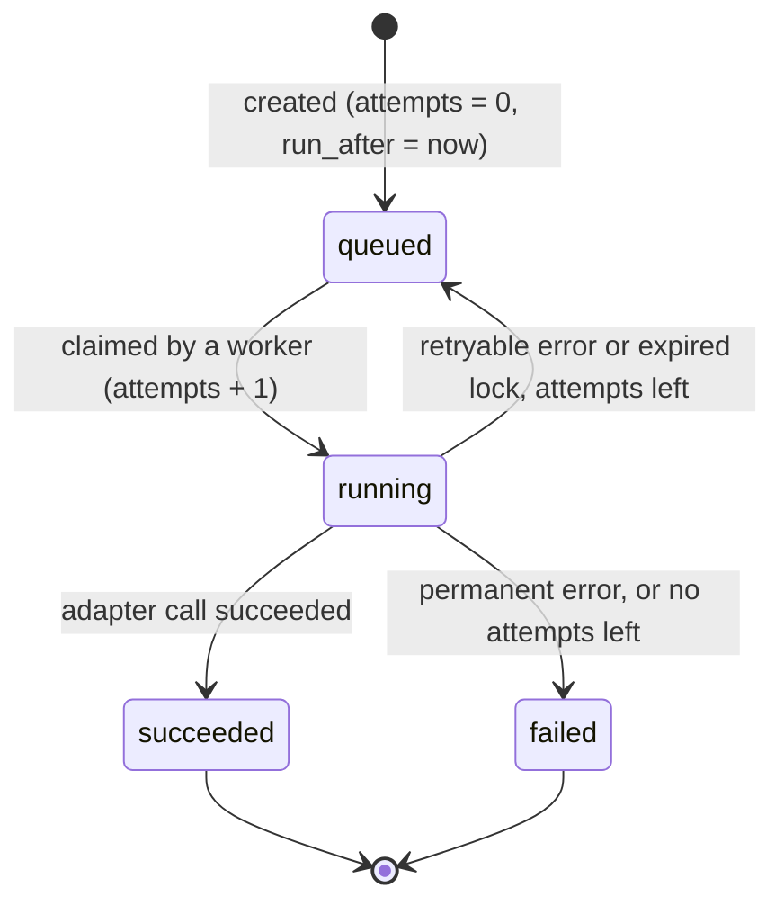

# Architecture

This document describes how ImotSync is put together and how publishing is meant to work. Parts marked **planned** are design decisions for later weeks of the [roadmap](../README.md#roadmap), not existing code.

## Components



| Component            | Responsibility                                                                                                                     | Status                                                                              |
| -------------------- | ---------------------------------------------------------------------------------------------------------------------------------- | ----------------------------------------------------------------------------------- |
| Admin panel (`web/`) | Brokers and admins manage properties, run the pre-publish check, publish in bulk and follow the status per portal and the job log. | Shell in place, screens planned                                                     |
| REST API (`api/`)    | Single entry point for the admin panel, the Android app and integrations: auth, properties, photos, publish requests, job log.     | Auth, properties and photos in place; publish requests and job log planned (Week 2) |
| Database (MariaDB)   | Source of truth for users, properties, photos, per-portal listing state and the job queue. Schema is managed with Knex migrations. | In place                                                                            |
| Uploads storage      | Processed photo files behind a `FileStorage` interface, stored under `UPLOAD_DIR` and served read-only at `/uploads/*`.            | Local disk in place; S3-compatible storage planned                                  |
| Job worker           | Claims due jobs from the `jobs` table, calls the matching adapter, records the outcome and schedules retries.                      | Planned (Week 2)                                                                    |
| Portal adapters      | One module per portal: validate a property against the portal's rules and translate it into the portal's import format.            | Planned (Week 2)                                                                    |
| Android app          | Field capture: login, camera photos, a short form, offline drafts synced to the API.                                               | Planned (Week 4)                                                                    |

The worker lives in the same codebase as the API. Because jobs are claimed with row locks (see [Claiming jobs safely](#claiming-jobs-safely)), it can run inside the API process for a small demo or as one or more separate processes, without changes to the queue.

## API conventions

The same API serves the admin panel, the Android app and integrations, so every endpoint follows the same rules. The endpoint list and the field rules are in the [README](../README.md#api); the complete contract is the OpenAPI document described below.

- **Code layout.** Each feature is a module under `api/src/modules/`: `auth` (login and the current user), `properties` (property CRUD and the list) and `images` (a property's photos). Every module has the same five files, `<module>.router.ts`, `.validators.ts`, `.service.ts`, `.repository.ts` and `.mappers.ts`: a thin router that wires the validation chains to the service and sends the responses, express-validator chains, a service with the business rules and transactions, a repository that holds the SQL, and mappers between database rows and API objects. Helpers specific to a module sit next to them: in `auth` the token service (`tokens.ts`), `requireAuth` (`require-auth.ts`) and the login rate limit (`login-rate-limit.ts`); in `properties` the filter and sort whitelist (`list-query.ts`); in `images` the multipart upload (`photo-upload.ts`), the sharp checks and processing (`image-processing.ts`) and the cleanup of stored files (`stored-files.ts`). Shared code is in `api/src/lib/` (validation middleware, `HttpError`, password hashing, file storage in `storage.ts`, the upload concurrency limit), the OpenAPI document in `api/src/openapi/`. Everything with side effects (database, configuration, logger, file storage), and the limits tests need to change (the login rate limit, the number of concurrent uploads, the upload body deadline, the health check timeout), is passed to `createApp(deps)`, so tests can replace it.
- **JSON shape.** Bodies use camelCase while the database uses snake_case; each resource has one mapper that converts its rows, so the naming changes in exactly one place. Dates are ISO 8601 strings in UTC (ending in `Z`), `DECIMAL` columns such as `price` and `areaM2` are JSON numbers, and ids are integers.
- **Pagination.** Lists take `page` (from 1) and `pageSize` (1 to 100, default 20) and answer `{"data": [...], "meta": {"page", "pageSize", "total", "totalPages"}}`.
- **Sorting and filtering.** `sort` names one field from a fixed list, with a leading `-` for descending, and ties are broken by `id` so that pages stay stable. Sort fields and filters reach SQL only through a whitelist that maps them to known columns; user input never becomes a column name, and values are always bound parameters. Enum filters take comma-separated lists. The text search `q` uses `LIKE` on the reference code, title, city and district, with the `LIKE` wildcards in the input escaped so they match literally. With the `utf8mb4_unicode_ci` collation, the search and the `city` filter are case-insensitive for Cyrillic as well as Latin text.
- **No N+1 queries.** A list page loads its properties, then the photos and the portal listings of all of them in batched queries, instead of one query per property.
- **Validation.** Every route validates its path, query and body with express-validator chains, and one shared middleware turns the results into `400 VALIDATION_ERROR` with `details: [{"field", "message"}]`. Bodies are checked exactly: an unknown field is an error, so a typo is reported instead of silently ignored. Text is trimmed and an empty optional text becomes `null`. (zod validates only the environment configuration.)
- **Errors.** Handlers throw an `HttpError` (or let an unexpected error escape), and the central error handler answers `{"error": {"code", "message", "details"?}}`. Unexpected errors become `500 INTERNAL_ERROR`; their details are logged, and with `NODE_ENV=production` they never reach the client.
- **Status codes.** `201` with a `Location` header for a created property, `204` without a body for deletes, `401` with `WWW-Authenticate: Bearer` when the token is missing or invalid. The full list of codes is in the [README](../README.md#errors).
- **OpenAPI as the contract.** The OpenAPI 3.1 document is written in TypeScript in `api/src/openapi/`, with reusable schemas for every request and response body, the error envelope and the pagination meta. It is served at `/api/openapi.json` and in Swagger UI at `/api/docs`, which keeps the token across page reloads. Helmet's Content Security Policy is relaxed only for `/api/docs`, as far as Swagger UI needs; every other response keeps the strict default. Tests keep the document honest: it must validate as OpenAPI, every route the app registers must be documented and every documented operation must exist, and the integration tests check real response bodies against the documented schemas.

## Authentication



- **Stateless JWT.** There is no session table: the token carries what the API needs, so any API instance can check it without a lookup in shared state. Tokens are signed with HS256 and `JWT_SECRET` using the [`jose`](https://github.com/panva/jose) library and carry these claims:

  | Claim        | Value                                                                   |
  | ------------ | ----------------------------------------------------------------------- |
  | `sub`        | The user's id, as a string                                              |
  | `role`       | `admin` or `broker`                                                     |
  | `iss`        | `imotsync`                                                              |
  | `aud`        | `imotsync-api`                                                          |
  | `iat`, `exp` | Issue time and expiry: `iat` + `JWT_TTL_SECONDS` (default 28800 s, 8 h) |

- **Strict verification.** Verification pins the algorithm to HS256, so a token with `alg: none` or any other algorithm is refused, and requires the issuer, the audience and an unexpired `exp`. `requireAuth` then checks that the user still exists, so deleting a user shuts them out at once rather than when the token expires. Any failure is `401 UNAUTHORIZED` with a `WWW-Authenticate: Bearer` header. `requireRole('admin')` answers `403 FORBIDDEN`; it is ready for admin-only endpoints, none of which exist yet.
- **Why a Bearer header for both clients.** The browser-based admin panel and the native Android app call the same API. A token in the `Authorization` header works identically for both (and for scripts and `api/requests.http`), whereas cookies belong to the browser. Because the browser never attaches the header on its own, cross-site request forgery does not apply. The trade-off is that a token held by the admin panel is readable by its JavaScript, so it relies on XSS defences (Angular's template escaping, Helmet's Content Security Policy) and on the short lifetime; where the admin panel keeps the token is decided with its login screen in Week 3.
- **Lifetime and revocation.** A token lives 8 hours by default (`JWT_TTL_SECONDS`), about one working day. There is no refresh token yet, so the client logs in again when the token expires. A single stateless token cannot be revoked before it expires; deleting the user stops it through the existence check, and changing `JWT_SECRET` ends every session at once.
- **A login that reveals nothing.** The email is trimmed and lowercased before the lookup. An unknown email and a wrong password get the same `401 INVALID_CREDENTIALS`, and for an unknown email the API still runs a scrypt verification against a fixed dummy hash, so both answers take about as long and the timing does not give away which emails have accounts. Passwords are stored as scrypt hashes in PHC format with the OWASP-recommended parameters and compared in constant time (`api/src/lib/password.ts`).
- **Rate limiting.** `POST /api/auth/login` is limited with express-rate-limit to 10 attempts per 15 minutes per IP address; over the limit the API answers `429 TOO_MANY_REQUESTS` in the usual error format, with the standard `RateLimit` headers. Tests inject their own limits through `createApp(deps)`. Behind a reverse proxy every request would seem to come from the proxy's address, so `TRUST_PROXY` (Express' `trust proxy`) names the hops whose `X-Forwarded-For` entries the API believes: the number of proxies in front of the API (usually `1`), or a comma-separated list of the proxies' addresses, subnets or presets (`loopback`, `linklocal`, `uniquelocal`, `10.0.0.0/8`, ...). Express then takes as the client's address the entry that the outermost trusted proxy appended, which the client cannot forge. It stays `false` (the default) when clients reach the API directly, because they could otherwise forge that header to dodge the limit. A hop count must equal the number of proxies exactly (one more and the API believes an entry the client wrote) and assumes the API's port is reachable only through them. `true` is never appropriate: it trusts every hop, so the client-written left-most entry becomes the address and every attempt can claim a new one. The configuration check therefore refuses it when `NODE_ENV=production`, and the API does not start; in development and tests it is accepted, and express-rate-limit warns with `ERR_ERL_PERMISSIVE_TRUST_PROXY`. The README's [Behind a reverse proxy](../README.md#behind-a-reverse-proxy) has the details. With express-rate-limit's default in-memory store, each API process counts on its own; several instances would need a shared store.

## Photo pipeline



- **The content decides, not the client.** multer keeps the uploaded files in memory within fixed limits (15 MB per file, 20 files per request, no other form fields), so nothing unprocessed is ever written to disk. A file over 15 MB gets `413 PAYLOAD_TOO_LARGE`; more files, or any other field, get `400 VALIDATION_ERROR`. The whole body may be at most 301 MB (20 files of 15 MB plus 1 MB for the multipart framing): a larger declared `Content-Length` gets `413 PAYLOAD_TOO_LARGE` before the body is read, and a body without a declared length is cut off at that size by closing the connection. Since one upload can hold about 300 MB in memory, each API process handles at most 2 uploads at a time (`api/src/lib/concurrency-limit.ts`); a further one gets `429 TOO_MANY_REQUESTS` with `Retry-After` before its body is read. The body also has a deadline of 60 seconds, so a client that sends slowly or stops sending cannot hold an upload slot for long: it gets `408 REQUEST_TIMEOUT`, the connection is closed, and the slot is free again. The declared MIME type and the file extension are ignored: sharp reads the actual bytes, and only JPEG, PNG, WebP and AVIF pass. Anything else (GIF, SVG, TIFF, HEIC, a PDF, a text file renamed to `.jpg`) and any damaged file get `415 UNSUPPORTED_MEDIA_TYPE` naming the file.
- **Decompression bombs.** Before anything is decoded, the dimensions in the image header are checked against a limit of 50 megapixels, and sharp's `limitInputPixels` enforces the same limit while decoding. An image over it gets `400 VALIDATION_ERROR`, so a small file that claims enormous dimensions cannot exhaust the server's memory.
- **Minimum size.** A photo below 400 px on its short side is too small for a listing and gets `400 VALIDATION_ERROR`.
- **Processing.** `rotate()` applies the EXIF orientation to the pixels, so the photo stays upright once the orientation tag is gone. The output keeps no metadata at all: no EXIF (which on phone photos includes the GPS position and the device model), no XMP and no IPTC. The image is resized to fit inside 2048 × 2048 px without enlarging smaller ones and encoded as JPEG with mozjpeg at quality 82: a single, widely supported output format, so the portal adapters never need to convert photos.
- **Storage behind an interface.** `FileStorage` (`api/src/lib/storage.ts`) addresses files by a key such as `properties/12/<UUID>.jpg` and has five operations, all of which a new implementation must provide:

  | Operation              | Purpose                                                                                                           |
  | ---------------------- | ----------------------------------------------------------------------------------------------------------------- |
  | `save(key, data)`      | Writes a file, creating folders as needed                                                                         |
  | `delete(key)`          | Removes one file; a file that is already gone is not an error                                                     |
  | `deletePrefix(prefix)` | Removes everything under a folder key, such as `properties/12` when the property is deleted                       |
  | `publicUrl(key)`       | The URL stored in `property_images.url`, from which clients and portals download the file                         |
  | `keyFromUrl(url)`      | Maps a stored URL back to its key, or `null` for a URL that does not point into this storage (nothing is deleted) |

  `LocalFileStorage` writes under `UPLOAD_DIR`, which Express serves at `/uploads`; an S3-compatible implementation can replace it later without changes to the routes. Files are stored as `properties/<propertyId>/<random UUID>.jpg`, so names are never derived from the client's file name and cannot be guessed from each other. Each `property_images` row records the public URL and the stored file's real `width`, `height` and `size_bytes`.

- **Path containment.** Deleting resolves the file path strictly inside `UPLOAD_DIR` and refuses anything that would escape it (for example through `..` segments), so even a corrupted URL in the database cannot remove other files. The seeded photos under `/uploads/demo/` can be deleted like any other; the seed regenerates them.
- **Files and rows stay consistent.** An upload writes the files first and then inserts the rows; if the insert fails, the files the request wrote are deleted again. Deleting a photo or a property removes the database rows first and the files afterwards; a failed file deletion is logged and not reported to the client, so the worst case is an orphaned file, never a row that points at a missing one.
- **Order.** New photos go after the current highest `sort_order`. `PUT /api/properties/{id}/images/order` must list exactly the property's photo ids, with none missing, foreign or repeated, and rewrites `sort_order` as 0 to n-1 in one transaction. The first photo is the property's cover (`coverImageUrl` in the list). Every photo change updates `properties.updated_at`.
- **Public by design.** `/uploads` needs no token, because portals download the photos by URL. It is served read-only, without directory listings, and with `Cross-Origin-Resource-Policy: cross-origin` so that pages on other origins may show the photos.

## Request flow: publishing a property (planned)

1. A property is created as a draft (`properties.status = 'draft'`) with its photos in `property_images`.
2. The broker selects portals. For each one the API runs that adapter's `validate()` and returns the list of problems (missing fields, too few or too large photos, description too long) without sending anything.
3. "Publish" upserts one `portal_listings` row per selected portal (unique on `property_id, portal`), sets it to `pending` and queues one `publish` job for it, in one transaction (see the rules below).
4. The worker claims the job, calls the adapter, and writes the outcome to the job (`result`, `last_error`) and to the listing (`status`, `external_id`, `published_at`, `last_error`).
5. A later change to price or photos queues `update` jobs for the portals where the listing is published. Bulk delete queues `remove` jobs.

Planned rules that keep a listing consistent:

- **One job at a time per listing, in order.** The jobs of one portal listing run one at a time, in the order they were queued: the worker starts a job only when no older job for the same listing is still `queued` (for example waiting for a retry) or `running`. So a running job is always its listing's oldest unfinished job, and an `update` never overtakes the `publish` before it.
- **Merge instead of piling up.** A change that arrives while the listing's newest unfinished job is still `queued` is merged into that job: adapters always send the property's current data, so a queued `publish` followed by a price change stays a single `publish`. A change that arrives while that job is `running` queues one new job behind it. A listing therefore has at most two unfinished jobs: the one in progress (running, or queued again to wait for a retry) and one queued behind it.
- **Queueing is serialised per listing.** Every transaction that queues or merges a job, or records a job's outcome, first locks the listing's row (`SELECT ... FROM portal_listings WHERE id = ? FOR UPDATE`) and then reads the listing's unfinished jobs with `FOR UPDATE`. Two requests for the same listing therefore never both insert a job, a merge never lands on a job a worker has just started, and a listing's job ids follow the order in which its jobs were queued, which the claim query below relies on.
- **Remove before delete.** Deleting a property row cascades to its `portal_listings` and `jobs` rows, so bulk delete first archives the property and queues `remove` jobs; the row is deleted only after every portal reports `removed`. Until `remove` jobs exist, `DELETE /api/properties/{id}` enforces part of this: it answers `409 CONFLICT` while any listing of the property is `pending` or `published`. A listing in `error` does not block the delete yet, although after a failed `update` it may still be live on the portal (see [the listing states](#portal-listing-portal_listingsstatus)); whether such a listing needs a `remove` job first, for example when it has an `external_id` or `published_at`, is an open decision for Week 2.

## Status state machines

The three status columns describe different things and change independently:

- `properties.status` (`draft`, `active`, `archived`) is the agency's own lifecycle of the property.
- `portal_listings.status` is the state of the property on one portal.
- `jobs.status` is the state of one queued operation against one portal.

### Portal listing (`portal_listings.status`)



- `draft`: the portal is selected for the property, nothing has been sent yet.
- `pending`: a `publish`, `update` or `remove` job for this listing is queued or running. "Publish" queues a `publish` job; editing a published property (price, photos, text) queues an `update` job; "Remove" or bulk delete queues a `remove` job.
- `published` / `removed`: the last job succeeded. `published_at` records when the listing was first published successfully.
- `error`: the last job failed after its final attempt, or with an error that retrying cannot fix; the reason is in `last_error`. "Retry" (or fixing the property and publishing again) queues a new job. If an `update` fails, the listing may still be live on the portal with its previous data, which `external_id` and `published_at` show.

### Job (`jobs.status`)



- `succeeded` and `failed` are final and set `finished_at`. `result` holds the outcome of the last attempt and `last_error` its error message, so the `jobs` table doubles as the job log.
- The "Retry" button on the job log (planned) does not reopen a failed job: it queues a new job for the same listing and action, so the history of the failed one stays intact.

## Retry policy (planned)

| Setting          | Plan                                                                                                                                           |
| ---------------- | ---------------------------------------------------------------------------------------------------------------------------------------------- |
| Attempts         | `max_attempts` is stored per job with a default of 5, so a single job can be given more attempts.                                              |
| Back-off         | Exponential with jitter: `delay = random(0.5, 1) * min(cap, base * 2^(attempts - 1))`, for example `base` 30 s and `cap` 1 h.                  |
| Scheduling       | On a retryable failure the job goes back to `queued` with `run_after = now + delay`; the worker only claims jobs whose `run_after` has passed. |
| Retryable errors | Network errors, timeouts, HTTP 5xx and 429 (a `Retry-After` header, if present, sets the minimum delay).                                       |
| Permanent errors | Validation errors and other 4xx responses: the job fails immediately and the listing moves to `error` with the reason.                         |

With these example values, the delays before attempts 2 to 5 are roughly 15–30 s, 30–60 s, 1–2 min and 2–4 min. Jitter spreads retries out, so many jobs that failed together (for example during a portal outage) do not all retry at the same moment.

Retries are safe to repeat because every portal receives the property's stable `ref_code`, which the portal uses to recognise an existing listing on re-import instead of creating a duplicate.

## Claiming jobs safely

Several workers (or several API instances) may poll the same table. A worker claims a job inside a short transaction:

```sql
START TRANSACTION;

-- The oldest due job whose listing has no older unfinished job.
SELECT j.id
  FROM jobs j
 WHERE j.status = 'queued'
   AND j.run_after <= UTC_TIMESTAMP()
   AND NOT EXISTS (SELECT 1
                     FROM jobs o
                    WHERE o.portal_listing_id = j.portal_listing_id
                      AND o.id < j.id
                      AND o.status IN ('queued', 'running'))
 ORDER BY j.run_after, j.id
 LIMIT 1
   FOR UPDATE SKIP LOCKED;

UPDATE jobs
   SET status = 'running',
       locked_at = UTC_TIMESTAMP(),
       locked_by = :workerId,
       attempts = attempts + 1
 WHERE id = :id;

COMMIT;
```

- `FOR UPDATE SKIP LOCKED` (MariaDB 10.6 and later) makes concurrent workers skip rows another transaction has already locked, instead of waiting or claiming the same job twice. The query uses the `(status, run_after)` index, and the `NOT EXISTS` check uses the `portal_listing_id` index.
- The `NOT EXISTS` subquery is a plain snapshot read: it takes no locks and cannot see a claim that another worker has not committed yet. That is why it does not just test for a `running` job, which would let two workers start two queued jobs of the same listing at the same moment. It asks whether any **older** job of the listing is still unfinished, and a job moving from `queued` to `running` does not change that answer, so the newer job is held back either way. This relies on the per-listing rules [above](#request-flow-publishing-a-property-planned): a listing's jobs are queued one after another, so a newer job always has a higher id.
- The claim never waits for a lock (`SKIP LOCKED`, plus a non-locking subquery), so it cannot deadlock with the transactions that lock a listing row and then its jobs.
- The adapter call happens **after** the commit, so no database lock is held during network I/O.
- `locked_by` identifies the worker (for example host name and process id) and `locked_at` when it took the job. A job still `running` long after `locked_at` (worker crashed or was restarted) is returned to `queued` by a periodic sweep, or marked `failed` if it has no attempts left.
- All `DATETIME` values are UTC, so `UTC_TIMESTAMP()` compares correctly with `run_after` and `locked_at`.

## Portal adapter interface

**Planned (Week 2).** A sketch of the common interface every portal adapter will implement:

```ts
/** Adapter key stored in portal_listings.portal, e.g. 'realistimo', 'bazar', 'demo'. */
export type PortalKey = string;

export interface ValidationIssue {
  /** Property field the issue is about, e.g. 'price', 'images', 'description'. */
  field: string;
  /** Human-readable message shown in the pre-publish check. */
  message: string;
}

export interface AdapterResult {
  /** Identifier assigned by the portal, when the portal reports one. */
  externalId?: string;
  /** Anything worth keeping in jobs.result, e.g. the portal's response summary. */
  details?: Record<string, unknown>;
}

/** Thrown by adapters; the worker uses `retryable` to decide between a retry and a failure. */
export class PortalError extends Error {
  readonly retryable: boolean;

  constructor(message: string, retryable: boolean) {
    super(message);
    this.name = 'PortalError';
    this.retryable = retryable;
  }
}

export interface PortalAdapter {
  readonly key: PortalKey;
  readonly displayName: string;

  /** Pure check against the portal's rules; no network calls. An empty array means ready. */
  validate(property: PropertyWithImages): ValidationIssue[];

  publish(property: PropertyWithImages): Promise<AdapterResult>;
  update(property: PropertyWithImages, listing: PortalListing): Promise<AdapterResult>;
  remove(listing: PortalListing): Promise<AdapterResult>;
}
```

`PropertyWithImages` and `PortalListing` are the API's own types for a property row with its ordered photos and a `portal_listings` row. Adapters receive these portal-independent types and do all mapping to the portal's format themselves, so the rest of the system never deals with portal-specific fields.

Adapters are registered in a map keyed by `PortalKey`. Because `portal_listings.portal` is a `VARCHAR`, a new adapter needs no migration.

## How portal feeds work

> **To be confirmed** against each portal's official documentation when its adapter is built. This section describes the general shapes only; it deliberately names no portal-specific fields, URLs or endpoints.

Portals offer agencies two broad kinds of official import:

- **Pull feed.** The agency publishes a feed (XML or JSON) at a URL, and the portal downloads it on its own schedule and imports the listings in it. In this model `publish` and `update` change what the next version of the feed contains, and `remove` takes the listing out of it (or marks it as removed, if the format has a way to say so). How quickly the portal picks up a change, and whether it reports import results back, depends on the portal.
- **Push import.** The agency's system sends listings to an import endpoint provided by the portal, using credentials the portal issues to the agency. Each call returns a result that the adapter records directly.

For each portal the adapter needs to settle, from the official documentation:

- the format and its required fields, and how the property's type, deal type and location map onto the portal's own lists;
- how listings are identified across imports (ImotSync supplies `ref_code` for this);
- photo rules (count, size, order) and whether photos are sent as files or referenced by URL, in which case they are served from `/uploads`;
- authentication and how a feed URL is protected;
- when a listing counts as `published`: after a successful push response, or after the portal confirms it imported the feed.

| Portal      | Import method                                     | Notes                                                                                                |
| ----------- | ------------------------------------------------- | ---------------------------------------------------------------------------------------------------- |
| Realistimo  | XML import, per Realistimo's public documentation | Planned for Week 2                                                                                   |
| Bazar.bg    | Listing import via a feed (XML or JSON)           | Planned for Week 2                                                                                   |
| Demo portal | In-process fake, no network                       | Fails a share of calls on purpose (both retryable and permanent errors) so retries and statuses show |
| imot.bg     | Official import                                   | Next adapter, not built: API access requires authorization and at least 500 active listings          |

ImotSync uses only these official import methods: no scraping and no automated logins into portal accounts. The demo never publishes to real portals.

## Cross-cutting decisions

- **Time.** Every `DATETIME` column stores UTC; conversion to local time happens in the clients.
- **Text encoding.** Every application table is created explicitly as InnoDB with `utf8mb4` / `utf8mb4_unicode_ci`, so Bulgarian (Cyrillic) titles and descriptions round-trip safely regardless of server defaults. (Knex's own bookkeeping tables, `knex_migrations` and `knex_migrations_lock`, get the server's default `utf8mb4` collation; they hold only migration names.)
- **Money.** `price` is `DECIMAL(12,2)` with a `currency` code, default `EUR` (Bulgaria's currency since 1 January 2026).
- **Errors.** The API always answers errors as `{"error":{"code":"...","message":"..."}}`, with a `details` list on validation errors, and never includes stack traces when `NODE_ENV=production` (see [API conventions](#api-conventions)).
- **Configuration.** One root `.env` file (see `.env.example`), read by Docker Compose and by the API when it runs outside Docker. The API container has no `.env` of its own: it receives only the variables listed under `environment` in `docker-compose.yml`.
