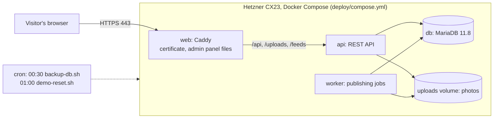

# Deploying the public demo

This guide puts ImotSync on one small Linux server at **<https://imotsync.palovtech.com>**, as a public demo with made-up data that resets every night. It starts from a server you have just bought and ends with HTTPS, the nightly reset and backups running.

The commands are for Ubuntu 24.04. Lines that start with `sudo` run on the server; the few that run on your own computer are marked as such.

## What runs where



| Service  | Image                                       | Role                                                                                                                                                                      |
| -------- | ------------------------------------------- | ------------------------------------------------------------------------------------------------------------------------------------------------------------------------- |
| `web`    | `imotsync-web`, built from `web/Dockerfile` | Caddy: gets and renews the Let's Encrypt certificate, serves the admin panel's static files, proxies `/api`, `/uploads` and `/feeds` to the API. The only published ports |
| `api`    | `imotsync-api`, built from `api/Dockerfile` | The REST API; applies pending migrations each time it starts                                                                                                              |
| `worker` | `imotsync-api`                              | Runs the publishing jobs (here: the demo portal) and the housekeeping                                                                                                     |
| `db`     | `mariadb:11.8`                              | The database, on a volume; not reachable from outside the stack                                                                                                           |

Data lives in four Docker volumes: `db_data` (the database), `uploads` (photos), `caddy_data` (certificates) and `caddy_config`. They survive restarts, updates and `docker compose down`; only `docker compose down -v` deletes them.

**Demo mode** (`DEMO_MODE=true` in `deploy/.env`, the default of this stack): a "Try the demo" button signs visitors in as a shared demo broker, a banner says the data is made up and reset every night, uploads and requests have lower limits, and the feeds are closed, so the made-up listings can never reach Realistimo or Bazar.bg. The README's [Public demo](../README.md#public-demo) section has the details.

## 1. Buy the server

In the [Hetzner Cloud console](https://console.hetzner.cloud/):

1. Create a project, then **Add Server**.
2. **Location:** Nuremberg or Falkenstein (Germany). **Image:** Ubuntu 24.04. **Type:** Shared vCPU, x86, **CX23** (2 vCPU, 4 GB RAM, 40 GB disk).
3. **Networking:** public IPv4 and IPv6.
4. **SSH keys:** add your public key (step 2 shows how to make one). With a key added, Hetzner sets no root password and password logins never work.
5. Optional: **Backups** (20% of the server price) keeps 7 daily images of the whole disk, on top of this guide's database dumps.
6. Name it, for example `imotsync`, and create it. Note its **IPv4 address**; this guide calls it `SERVER_IP`.

## 2. SSH key

On your own computer (PowerShell on Windows, a terminal on macOS or Linux), if you have no key yet:

```bash
ssh-keygen -t ed25519 -C "imotsync server"
```

Accept the default file (`~/.ssh/id_ed25519`) and set a passphrase. The public key, to paste into Hetzner, is `~/.ssh/id_ed25519.pub` (in PowerShell: `Get-Content $HOME\.ssh\id_ed25519.pub`).

Log in for the first time, as root:

```bash
ssh root@SERVER_IP
```

## 3. A user for the app, updates, SSH lock-down

On the server, as root. Create a `deploy` user that may use `sudo`, with the same key:

```bash
adduser --disabled-password --gecos "" deploy
usermod -aG sudo deploy
passwd deploy        # a password for sudo (logins stay key-only)
install -d -m 700 -o deploy -g deploy /home/deploy/.ssh
install -m 600 -o deploy -g deploy /root/.ssh/authorized_keys /home/deploy/.ssh/authorized_keys
```

Install the updates, and let security updates install themselves from now on:

```bash
apt update && apt full-upgrade -y
apt install -y unattended-upgrades
dpkg-reconfigure -f noninteractive unattended-upgrades
```

Allow SSH with keys only, and no root login:

```bash
cat > /etc/ssh/sshd_config.d/10-hardening.conf <<'EOF'
PermitRootLogin no
PasswordAuthentication no
KbdInteractiveAuthentication no
EOF
sshd -t && systemctl reload ssh
```

**Before you close this session**, check in a second terminal on your computer that `ssh deploy@SERVER_IP` works and that `sudo -v` there accepts the password. From now on, log in as `deploy`.

## 4. Firewall (ufw): 22, 80, 443

```bash
sudo ufw default deny incoming
sudo ufw default allow outgoing
sudo ufw allow OpenSSH
sudo ufw allow 80/tcp
sudo ufw allow 443        # TCP for HTTPS, UDP for HTTP/3
sudo ufw enable
sudo ufw status verbose
```

Port 80 must stay open: Let's Encrypt checks it before it issues the certificate, and Caddy redirects plain HTTP to HTTPS there.

Docker writes its own firewall rules for published ports, past ufw. That is why `compose.yml` publishes only Caddy's 80 and 443, which are open anyway, and never the API's or the database's port. Hetzner's own Cloud Firewall (in the console, free) can repeat the same three rules in front of the server if you want a second layer.

## 5. Docker

Docker's own packages for Ubuntu ([docs.docker.com](https://docs.docker.com/engine/install/ubuntu/)):

```bash
sudo apt install -y ca-certificates curl git
sudo install -m 0755 -d /etc/apt/keyrings
sudo curl -fsSL https://download.docker.com/linux/ubuntu/gpg -o /etc/apt/keyrings/docker.asc
sudo chmod a+r /etc/apt/keyrings/docker.asc
echo "deb [arch=$(dpkg --print-architecture) signed-by=/etc/apt/keyrings/docker.asc] https://download.docker.com/linux/ubuntu $(. /etc/os-release && echo "$VERSION_CODENAME") stable" \
  | sudo tee /etc/apt/sources.list.d/docker.list > /dev/null
sudo apt update
sudo apt install -y docker-ce docker-ce-cli containerd.io docker-buildx-plugin docker-compose-plugin
sudo usermod -aG docker deploy
```

Log out and in again (so the `docker` group applies), then check:

```bash
docker run --rm hello-world
docker compose version
```

Optional but useful on 4 GB: a 2 GB swap file, so the image builds never run out of memory:

```bash
sudo fallocate -l 2G /swapfile && sudo chmod 600 /swapfile
sudo mkswap /swapfile && sudo swapon /swapfile
echo '/swapfile none swap sw 0 0' | sudo tee -a /etc/fstab
```

## 6. DNS in Cloudflare

Caddy gets the certificate itself, so Cloudflare must only point the name at the server, not proxy it.

1. In the Cloudflare dashboard, open the **palovtech.com** zone, then **DNS → Records → Add record**.
2. **Type** `A`, **Name** `imotsync`, **IPv4 address** `SERVER_IP`, **Proxy status** off: **DNS only (grey cloud)**, **TTL** Auto. Save.
3. **No `AAAA` record.** The stack's Docker network is IPv4 only. Over IPv6, Docker would hand visitors' connections to Caddy from its own gateway address, so the API would see every IPv6 visitor as the same client, and one of them could use up the demo's per-address limits for all the others. Without an `AAAA` record every visitor arrives over IPv4, with their own address.

Check from your computer that the name resolves to the server before you go on (it can take a minute):

```bash
nslookup imotsync.palovtech.com 1.1.1.1
```

With the orange cloud (proxied), visitors would reach Cloudflare's servers instead, and the certificate request and the HTTP-to-HTTPS redirect would fail or loop. If you want the proxy later, switch Cloudflare's SSL/TLS mode to **Full (strict)** first; Caddy's certificate keeps working behind it.

## 7. First deploy

Get the code (the repository is public, so no credentials are needed):

```bash
sudo install -d -o deploy -g deploy /opt/imotsync
git clone https://github.com/DiyanskiTY/imotsync.git /opt/imotsync
cd /opt/imotsync/deploy
```

Write the settings. Every secret is a fresh random value; none of them is ever needed in a browser:

```bash
cp .env.example .env
chmod 600 .env
for name in JWT_SECRET FEED_TOKEN DB_PASSWORD DB_ROOT_PASSWORD SEED_DEMO_PASSWORD; do
  sed -i "s|^$name=.*|$name=$(openssl rand -hex 32)|" .env
done
nano .env     # check SITE_ADDRESS and PUBLIC_BASE_URL; DEMO_MODE=true
```

`SEED_DEMO_PASSWORD` is the password of both seeded accounts. Visitors use the demo button and never need it; you can sign in as `admin@imotsync.local` with it (`grep SEED_DEMO_PASSWORD .env`).

Build and start everything, then load the demo data:

```bash
docker compose up -d --build --wait
bash demo-reset.sh
```

The first build takes a few minutes. `--wait` returns once the database and the API report healthy; Caddy asks Let's Encrypt for the certificate within seconds of starting (`docker compose logs web` shows it).

Check it:

```bash
docker compose ps
curl -sI https://imotsync.palovtech.com/ | grep -iE '^HTTP|x-robots-tag'          # 200, noindex
curl -s https://imotsync.palovtech.com/api/health                                 # "status":"ok"
curl -s https://imotsync.palovtech.com/api/client-config                          # "demoMode":true
curl -s -o /dev/null -w '%{http_code}\n' "https://imotsync.palovtech.com/feeds/bazar/$(grep FEED_TOKEN .env | cut -d= -f2).xml"   # 404: closed
```

Then open <https://imotsync.palovtech.com> in a browser: the banner is at the top, **Try the demo** signs you in, and publishing a property to the demo portal shows jobs succeed, fail and retry.

## 8. Nightly reset and backups

Two scripts in `deploy/`, run by cron as `deploy`:

- `backup-db.sh` writes `/var/backups/imotsync/imotsync-<date>.sql.gz` (a consistent `mariadb-dump`) and deletes dumps older than 14 days.
- `demo-reset.sh` stops the API and the worker (a few seconds of `502` for anyone online at that hour), replaces all data with the made-up seed (users, properties, photos, listings, jobs; one transaction, so a failure leaves the old data), and starts both again. Visitors who are signed in stay signed in: the demo accounts keep their ids.

Install them:

```bash
sudo install -d -o deploy -g deploy /var/backups/imotsync
sudo install -m 644 /opt/imotsync/deploy/imotsync.cron /etc/cron.d/imotsync
bash /opt/imotsync/deploy/backup-db.sh        # try both once
bash /opt/imotsync/deploy/demo-reset.sh
```

[`imotsync.cron`](../deploy/imotsync.cron) runs the backup at 00:30 and the reset at 01:00 server time. A new Hetzner server runs on UTC, so that is 02:30 and 03:00 in Bulgaria in winter (an hour later in summer). Their output goes to the system journal:

```bash
journalctl -t imotsync-reset -n 20
journalctl -t imotsync-backup -n 20
```

The dumps stay on the same disk. For copies elsewhere, enable Hetzner's backups (step 1) or copy `/var/backups/imotsync` off the server now and then (`scp` from your computer). The photos are not backed up: the reset regenerates the demo's own, and visitors' uploads are deleted every night anyway.

**Restore a dump** (stop the worker first, like the reset does):

```bash
cd /opt/imotsync/deploy
docker compose stop worker
gunzip -c /var/backups/imotsync/imotsync-YYYYMMDD-HHMMSS.sql.gz \
  | docker compose exec -T db sh -c 'MYSQL_PWD="$MARIADB_ROOT_PASSWORD" exec mariadb -uroot "$MARIADB_DATABASE"'
docker compose start worker
```

## 9. Updates

After you push to GitHub:

```bash
cd /opt/imotsync
git pull
cd deploy
docker compose up -d --build --wait
docker image prune -f
```

Compose rebuilds the images and replaces only the containers whose image or settings changed; the API applies new migrations as it starts. A visitor may see a few seconds of errors while the API restarts. To go back to an earlier version, `git checkout <commit>` and run the same `up` command (a migration that already ran stays applied; roll it back first with `docker compose run --rm api node dist/db/migrate.js rollback` if the older code cannot work with it).

After a change to `deploy/.env`, the same `docker compose up -d --wait` applies it. After a change to `Caddyfile`: `docker compose restart web`.

## Day to day

| Task                    | Command (in `/opt/imotsync/deploy`)                                                                  |
| ----------------------- | ---------------------------------------------------------------------------------------------------- |
| State of the containers | `docker compose ps`                                                                                  |
| Logs (follow)           | `docker compose logs -f api worker` (or `web`, `db`)                                                 |
| Reset the demo now      | `bash demo-reset.sh`                                                                                 |
| Restart one service     | `docker compose restart api`                                                                         |
| Stop / start everything | `docker compose stop` / `docker compose up -d --wait`                                                |
| Disk use                | `df -h /` and `docker system df`                                                                     |
| Database shell          | `docker compose exec db sh -c 'mariadb -u"$MARIADB_USER" -p"$MARIADB_PASSWORD" "$MARIADB_DATABASE"'` |

Container logs are capped at 3 × 10 MB per container (`compose.yml`), so they cannot fill the disk.

**Changing a secret.** Replace the value in `.env` and run `docker compose up -d --wait`. A new `JWT_SECRET` signs everyone out. `DB_PASSWORD` and `DB_ROOT_PASSWORD` are only read when the database volume is first created; to change them later, change them inside MariaDB too (`ALTER USER`), or, on the demo, delete the volume with `docker compose down -v`, start again and run `demo-reset.sh`.

**If a visitor misuses the demo.** Everything a visitor writes (titles, descriptions, photos) is public on this domain until the nightly reset. To remove it at once, run `bash demo-reset.sh`; it also restarts the API, which clears the per-address request counters. To keep someone out for longer, block their address in front of the server (`sudo ufw insert 1 deny from <address>`, or Hetzner's Cloud Firewall).

## Troubleshooting

- **No certificate / the browser warns about HTTPS.** `docker compose logs web` names the reason. Usually the DNS record does not point at the server yet, is proxied (orange cloud), or port 80 is closed (`sudo ufw status`). Caddy retries by itself; after a fix, `docker compose restart web` speeds it up. Let's Encrypt limits failed attempts per hour, so do not restart in a loop.
- **502 from Caddy.** The API is not running or not healthy: `docker compose ps` and `docker compose logs api`. A configuration error (a missing or too short secret) stops the API at once with a message naming the variable.
- **"Try the demo" says something went wrong.** The demo data is not loaded: run `bash demo-reset.sh`.
- **Listings stay pending.** The worker is stopped or failing: `docker compose logs worker`.
- **429 Too Many Requests while testing.** The demo limits each visitor's address (README, Public demo); wait up to 15 minutes or restart the API (`docker compose restart api`), which clears the counters.

## Running this stack on your own computer

The same Compose file runs locally over plain HTTP, which is how it is checked before a deploy. Use a separate env file and project name so it stays apart from the development stack, for example `deploy/.env.local` (git-ignored):

```dotenv
SITE_ADDRESS=:80
PUBLIC_BASE_URL=http://localhost:3100
ALLOW_INSECURE_PUBLIC_BASE_URL=true
HTTP_PORT=3100
HTTPS_PORT=3143
DEMO_MODE=true
JWT_SECRET=<random>
FEED_TOKEN=<random>
DB_PASSWORD=<random>
DB_ROOT_PASSWORD=<random>
SEED_DEMO_PASSWORD=<random>
```

From the repository root, in Git Bash or WSL (the scripts are Bash):

```bash
export COMPOSE_ENV_FILES="$PWD/deploy/.env.local" COMPOSE_PROJECT_NAME=imotsync-local
docker compose -f deploy/compose.yml up -d --build --wait
bash deploy/demo-reset.sh
```

Open <http://localhost:3100>. Stop it with `docker compose -f deploy/compose.yml down` (`-v` also deletes its data). `SITE_ADDRESS=:80` makes Caddy serve plain HTTP for any host name, so it never asks Let's Encrypt for anything.
